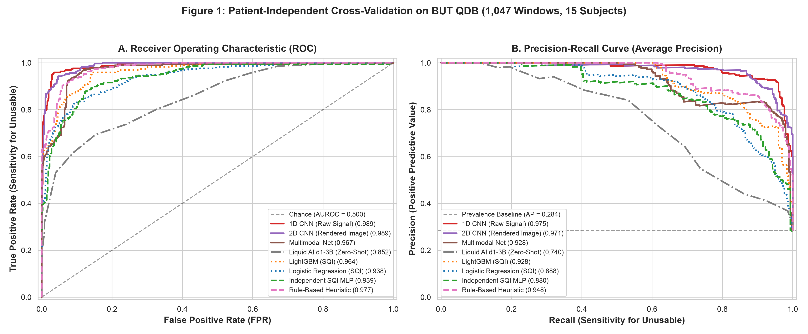
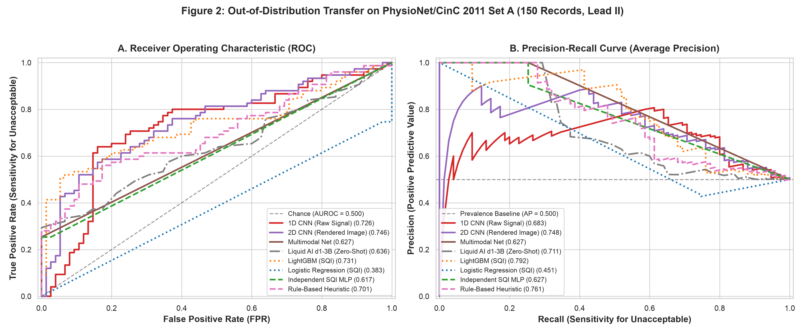
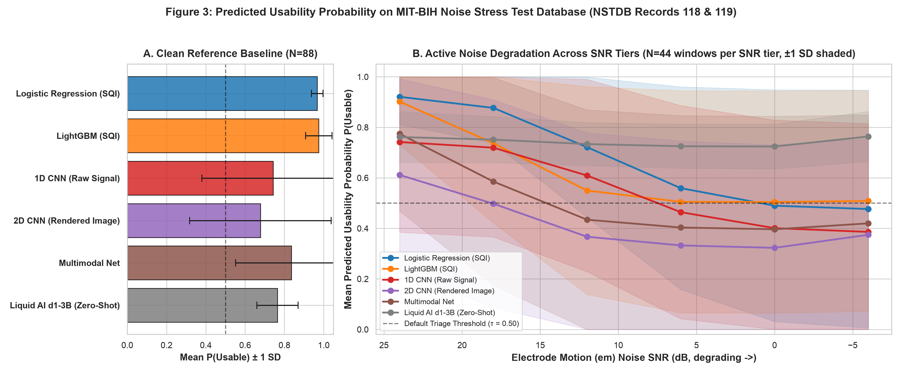
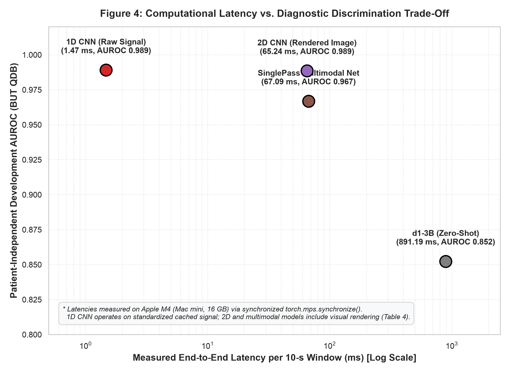

# Zero-shot and task-specific models for ECG usability screening: patient-independent performance, cross-dataset transfer, and computational cost

## Abstract

**Background:** Automated electrocardiogram (ECG) interpretation algorithms degrade when applied to corrupted recordings. Quality control triage is critical to accept clean traces, reject unusable segments, and prompt for re-recording. While deep multimodal decision models and lightweight convolutional networks offer potential solutions, their comparative accuracy, zero-shot transfer, and computational overhead require rigorous characterization under patient-disjoint outer validation.

**Methods:** We benchmarked eight models across six methodological paradigms: classical tabular classifiers (Logistic Regression, LightGBM, MLP on 13 input features including 11 Signal Quality Indices [SQIs] and 2 metadata parameters), deep learning architectures (1D CNN on raw 500 Hz waveforms, 2D CNN on rendered visual strips, and a single-pass multimodal network combining SQIs and visual features), an expert heuristic baseline, and the 3.12-billion-parameter LiquidAI/d1-3B multimodal edge model evaluated zero-shot with zero output tokens. Models were trained on the Brno University of Technology ECG Quality Database (BUT QDB; quota-based sampling of 1,047 windows [750 usable, 297 unusable; 28.4% prevalence], 15 subjects) under patient-disjoint 5-fold GroupKFold cross-validation [7], and evaluated for out-of-distribution transfer on the PhysioNet/Computing in Cardiology Challenge 2011 Set A (150 balanced records, Lead II) [2, 6] and MIT-BIH Noise Stress Test Database (NSTDB; 528 electrode motion noisy window evaluations across 6 calibrated SNR labels, paired with 88 clean reference windows from the MIT-BIH base records) [3]. Hardware latency was profiled on Apple Silicon.

**Results:** On the patient-independent BUT QDB development cohort (seed 42), the unimodal 1D CNN (AUROC 0.989; Average Precision [AP] 0.975; Brier score 0.058) and 2D CNN (AUROC 0.989; AP 0.971; Brier score 0.052) gave the highest discrimination. Over four additional seeds their mean AUROCs were 0.976 and 0.986. Relabelling the class-2 windows as unusable left the CNN ranking unchanged (2D CNN AUROC 0.984 for seed 42), whereas the multimodal net and the SQI MLP varied strongly across training seeds. Multimodal fusion did not improve on the unimodal networks (AUROC 0.967, AP 0.928). Evaluated zero-shot, LiquidAI/d1-3B achieved AUROC 0.852 (AP 0.740; Brier score 0.154). On out-of-distribution transfer to CinC 2011 Set A, the 2D CNN had the highest AUROC in every balanced subset tested (0.746 on the reported subset; 0.709–0.883 across five random subsets), and the 1D CNN ranged from 0.660 to 0.816. At the default threshold, however, the 2D CNN flagged only 15–28% of unacceptable recordings across random subsets and the 1D CNN 59–76%; LightGBM flagged 8–20%. The multimodal net gave constant outputs on CinC in three of four additional training seeds, zero-shot d1-3B reached AUROC 0.636, and SQI logistic regression was inverted in every subset (AUROC 0.29–0.37). No model reached 80% sensitivity to unacceptable recordings while keeping false rejection at or below 4% (reported subset, seed 42). Under calibrated NSTDB stress with a true clean reference (seed 42), usable probability fell from +24 dB to +6 dB for every model, most strongly for the SQI models; the zero-shot d1-3B changed little (0.76 to 0.72), and below 0 dB the learned models plateau between 0.3 and 0.5. Hardware profiling showed that waveform rasterization accounts for about 93% of end-to-end latency in image-based pipelines (66.5–72.2 ms median preprocessing), whereas the 1D CNN ran in 1.50 ms median on cached inputs on Apple Silicon MPS.

**Conclusion:** The 1D convolutional network on raw biosignals gave the most favorable in-domain accuracy–latency trade-off in the evaluated implementation (AUROC 0.989; 1.50 ms median on cached inputs; no rendering overhead), and it stayed among the strongest models under the class-2 relabelling (AUROC 0.961) and across training seeds. Cross-dataset transfer was the main limitation: the 2D CNN ranked recordings best in every balanced CinC subset tested (AUROC 0.71–0.88) but accepted 72–85% of unacceptable recordings at the default threshold. The zero-shot configuration of LiquidAI/d1-3B under the specified prompt and test datasets lagged task-specific architectures; whether prompt optimization or fine-tuning bridges this gap remains an open question.

---

## 1. Introduction & Research Framework

Automated electrocardiogram (ECG) interpretation algorithms represent a cornerstone of contemporary cardiovascular medicine, powering telemetry monitors, ambulatory Holter systems, and mobile health devices. However, automated diagnostic pipelines degrade substantially when exposed to real-world biosignal corruption. Common physical noise sources—including electrode motion artifact, baseline wander from patient respiration, electromyographic (EMG) interference from skeletal muscle contraction, and ambient powerline noise—can distort P-wave, QRS, and T-wave morphologies. As highlighted in foundational stress testing protocols [3], electrode motion artifacts are particularly pernicious because their spectral power overlaps directly with genuine ventricular depolarization, frequently mimicking ventricular arrhythmias and resisting conventional linear bandpass filtering. Automated signal quality assessment (SQA) is therefore indispensable as an initial triage gate to prevent spurious clinical alarms, prevent erroneous diagnostic conclusions, and prompt timely electrode re-attachment or signal re-recording.

### 1.1 Distinct Clinical Task Formulation

A critical methodological challenge in ECG quality assessment literature is the frequent conflation of distinct clinical task formulations. Specifically, "QRS-based rhythm usability", "morphological precision usability", and "overall 12-lead diagnostic acceptability" represent fundamentally distinct reference standards with disparate clinical stringencies. For instance, in the Brno University of Technology ECG Quality Database (BUT QDB) [1], annotations are stratified into three distinct tiers: Class 1 denotes pristine diagnostic quality; Class 2 designates records where noise precludes fine morphological measurement (such as ST-segment deviation or QT interval duration) yet permits reliable QRS complex detection and heart rate determination; and Class 3 designates recordings where severe corruption prevents even basic QRS identification. Conversely, community challenges such as the PhysioNet/Computing in Cardiology Challenge 2011 [2, 6] evaluated overall 12-lead diagnostic acceptability as judged by expert cardiologists. In this investigation, we strictly operationalize the primary clinical quality triage task as binary unusable detection (Class 3 vs. Classes 1 & 2 in BUT QDB), designed to identify uninterpretable waveforms that must be rejected from automated analysis.

### 1.2 Related Work in ECG Quality Assessment

Related Work in ECG Signal Quality Assessment spans several historical and emerging paradigms, as synthesized in comprehensive reviews of ECG quality evaluation technologies [21]. Classical engineering approaches have relied primarily on handcrafted Signal Quality Indices (SQIs) and multi-index decision heuristics. Seminal work by Clifford et al. [18] and Orphanidou et al. [20] demonstrated that statistical measures, spectral energy ratios, and detector consistency can triage clinical acceptability in ambulatory and mobile recordings. Handcrafted SQIs quantify statistical properties (e.g., skewness, kurtosis), spectral energy ratios, and consistency across parallel QRS detectors [1, 2, 18]. While computationally lightweight and interpretable, tabular feature engineering often fails to capture complex spatiotemporal artifact patterns. More recently, learned representations tailored for wearable biosensors have demonstrated improved feature extraction; for example, combining wavelet scattering transforms with Long Short-Term Memory (LSTM) networks captures multiscale transient dynamics while mitigating intra-patient morphological variability [15]. Furthermore, contemporary frameworks have explored joint noise localization and quality estimation, such as parallel multi-task convolutional architectures that simultaneously denoise, locate artifact boundaries, and classify segment quality [17], or specialized transient noise detectors designed to suppress false positive arrhythmia alarms in atrial fibrillation screening [16]. In parallel, the broader machine learning community has seen the emergence of general-purpose multimodal foundation models and vision-language decision architectures capable of zero-shot classification [5]. However, prior studies frequently evaluate these paradigms under disparate datasets, inconsistent validation splits, or optimistic random window sampling, preventing direct and reproducible comparison across architectural families.

### 1.3 Research Gaps and Primary Questions

To address these gaps, this study establishes a benchmark structured along four methodological axes:
1. Patient-Independent Generalization: Evaluating models under patient-disjoint GroupKFold cross-validation to isolate subject identities [7], preventing intra-patient data leakage.
2. Out-of-Distribution Transfer and Dataset Shift: Characterizing cross-dataset performance across disparate patient demographics and clinical acquisition modalities, grounded in established dataset shift principles in health AI [4, 14].
3. Operating Threshold Behavior: Differentiating fixed default decision rules (τ = 0.50) from post-hoc exploratory ROC operating points.
4. End-to-End Computational Profiling: Measuring the execution budget on edge hardware across CPU and GPU/MPS devices, quantifying the specific latency overhead introduced by visual waveform rasterization.

Specifically, we investigate four primary Research Questions (RQs):
* **RQ1 (Unimodal vs. Multimodal Fusion):** Does fusing visual ECG waveforms with tabular SQIs yield superior patient-independent quality triage compared to specialized unimodal 1D signal or 2D image models?
* **RQ2 (Zero-Shot Edge VLM vs. Supervised Baselines):** How does a contemporary 3.12-billion-parameter multimodal decision model (LiquidAI/d1-3B [5]), evaluated zero-shot via choice-probability scoring without task-specific training, compare against task-specialized supervised neural networks and expert rule heuristics?
* **RQ3 (Cross-Dataset Transfer Resilience):** How effectively do tabular, visual, and raw signal representations transfer out-of-distribution to external ECG recordings (CinC 2011 Set A) and calibrated noise stress conditions (NSTDB), and what mechanisms govern feature shift?
* **RQ4 (The Visual Rendering Bottleneck):** What are the empirical hardware latencies and memory footprints across architectures, and does waveform rasterization impose a substantial cost for resource-constrained edge clinical deployment?

---

## 2. Data and Stratified Sampling Protocols

### 2.1 BUT ECG Quality Database (BUT QDB) [1]
The primary development cohort was derived from the BUT ECG Quality Database, curated by Brno University of Technology and hosted on PhysioNet [1]. BUT QDB comprises 18 long-term single-lead ECG recordings acquired across 15 distinct subjects. Waveforms were digitized at a sampling rate of 1,000 Hz with 16-bit resolution. Across all 18 records the total annotated signal duration is 99.39 hours (357,791.9 seconds); the previously cited duration of 98.1 hours reflects the 17-record subset excluding Record 124001_ECG (4,799.5 seconds / 1.33 hours). We applied quota-based sampling across all 18 records to construct a quota-based, computationally tractable development benchmark of 1,047 non-overlapping 10-second segments, yielding 750 usable windows (Class 1 & 2) and 297 unusable windows (Class 3), corresponding to an empirical 28.4% unusable prevalence. Segments were standardized to 500 Hz via polyphase resample filtering. Class 2 (193 windows) is treated as usable in the main analysis; relabelling it as unusable is evaluated in Table 1d.

### 2.2 PhysioNet / Computing in Cardiology Challenge 2011 (CinC 2011 Set A) [2, 6]
To evaluate external zero-shot transfer, we utilized Set A of the PhysioNet/Computing in Cardiology Challenge 2011 [2, 6]. The challenge dataset consists of 10-second, 12-lead ECG recordings digitized at 500 Hz. Expert cardiologists provided overall 12-lead diagnostic acceptability annotations. The reported evaluation set is a balanced 150-record cohort (75 acceptable, 75 unacceptable) formed from the first records of the sorted PhysioNet lists, evaluated strictly on Lead II signals. Because this selection is not random, five random balanced subsets (75 + 75, seeds 42, 1, 2, 3, 4) were also evaluated with the same models (Table 2d). It is vital to note that this introduces an inherent clinical target mismatch: models evaluated on Lead II are tasked with predicting a whole-record 12-lead diagnostic decision, providing a stringent real-world test of covariate and label shift [4].

### 2.3 MIT-BIH Noise Stress Test Database (NSTDB) [3]
To benchmark noise-stress robustness under calibrated signal-to-noise ratios, we evaluated models on the MIT-BIH Noise Stress Test Database [3]. The NSTDB noisy records (118e24 to 119e_6) are MIT-BIH base records 118 and 119 with electrode-motion ('em') noise added at nominal SNR labels of +24, +18, +12, +6, 0 and -6 dB. The noise is continuous over each record: the residual between a noisy record and its base record is non-zero in every second (median per-second residual rms 0.14 mV at +24 dB and 4.4 mV at -6 dB, a 30 dB span consistent with the labels). We therefore use a paired design. Clean reference windows come from the MIT-BIH base records themselves (88 windows, 44 per record). Noisy windows come from the NSTDB records at each SNR label (528 windows, 44 per record and label). Both use the same 44 start times per record (65 + 10i, 425 + 10i, 305 + 10i and 545 + 10i seconds, i = 0–10), so every noisy window has a clean counterpart. The nominal SNR labels are used as published; we did not reproduce NSTDB's SNR definition, so absolute SNR values are nominal. An earlier version treated windows from the noisy records as a clean control; those windows carry noise and were replaced (Limitation 12).

### 2.4 Patient-Independent Grouped Cross-Validation Design [7]
To enforce patient-disjoint outer evaluation on BUT QDB, we applied 5-fold GroupKFold cross-validation [7], grouping windows strictly by patient identifier (15 subjects). This ensures that no patient contributes data to both the training and test partitions within any fold. While GroupKFold prevents patient identity leakage, the small overall patient count (15 subjects, with unusable Class 3 artifacts present in only 7 subjects) remains an important empirical limitation. Table 0 summarizes the patient and sample distribution across all five outer cross-validation folds. Model-specific feature scaling policies were strictly isolated to each fold's 12 training subjects: Logistic Regression utilized scikit-learn's StandardScaler; Independent SQI MLP and the tabular branch of SinglePass Multimodal Net utilized empirical z-score standardization fit strictly on the training partition; LightGBM operated on raw unscaled SQI features (scale-invariant decision trees); 1D CNN processed 500 Hz biosignals normalized to zero mean and unit variance within each window; and 2D CNN processed torchvision normalized RGB images. No MinMax scaling was applied.

#### Table 0: Patient-Independent 5-Fold GroupKFold Cross-Validation Partitioning on BUT QDB
*Windows were grouped strictly by patient ID so that no patient appears in both training and test sets in any fold.*

| Fold ID | Patient Subject IDs (N=3/fold) | Total Windows | Usable Windows (Class 0) | Unusable Windows (Class 1) | Unusable Prevalence (%) |
| :---: | :---: | :---: | :---: | :---: | :---: |
| **Fold 0** | 103, 113, 122 | 214 | 150 | 64 | 29.9% |
| **Fold 1** | 114, 118, 126 | 210 | 150 | 60 | 28.6% |
| **Fold 2** | 111, 115, 125 | 210 | 150 | 60 | 28.6% |
| **Fold 3** | 104, 105, 123 | 210 | 150 | 60 | 28.6% |
| **Fold 4** | 100, 121, 124 | 203 | 150 | 53 | 26.1% |
| **Total Cohort** | **15 Unique Patients** | **1,047** | **750** | **297** | **28.4%** |

---

## 3. Model Architectures & Experimental Setup

### 3.1 Signal Quality Indicators (SQIs) and Input Representations
For tabular and multimodal models, we extracted 13 input features comprising 11 domain-expert Signal Quality Indices (SQIs) [18, 20, 21] and 2 recording metadata parameters:
1. `bsqi_detector_agreement`: F1-matching score between Pan-Tompkins [19] and difference-based QRS detectors (temporal tolerance: 50 ms) [18].
2. `baseline_wander_ratio`: Relative Welch spectral power in the baseline band (<0.5 Hz) relative to the ECG band (0.5-40 Hz) [18].
3. `high_frequency_noise_ratio`: Relative Welch spectral power in the electromyographic band (>40 Hz up to min(fs/2, 100 Hz)) relative to the ECG band [18].
4. `saturation_fraction`: Proportion of samples hitting dynamic extrema (ADC rail clipping).
5. `flatline_fraction`: Proportion of consecutive samples with zero difference (amplifier disconnection or saturation).
6. `qrs_energy_ratio`: Relative Welch spectral power in the QRS depolarization band (5-15 Hz) relative to the ECG band.
7. `kurtosis_ksqi`: Sample kurtosis of the 10-second signal distribution (scipy.stats.kurtosis) [18].
8. `skewness_ssqi`: Sample skewness of the 10-second signal distribution (scipy.stats.skew) [18].
9. `zero_crossing_rate`: Rate of sign zero-crossings after mean subtraction.
10. `powerline_noise_ratio`: Relative Welch spectral power in powerline notch bands (49-51 Hz and 59-61 Hz) relative to the ECG band.
11. `signal_std`: Standard deviation of signal amplitude in mV.
12. `duration_sec`: Window duration in seconds (constant metadata: 10.0 s in BUT QDB).
13. `sampling_rate`: Sampling frequency in Hz (constant metadata: 500 Hz standardized input).

In the development cohort (1,047 windows), duration_sec and sampling_rate are constant metadata, while saturation_fraction (mean 4.0 × 10^-4, σ ≈ 8.7 × 10^-6) and flatline_fraction (mean 6.7 × 10^-5, σ ≈ 1.3 × 10^-4) have near-zero variance. When applied out-of-distribution without regularization, unconstrained standard scaling caused numerical saturation, motivating our retrospective sensitivity analysis on robust scaling.

### 3.2 Supervised Model Architectures
We implemented and evaluated six supervised architectures:
* **Logistic Regression (SQI):** Linear baseline trained on standardized 13-dimensional feature vectors with L2 regularization (14 parameters: 13 weights, 1 intercept).
* **LightGBM (SQI):** Gradient-boosted decision tree ensemble trained with 100 estimators, max depth 4, learning rate 0.05.
* **Independent SQI MLP:** Multi-layer perceptron comprising two hidden layers (64 and 32 units, each followed by batch normalization [BatchNorm1d] and ReLU activations, with dropout 0.2; 3,201 trainable parameters: 3,009 dense weights and biases + 192 affine batch normalization parameters), trained via AdamW (lr=1e-3, weight_decay=1e-3) for 35 epochs of mini-batch gradient descent (batch size 64).
* **1D CNN (Raw Signal):** Unimodal convolutional network operating directly on raw 500 Hz 1D ECG biosignal waveforms (1 x 5,000 samples; 167,489 trainable parameters). Features four 1D convolutional blocks (filters: 32, 64, 128, 128; kernel sizes: 15, 11, 7, 5; each block applies batch normalization, LeakyReLU, max-pooling by 4 and dropout 0.15), global average pooling, and a two-layer classification head (128 → 32 → 1).
* **2D CNN (Rendered Image):** Unimodal visual network operating on rendered RGB waveform strips (513 x 257 px at 100 dpi, resized to 3 x 128 x 256 before the network; 245,697 trainable parameters). The backbone has four convolutional blocks (channels: 32, 64, 128, 128; 3 x 3 kernels; batch normalization and ReLU; max-pooling in the first three blocks), followed by global average pooling and a two-layer classifier (128 → 32 → 1, dropout 0.3).
* **SinglePass Multimodal Net:** Multimodal network combining the visual convolutional backbone (processing the identical 3-channel RGB image tensor) with an auxiliary MLP branch processing the 13 input features (131,969 trainable parameters). Visual embeddings (64-d) and tabular embeddings (64-d) are combined via gated fusion and mapped through a decision head (64 units, dropout 0.3).

For external evaluation on CinC 2011 and NSTDB, supervised models were trained on the complete 1,047-window BUT QDB development cohort using the identical hyperparameters and random seed (42).

### 3.3 Expert Heuristic Baseline: Rule-Based SQI Heuristic
As a deterministic clinical benchmark, we evaluated an established expert rule-based heuristic grounded in multi-SQI fusion protocols [18, 20] (0 trainable parameters) that computes a continuous unusability score from a fixed logistic combination of SQIs as implemented in models/rule_heuristic_baseline.py: logit_SQI = −3.0·(bSQI − 0.5) + 1.2·min(basSQI, 3) + 1.5·min(hfSQI, 3) + 5.0·saturation + 5.0·flatline − 0.5, and p_SQI = σ(logit_SQI). The visual component converts each rendered strip to 8-bit grayscale (mode 'L') and computes the ink density (fraction of pixels < 200) and the column-wise spread of ink: logit_vis = 4.0·(ink − 0.08) − 2.0·(spread − 0.02), p_vis = σ(logit_vis). The final score is p = 0.6·p_SQI + 0.4·p_vis, clipped to [0.01, 0.99], with τ = 0.50. The coefficients were set by hand (they are not fitted). An earlier draft described hard thresholds (bSQI < 0.60, basSQI > 0.40, hfSQI > 0.35, flatline > 1.5 s); that description did not match the implemented code and has been removed. Because this rule is evaluated on the same BUT QDB cohort, its coefficients should be read as expert priors; whether they were chosen after inspecting BUT QDB outcomes is not documented.

### 3.4 Multimodal Decision Model: Liquid AI d1-3B [5]
To investigate the zero-shot capabilities of frontier multimodal models, we evaluated `LiquidAI/d1-3B` [5], an open-weight 3.12-billion-parameter multimodal edge decision model (model revision commit: `051bcc464b01b9f92942b364d9586b0ef5912432`). The model was evaluated strictly zero-shot (meaning no fine-tuning or training on ECG signals was conducted) via the `system_one` inference interface shipped with that revision on Apple Silicon MPS (device: mps, dtype: torch.bfloat16). The vision encoder processes the rendered ECG strip alongside a structured clinical task prompt:

Task Question: "Determine whether this electrocardiogram (ECG) recording segment is usable for reliable QRS-based rhythm analysis, or unusable due to severe artifacts, baseline wander, high-frequency noise, or saturation/flatline."
Criteria: usable: "QRS complexes are distinguishable and suitable for rhythm analysis. Artifacts are manageable."; unusable: "ECG is severely corrupted by noise, baseline drift, saturation, or absent complexes; requires human review or re-recording."

The model is configured with `output_tokens: 0`, returning choice probabilities over categorical options from `raw_response['answers']['usability']['probabilities']['unusable']`. We explicitly note that these choice probabilities represent uncalibrated model outputs. Furthermore, there is an inherent input asymmetry: the supervised Multimodal Net received both visual images and 13 numerical features, whereas d1-3B received solely the visual image and task prompt without numerical SQIs.

### 3.5 Evaluation Metrics, Threshold Selection, and Reproducibility Protocols
Discrimination was quantified using Area Under the Receiver Operating Characteristic (AUROC) and Average Precision (AP, non-interpolated) via scikit-learn [8]. We strictly differentiate two decision threshold regimes: (1) default fixed threshold τ = 0.50; and (2) exploratory post-hoc ROC sweeps (Target 1: maximum sensitivity at FPR ≤ 5% on BUT QDB and ≤ 4% on CinC; Target 2: minimum FPR at sensitivity ≥ 80%; ties resolved deterministically, Target 1 by maximum sensitivity then minimum FPR, Target 2 by minimum FPR then maximum sensitivity) [8]. Tables 1b and 2b present these exploratory analyses on the evaluated partitions and do not represent prospectively validated deployment thresholds. For external transfer experiments, feature scalers (including RobustScaler) were fit strictly on the BUT QDB source development cohort (N=1,047) and applied frozen to CinC 2011 to evaluate transfer without target data leakage. Calibration was assessed via the Brier score. Subject-level cluster bootstrapping (1,000 iterations, seed 42) was used to construct 95% confidence intervals on BUT QDB. Hardware latency was profiled on Apple Silicon (M2, 8 CPU / 10 GPU cores, 24 GB Unified Memory) with explicit `torch.mps.synchronize()` barriers across 25 paired test trials.

---

## 4. Experimental Results

In this section, we present the empirical findings of our multi-paradigm benchmark structured along four evaluation axes: (1) patient-independent cross-validation on BUT QDB, including exploratory ROC operating points; (2) cross-dataset out-of-distribution transfer to CinC 2011 Set A, including a feature-set sensitivity analysis; (3) noise stress testing under calibrated electrode motion artifact on MIT-BIH NSTDB; and (4) hardware-synchronized edge latency, execution device, and weight storage profiling, quantifying the waveform rendering bottleneck. All numbers in this section were regenerated on 2026-10-12 from seeded training runs (seed 42) by `evaluation/build_manuscript_tables.py`.

### 4.1 Patient-Independent 5-Fold Cross-Validation on BUT QDB

Table 1 and Figure 1 summarize patient-independent 5-fold cross-validation performance across the eight models on BUT QDB (1,047 windows, 15 subjects), reported for seed 42. Seed-to-seed variation of the CNN and multimodal estimates is in Section 4.5. The two unimodal convolutional networks had the highest discrimination: the 1D CNN on raw 500 Hz waveforms (AUROC 0.989, 95% CI 0.964–0.999; AP 0.975; Brier 0.058) and the 2D CNN on rendered strips (AUROC 0.989, 95% CI 0.967–0.999; AP 0.971; Brier 0.052). The expert heuristic reached AUROC 0.977 (AP 0.948) with poorer calibration (Brier 0.105). The SinglePass Multimodal Net did not improve on the unimodal networks (AUROC 0.967, AP 0.928, Brier 0.094). The tabular models reached AUROC 0.938–0.964. The zero-shot LiquidAI/d1-3B model reached AUROC 0.852 (95% CI 0.717–0.944; AP 0.740; Brier 0.154), reflecting uncalibrated choice probabilities and the absence of domain-specific adaptation.

#### Table 1: Patient-Independent 5-Fold Cross-Validation Performance on BUT QDB (1,047 Windows, 15 Subjects)
*Positive Class = Unusable (297 windows), Negative Class = Usable (750 windows). 95% CIs derived via 1,000 subject-level cluster bootstrap iterations (seed 42).*

| Model Architecture | AUROC [95% CI] | AP | Brier | Fixed τ = 0.50 [TP / FP / TN / FN] | Balanced Acc. [95% CI] | Sensitivity [95% CI] | False Reject Rate [95% CI] |
| :--- | :---: | :---: | :---: | :---: | :---: | :---: | :---: |
| **1D CNN (Raw Signal)** | 0.989 [0.964 – 0.999] | 0.975 | 0.058 | [228 / 5 / 745 / 69] | 88.1% [71.7 – 98.4%] | 76.8% [43.7 – 97.5%] | 0.7% [0.0 – 1.6%] |
| **2D CNN (Rendered Image)** | 0.989 [0.967 – 0.999] | 0.971 | 0.052 | [234 / 7 / 743 / 63] | 88.9% [75.5 – 99.5%] | 78.8% [51.8 – 100.0%] | 0.9% [0.3 – 1.7%] |
| **Rule-Based SQI Heuristic** | 0.977 [0.926 – 0.998] | 0.948 | 0.105 | [196 / 9 / 741 / 101] | 82.4% [57.2 – 96.1%] | 66.0% [15.5 – 92.9%] | 1.2% [0.3 – 2.4%] |
| **SinglePass Multimodal Net** | 0.967 [0.926 – 0.999] | 0.928 | 0.094 | [189 / 14 / 736 / 108] | 80.9% [63.4 – 98.5%] | 63.6% [28.1 – 98.9%] | 1.9% [0.7 – 3.3%] |
| **LightGBM (SQI)** | 0.964 [0.893 – 0.997] | 0.928 | 0.074 | [218 / 31 / 719 / 79] | 84.6% [64.8 – 96.1%] | 73.4% [33.9 – 94.6%] | 4.1% [1.6 – 7.3%] |
| **Independent SQI MLP** | 0.939 [0.834 – 0.990] | 0.880 | 0.088 | [231 / 65 / 685 / 66] | 84.6% [68.2 – 95.6%] | 77.8% [48.8 – 96.5%] | 8.7% [2.4 – 18.7%] |
| **Logistic Regression (SQI)** | 0.938 [0.838 – 0.994] | 0.888 | 0.084 | [227 / 47 / 703 / 70] | 85.1% [67.6 – 96.4%] | 76.4% [44.0 – 96.8%] | 6.3% [1.7 – 13.5%] |
| **LiquidAI d1-3B (Zero-Shot)** | 0.852 [0.717 – 0.944] | 0.740 | 0.154 | [158 / 30 / 720 / 139] | 74.6% [59.0 – 87.2%] | 53.2% [21.3 – 77.4%] | 4.0% [1.5 – 6.9%] |

At the default threshold (τ = 0.50), the 1D CNN identified 76.8% of unusable windows with a 0.7% false reject rate (balanced accuracy 88.1%), and the 2D CNN identified 78.8% with a 0.9% false reject rate (balanced accuracy 88.9%). Table 1b reports exploratory post-hoc operating points under two constraints: Target 1 (maximum sensitivity with FPR ≤ 5%) and Target 2 (minimum FPR with sensitivity ≥ 80%). Under Target 1 the 1D CNN reached 95.96% sensitivity at 3.47% FPR, and the 2D CNN 94.28% at 4.67% FPR. Under Target 2 the zero-shot d1-3B model required a 32.67% false reject rate to reach 80.13% sensitivity. These sweeps are computed on the same partition they are reported on and are not validated deployment thresholds.

#### Table 1b: Exploratory ROC Operating-Point Analysis on BUT QDB
*Decision Rule: Positive class (Unusable) if p ≥ τ. Target 1: maximum sensitivity with FPR ≤ 5% (ties: minimum FPR). Target 2: minimum FPR with sensitivity ≥ 80% (ties: maximum sensitivity). Post-hoc exploratory sweeps on the reported partition, not validated deployment thresholds.*

| Model Architecture | Target 1: Sens. (Actual FPR) | Threshold τ | Target 2: FPR (Actual Sens.) | Threshold τ |
| :--- | :---: | :---: | :---: | :---: |
| **2D CNN (Rendered Image)** | 94.28% (FPR 4.67%) | 0.05569 | 0.93% (Sens 80.13%) | 0.48918 |
| **1D CNN (Raw Signal)** | 95.96% (FPR 3.47%) | 0.00794 | 1.33% (Sens 80.13%) | 0.33178 |
| **Rule-Based SQI Heuristic** | 84.51% (FPR 4.93%) | 0.37622 | 4.13% (Sens 80.47%) | 0.40701 |
| **SinglePass Multimodal Net** | 69.02% (FPR 4.67%) | 0.17462 | 6.53% (Sens 80.13%) | 0.10541 |
| **LightGBM (SQI)** | 80.47% (FPR 4.80%) | 0.36019 | 4.80% (Sens 80.47%) | 0.36019 |
| **Independent SQI MLP** | 70.03% (FPR 4.93%) | 0.72503 | 9.33% (Sens 80.47%) | 0.43368 |
| **Logistic Regression (SQI)** | 74.07% (FPR 4.80%) | 0.56444 | 8.27% (Sens 80.13%) | 0.39292 |
| **LiquidAI d1-3B (Zero-Shot)** | 53.20% (FPR 4.00%) | 0.50000 | 32.67% (Sens 80.13%) | 0.37754 |

Figure 1 displays the complete cross-validation ROC and PR curves with non-interpolated Average Precision baselines.

*Figure 1: Patient-independent cross-validation performance on BUT QDB (1,047 windows, 15 subjects). (A) Receiver Operating Characteristic (ROC) curves with chance baseline (AUROC = 0.500). (B) Precision-Recall curves with prevalence baseline (AP = 0.284). Average Precision (AP) strictly computed via non-interpolated scikit-learn metrics [8].*

#### Table 1d: Sensitivity Analysis with Class 2 Relabelled as Unusable (BUT QDB)
*Retrospective sensitivity analysis. Five-fold subject-independent CV with identical folds, settings and seed (42); only the training and evaluation labels change. Rule heuristic and d1-3B do not use training labels and keep their scores. Sens. / FR use τ = 0.50. 95% CIs from 1,000 subject-level bootstrap iterations.*

| Model | AUROC, class 3 unusable (297) [95% CI] | AUROC, classes 2–3 unusable (490) [95% CI] | Sens. / FR at τ = 0.50, class 3 unusable | Sens. / FR at τ = 0.50, classes 2–3 unusable |
| :--- | :---: | :---: | :---: | :---: |
| **Logistic Regression (SQI)** | 0.938 [0.838 – 0.994] | 0.955 [0.920 – 0.976] | 76.4% / 6.3% | 85.3% / 8.6% |
| **LightGBM (SQI)** | 0.964 [0.893 – 0.997] | 0.951 [0.918 – 0.972] | 73.4% / 4.1% | 89.0% / 13.1% |
| **Independent SQI MLP** | 0.939 [0.834 – 0.990] | 0.837 [0.594 – 0.966] | 77.8% / 8.7% | 75.9% / 14.7% |
| **1D CNN (Raw Signal)** | 0.989 [0.964 – 0.999] | 0.961 [0.902 – 0.994] | 76.8% / 0.7% | 78.2% / 6.6% |
| **2D CNN (Rendered Image)** | 0.989 [0.967 – 0.999] | 0.984 [0.960 – 0.998] | 78.8% / 0.9% | 90.6% / 5.6% |
| **SinglePass Multimodal Net** | 0.967 [0.926 – 0.999] | 0.865 [0.611 – 0.993] | 63.6% / 1.9% | 78.6% / 6.5% |
| **Rule-Based SQI Heuristic** | 0.977 [0.926 – 0.998] | 0.973 [0.948 – 0.987] | 66.0% / 1.2% | 41.8% / 0.0% |
| **LiquidAI d1-3B (Zero-Shot)** | 0.852 [0.717 – 0.944] | 0.785 [0.655 – 0.875] | 53.2% / 4.0% | 35.3% / 2.7% |

Relabelling the 193 class-2 windows as unusable (490 unusable windows, 46.8%) leaves the CNN ranking unchanged. The 2D CNN (AUROC 0.984 for seed 42; 0.984–0.986 across seeds 1–4) and the 1D CNN (0.961; 0.959–0.964) remain the strongest networks, and logistic regression and LightGBM keep AUROC above 0.95. The multimodal net (0.865 for seed 42) and the SQI MLP (0.837) depend strongly on the training seed under this label definition: across seeds 1–4 the multimodal net ranges from 0.867 to 0.984 and the MLP from 0.825 to 0.942. Their decrease for seed 42 is therefore not a stable property of the models. The rule heuristic (0.973) and d1-3B (0.785) do not use training labels. Because class 2 denotes noise that still permits QRS detection (Section 1.1), this analysis shows which conclusions depend on the class boundary.

### 4.2 External Out-of-Distribution Transfer to CinC 2011 Set A

Models trained on the complete 1,047-window BUT QDB cohort were transferred zero-shot to CinC 2011 Set A (150 balanced records, Lead II). As detailed in Section 2.2, this evaluation involves a clinical target mismatch: models evaluated on single-lead Lead II waveforms are benchmarked against labels reflecting overall 12-lead diagnostic acceptability. Table 2 presents the reported subset with the seed-42 models. By AUROC, the 2D CNN (0.746), LightGBM (0.731) and 1D CNN (0.726) ranked recordings best, followed by the rule heuristic (0.701), the zero-shot d1-3B (0.636), the SinglePass Multimodal Net (0.627) and the Independent SQI MLP (0.617). Table 2d repeats the transfer on five random balanced subsets. The 2D CNN had the highest AUROC in every subset (0.709–0.883), whereas the 1D CNN ranged from 0.660 to 0.816 and LightGBM from 0.700 to 0.821, so the ordering on the reported subset is not robust. Ranking did not translate into detection at the default threshold. The 1D CNN identified 61.3% of unacceptable recordings on the reported subset (58.7–76.0% across random subsets) at 14.7% false rejection. The 2D CNN identified 17.3% on the reported subset and 14.7–28.0% across random subsets. Its default-threshold sensitivity also depended on the training seed (17.3% for seed 42; 40–43% for seeds 1–4 on the reported subset; Section 4.5). No model reached 80% sensitivity while keeping false rejection at or below 4% on the reported subset (Table 2b).

#### Table 2: Cross-Dataset Transfer Benchmark on CinC 2011 Set A (150 Records)
*Positive Class = Unacceptable (75 records), Negative Class = Acceptable (75 records). Seed 42 models on the reported subset; random subsets are in Table 2d and training seeds 1–4 in Section 4.5. Models evaluated strictly on Lead II signals zero-shot without target-domain fine-tuning. Reference labels reflect 12-lead diagnostic acceptability. At τ = 0.50 the MLP output was saturated near zero (no recording above threshold) and logistic regression was saturated near one for most recordings.*

| Model Architecture | Transfer AUROC | Transfer AP | Brier Score | Fixed τ = 0.50 [TP / FP / TN / FN] | Sensitivity | False Reject Rate | Balanced Accuracy |
| :--- | :---: | :---: | :---: | :---: | :---: | :---: | :---: |
| **2D CNN (Rendered Image)** | 0.746 | 0.748 | 0.356 | [13 / 3 / 72 / 62] | 17.3% | 4.0% | 56.7% |
| **LightGBM (SQI)** | 0.731 | 0.792 | 0.320 | [7 / 1 / 74 / 68] | 9.3% | 1.3% | 54.0% |
| **1D CNN (Raw Signal)** | 0.726 | 0.683 | 0.266 | [46 / 11 / 64 / 29] | 61.3% | 14.7% | 73.3% |
| **Rule-Based SQI Heuristic** | 0.701 | 0.761 | 0.238 | [72 / 63 / 12 / 3] | 96.0% | 84.0% | 56.0% |
| **LiquidAI d1-3B (Zero-Shot)** | 0.636 | 0.711 | 0.389 | [75 / 75 / 0 / 0] | 100.0% | 100.0% | 50.0% |
| **SinglePass Multimodal Net** | 0.627 | 0.627 | 0.373 | [19 / 0 / 75 / 56] | 25.3% | 0.0% | 62.7% |
| **Independent SQI MLP** | 0.617 | 0.627 | 0.500 | [0 / 0 / 75 / 75] | 0.0% | 0.0% | 50.0% |
| **Logistic Regression (SQI)** | 0.383 | 0.451 | 0.627 | [56 / 75 / 0 / 19] | 74.7% | 100.0% | 37.3% |

The tabular results do not have a single cause. The logistic regression (AUROC 0.383; 0.291–0.372 across random subsets) ranks acceptable recordings above unacceptable ones on this target. Two mechanisms are visible in the data. First, saturation and flatline fractions are almost constant in BUT QDB (σ ≈ 9 × 10^-6 and 1 × 10^-4) but common in CinC (mean flatline fraction 0.37), so standard scaling converts CinC values into very large z-scores. Second, several SQIs carry opposite associations in the two databases: the univariate AUROC of the high-frequency noise ratio is 0.777 in BUT QDB but 0.329 in CinC (Limitation 9). Table 2c shows that removing the saturation, flatline and constant-metadata features restores logistic regression transfer to AUROC 0.746, whereas removing only the amplitude feature does not. Because this feature subset was chosen after inspecting CinC feature behaviour, the reduced-set results are exploratory and are not evidence of validated transfer.

#### Table 2b: Exploratory Post-Hoc ROC Operating-Point Analysis on CinC 2011 Set A
*Decision Rule: Positive class (Unusable) if p ≥ τ. Target 1: maximum sensitivity with FPR ≤ 4% (3 of 75 acceptable records; ties: minimum FPR). Target 2: minimum FPR with sensitivity ≥ 80% (ties: maximum sensitivity). "Not attainable" marks models whose scores saturate so that no threshold meets the constraint; "trivial" marks thresholds at which every recording is flagged. The multimodal net and the MLP output saturated scores (binary or near zero; thresholds below 10^-3 are not graded cut-offs), so their rows describe a single decision rule rather than a threshold curve. Exploratory sweeps on the target domain, not validated deployment thresholds.*

| Model Architecture | Target 1: Sens. (Actual FPR) | Threshold τ | Target 2: FPR (Actual Sens.) | Threshold τ |
| :--- | :---: | :---: | :---: | :---: |
| **2D CNN (Rendered Image)** | 17.33% (FPR 4.00%) | 0.57338 | 46.67% (Sens 81.33%) | 1.74e-04 |
| **1D CNN (Raw Signal)** | 9.33% (FPR 4.00%) | 0.99977 | 37.33% (Sens 80.00%) | 4.44e-04 |
| **Rule-Based SQI Heuristic** | 32.00% (FPR 4.00%) | 0.71544 | 68.00% (Sens 81.33%) | 0.53974 |
| **SinglePass Multimodal Net** | 25.33% (FPR 0.00%) | 1.00000 | trivial (all predicted unusable) | 0.00000 |
| **LightGBM (SQI)** | 41.33% (FPR 1.33%) | 0.36021 | 70.67% (Sens 84.00%) | 0.01955 |
| **Independent SQI MLP** | 25.33% (FPR 0.00%) | 2.98e-34 | trivial (all predicted unusable) | 0.00000 |
| **Logistic Regression (SQI)** | not attainable (scores saturate) | — | trivial (all predicted unusable) | 0.00000 |
| **LiquidAI d1-3B (Zero-Shot)** | 30.67% (FPR 2.67%) | 0.95532 | 73.33% (Sens 80.00%) | 0.85195 |

#### Table 2c: Feature-Set and Scaler Sensitivity of Tabular Models under Transfer
*Retrospective sensitivity analysis (BUT QDB → CinC 2011). Scalers and models are fit on BUT QDB only and applied frozen to CinC 2011. Feature subsets were selected after inspecting CinC feature behaviour and are therefore exploratory. The MLP row uses its internal standardization and cannot take an external scaler.*

| Feature set | LR · StandardScaler AUROC / AP | LR · RobustScaler AUROC / AP | LR · Z-clip [-3, 3] AUROC / AP | MLP (internal scaler) AUROC / AP |
| :--- | :---: | :---: | :---: | :---: |
| All 13 features | 0.383 / 0.451 | 0.377 / 0.442 | 0.749 / 0.791 | 0.617 / 0.627 |
| Drop signal_std | 0.431 / 0.529 | 0.370 / 0.441 | 0.723 / 0.775 | 0.627 / 0.627 |
| Drop saturation, flatline, constants | 0.746 / 0.796 | 0.746 / 0.805 | 0.751 / 0.792 | 0.750 / 0.749 |
| Drop signal_std, saturation, flatline, constants | 0.713 / 0.770 | 0.721 / 0.781 | 0.723 / 0.774 | 0.729 / 0.762 |

#### Table 2d: Transfer to Five Random Balanced CinC Subsets
*Models trained once on the BUT QDB cohort (seed 42), as in Table 2. The reported subset is the first 75 + 75 records of the sorted PhysioNet lists; random subsets are 75 + 75 records drawn without replacement (seeds 42, 1, 2, 3, 4) from 773 acceptable and 225 unacceptable records. Sensitivity and false reject use τ = 0.50.*

| Model | AUROC: first-N (reported) | AUROC: random draws, mean ± SD (min–max) | Sensitivity at τ = 0.50: first-N | Sensitivity at τ = 0.50: random draws, mean ± SD | False reject at τ = 0.50: random draws, mean ± SD |
| :--- | :---: | :---: | :---: | :---: | :---: |
| **Logistic Regression (SQI)** | 0.383 | 0.323 ± 0.032 (0.291–0.372) | 74.7% | 67.5 ± 6.8% | 100.0 ± 0.0% |
| **LightGBM (SQI)** | 0.731 | 0.750 ± 0.049 (0.700–0.821) | 9.3% | 16.0 ± 4.7% | 4.3 ± 1.7% |
| **Independent SQI MLP** | 0.617 | 0.670 ± 0.030 (0.628–0.703) | 0.0% | 0.0 ± 0.0% | 0.0 ± 0.0% |
| **1D CNN (Raw Signal)** | 0.726 | 0.707 ± 0.062 (0.660–0.816) | 61.3% | 66.7 ± 6.3% | 22.7 ± 3.7% |
| **2D CNN (Rendered Image)** | 0.746 | 0.780 ± 0.064 (0.709–0.883) | 17.3% | 20.3 ± 5.2% | 6.7 ± 3.0% |
| **SinglePass Multimodal Net** | 0.627 | 0.668 ± 0.038 (0.620–0.707) | 25.3% | 33.3 ± 6.9% | 0.3 ± 0.6% |
| **Rule-Based SQI Heuristic** | 0.701 | 0.685 ± 0.046 (0.641–0.738) | 96.0% | 92.5 ± 2.9% | 88.0 ± 2.5% |
| **LiquidAI d1-3B (Zero-Shot)** | 0.636 | 0.652 ± 0.059 (0.584–0.725) | 100.0% | 99.7 ± 0.6% | 100.0 ± 0.0% |

*Figure 2: Out-of-distribution transfer performance on PhysioNet/CinC 2011 Set A (150 balanced records, Lead II). (A) Receiver Operating Characteristic curves with chance baseline (AUROC = 0.500). (B) Precision-Recall curves with prevalence baseline (AP = 0.500).*

### 4.3 Controlled Noise Stress Testing on MIT-BIH NSTDB

Controlled noise stress testing was conducted on the MIT-BIH Noise Stress Test Database (NSTDB) across nominal SNR labels (+24 dB down to -6 dB) with the paired design of Section 2.3 (88 clean reference windows and 528 noisy windows). Table 3 and Figure 3 give the mean predicted usable probability, P(usable) = 1 − P(unusable). Relative to the clean reference, the usable probability already falls at +24 dB for logistic regression (0.97 to 0.92), LightGBM (0.98 to 0.90), the 2D CNN (0.68 to 0.61) and the multimodal net (0.84 to 0.77). It does not change for the 1D CNN (0.74 to 0.74) or for d1-3B (0.76 to 0.76). From +24 dB to +6 dB the usable probability decreases for every model. The decrease is steepest for LightGBM and logistic regression (0.90 to 0.50 and 0.92 to 0.56) and smallest for the rule heuristic (0.72 to 0.67) and d1-3B (0.76 to 0.72). Below 0 dB the learned models plateau between 0.3 and 0.5 with standard deviations of about 0.4. Several models rise slightly at -6 dB relative to 0 dB (LightGBM 0.504 to 0.509, 2D CNN 0.323 to 0.375, multimodal net 0.396 to 0.420, rule heuristic 0.639 to 0.645, d1-3B 0.724 to 0.764), so the degradation is not monotonic over the full range. The zero-shot d1-3B changes by less than 0.04 between the clean reference and +6 dB, so it does not separate noisy from clean windows at these levels. The heuristic column was computed by the current implementation; an earlier draft reported 0.998 at clean control, which could not be reproduced.

#### Table 3: Continuous Usability Probability Degradation Across Calibrated SNR Levels
*Mean ± SD of predicted usable probability, P(usable) = 1 − P(unusable). Clean reference: 88 windows from the MIT-BIH base records 118 and 119 (44 per record; no SNR label). Noisy: 44 windows per record and SNR label (88 per label; 528 in total), at the same start times as the clean reference. Models trained on the full BUT QDB cohort (seed 42).*

| SNR Level | Logistic Regression (SQI) | LightGBM (SQI) | 1D CNN (Raw Signal) | 2D CNN (Image) | Multimodal Net | Rule Heuristic Baseline |
| :--- | :---: | :---: | :---: | :---: | :---: | :---: |
| **Clean reference (MIT-BIH base)** | 0.966 ± 0.029 | 0.975 ± 0.067 | 0.743 ± 0.362 | 0.678 ± 0.360 | 0.836 ± 0.285 | 0.739 ± 0.012 |
| **+24 dB (Low Noise)** | 0.921 ± 0.110 | 0.902 ± 0.170 | 0.742 ± 0.357 | 0.612 ± 0.380 | 0.774 ± 0.306 | 0.723 ± 0.024 |
| **+18 dB** | 0.877 ± 0.139 | 0.737 ± 0.315 | 0.719 ± 0.354 | 0.498 ± 0.412 | 0.585 ± 0.411 | 0.712 ± 0.028 |
| **+12 dB** | 0.721 ± 0.277 | 0.550 ± 0.412 | 0.609 ± 0.381 | 0.367 ± 0.412 | 0.434 ± 0.435 | 0.691 ± 0.049 |
| **+6 dB** | 0.559 ± 0.401 | 0.505 ± 0.440 | 0.464 ± 0.422 | 0.332 ± 0.413 | 0.403 ± 0.443 | 0.668 ± 0.070 |
| **0 dB (Equal Power)** | 0.490 ± 0.459 | 0.504 ± 0.440 | 0.401 ± 0.428 | 0.323 ± 0.408 | 0.396 ± 0.447 | 0.639 ± 0.101 |
| **-6 dB (Severe Noise)** | 0.477 ± 0.471 | 0.509 ± 0.437 | 0.386 ± 0.429 | 0.375 ± 0.380 | 0.420 ± 0.429 | 0.645 ± 0.099 |

*Figure 3: Predicted usability probability on MIT-BIH Noise Stress Test Database (NSTDB Records 118 & 119). (A) Clean reference windows from the MIT-BIH base records (N = 88, mean ± 1 SD). (B) Degradation across noisy SNR labels (N = 88 windows per label, ±1 SD shaded). The zero-shot d1-3B (grey) changes by less than 0.04 across the noisy levels.*

### 4.4 Edge Computational Profiling and the Rendering Bottleneck

Edge deployment was profiled on Apple Silicon (M2, 8 CPU / 10 GPU cores, 24 GB unified memory) with explicit `torch.mps.synchronize()` barriers across 25 paired test trials. Parameter counts were computed from the PyTorch model definitions: 1D CNN 167,489 (0.64 MiB disk), 2D CNN 245,697 (0.94 MiB), SinglePass Multimodal Net 131,969 (0.47 MiB), Independent SQI MLP 3,201 (0.01 MiB), logistic regression 14, LightGBM 1,092 split nodes across 100 trees of the cohort-fitted model, and the expert rule heuristic 0. The zero-shot LiquidAI/d1-3B model has 3.12 billion parameters (5,958 MiB on disk).

#### Table 4: Synchronized Hardware Latency, Execution Device, and Weight Storage on Apple M2
*Latencies are median (p95) over 25 paired trials, measured with `torch.mps.synchronize()` where the model ran on MPS. The execution device is the one the profiling run used: classifiers constructed without an explicit device default to MPS when available, so the MLP, 1D CNN, 2D CNN and multimodal net ran on MPS, while logistic regression, LightGBM and the rule heuristic ran on CPU (scikit-learn/NumPy). Preprocessing share is the median of per-run ratios (preprocessing / total). The 1D CNN preprocessing time is zero because its inputs are pre-resampled cached signals.*

| Model Architecture | Parameters | Disk Weights | Execution Device | Preproc Median (p95) | Forward Median (p95) | Total Median (p95) | Preproc Share (Median of Ratios) |
| :--- | :---: | :---: | :---: | :---: | :---: | :---: | :---: |
| **Rule-Based SQI Heuristic** | 0 | 0.00 MiB | CPU | 2.79 ms (3.28 ms) | 0.23 ms (0.25 ms) | 3.03 ms (3.51 ms) | 92.3% |
| **Logistic Regression (SQI)** | 14 | 0.01 MiB | CPU | 1.40 ms (1.52 ms) | 0.19 ms (0.25 ms) | 1.59 ms (1.74 ms) | 87.9% |
| **LightGBM (SQI)** | 1,092 | 0.14 MiB | CPU | 1.45 ms (1.78 ms) | 0.22 ms (0.35 ms) | 1.68 ms (2.03 ms) | 87.4% |
| **Independent SQI MLP** | 3,201 | 0.01 MiB | Apple M2 (MPS) | 1.44 ms (1.87 ms) | 1.18 ms (1.51 ms) | 2.64 ms (3.22 ms) | 55.7% |
| **1D CNN (Raw Signal)** | 167,489 | 0.64 MiB | Apple M2 (MPS) | 0.00 ms (0.00 ms) | 1.50 ms (2.10 ms) | 1.50 ms (2.10 ms) | 0.0% |
| **2D CNN (Rendered Image)** | 245,697 | 0.94 MiB | Apple M2 (MPS) | 66.49 ms (152.10 ms) | 4.86 ms (7.31 ms) | 71.43 ms (156.88 ms) | 93.2% |
| **SinglePass Multimodal Net** | 131,969 | 0.47 MiB | Apple M2 (MPS) | 72.15 ms (153.65 ms) | 5.38 ms (6.04 ms) | 77.23 ms (159.15 ms) | 93.0% |
| **LiquidAI d1-3B (Zero-Shot)** | 3,120,000,000 | 5958.00 MiB | Apple M2 (MPS) | 70.72 ms (201.70 ms) | 845.10 ms (857.15 ms) | 916.30 ms (1048.48 ms) | 7.7% |

Profiling shows that for the image-based models, waveform rasterization is the bottleneck. For the 2D CNN, Matplotlib rendering took a median 66.49 ms (p95 152.10 ms), 93.2% of the 71.43 ms total, while the forward pass took 4.86 ms. For the multimodal net, preprocessing took 72.15 ms (93.0% of 77.23 ms total) and the forward pass 5.38 ms. The d1-3B model is dominated by neural inference (845.10 ms forward pass of 916.30 ms total; preprocessing share 7.7%). The unimodal 1D CNN ran in 1.50 ms median (p95 2.10 ms) on cached 500 Hz inputs with no rendering step. The MLP's forward pass on MPS (1.18 ms) is dominated by device dispatch overhead for a model this small, so its preprocessing share (55.7%) should not be compared with the other models.

*Figure 4: Diagnostic discrimination (AUROC) versus measured end-to-end inference latency on edge hardware (log scale). Marker positions reflect measured median execution times on Apple M2 hardware.*

### 4.5 Seed Stability of the Neural Models

Because the CNN and multimodal models are trained with stochastic optimization, we repeated the BUT QDB cross-validation and the CinC transfer with seeds 1–4 (Table 5). The in-domain ranking was stable: pooled out-of-fold AUROC changed by at most 0.02 from seed 42 for each model (1D CNN 0.971–0.979 for seeds 1–4 versus 0.989 for seed 42; 2D CNN 0.983–0.993 versus 0.989; multimodal net 0.967–0.975 versus 0.967). Transfer rankings were stable for the CNNs (1D CNN AUROC 0.710–0.719; 2D CNN 0.747–0.766), but default-threshold sensitivity on CinC was not. On the reported subset the 2D CNN flagged 40–43% of unacceptable recordings across seeds 1–4, against 17.3% for seed 42, so the seed-42 operating point should not be taken as representative. The multimodal net gave constant outputs on CinC for seeds 1, 2 and 3 (AUROC 0.500, every recording flagged). For seed 42 its outputs take only two distinct values, so its AUROC of 0.627 reflects a single operating point, and seed 4 reproduces the same AUROC, sensitivity and false rejection. Table 6 separates the effect of the training seed from that of the sampled CinC subset across five random balanced subsets (Table 2d). For the CNNs the subset explains most of the variation: the 1D and 2D CNN AUROC changes by 0.008–0.009 across training seeds within a subset, but by 0.064–0.066 across subsets. The multimodal net varies mainly with seed (SD 0.091), because seeds 1–3 produce constant outputs on every subset. The MLP outputs take only a few distinct values on CinC, so near-identical AUROCs across seeds reflect saturation rather than identical models. Logistic regression and LightGBM are deterministic under their fixed random state. Seed variation was not assessed for the NSTDB stress test, latency profiling or zero-shot d1-3B.

#### Table 6: Training-Seed and CinC-Subset Variation of the Supervised Models
*Seeds 1, 2, 3, 4 and 42 retrain the cohort models; each model is scored on the reported subset and five random balanced subsets. Values are AUROC. Logistic regression and LightGBM use a fixed random state, so their seed variation is zero by construction.*

| Model | AUROC range over seeds × subsets | SD across training seeds (mean over subsets) | SD across subsets (mean over seeds) |
| :--- | :---: | :---: | :---: |
| **Logistic Regression (SQI)** | 0.291–0.372 | 0.000 | 0.032 |
| **LightGBM (SQI)** | 0.700–0.821 | 0.000 | 0.049 |
| **Independent SQI MLP** | 0.613–0.707 | 0.007 | 0.033 |
| **1D CNN (Raw Signal)** | 0.643–0.825 | 0.009 | 0.066 |
| **2D CNN (Rendered Image)** | 0.709–0.903 | 0.008 | 0.064 |
| **SinglePass Multimodal Net** | 0.500–0.707 | 0.091 | 0.015 |

#### Table 5: Seed Stability of the 1D CNN, 2D CNN and Multimodal Net
*Seed 42 is the reported run used in Tables 1–4; seeds 1–4 were run with experiments/seed_stability.py. BUT QDB values are pooled 5-fold out-of-fold metrics; CinC values use the model trained on the full cohort. Sensitivity and false rejection use τ = 0.50.*

| Model | Metric | Seed 42 (reported) | Seed 1 | Seed 2 | Seed 3 | Seed 4 | Mean ± SD (seeds 1–4) |
| :--- | :--- | :---: | :---: | :---: | :---: | :---: | :---: |
| **1D CNN (Raw Signal)** | BUT QDB pooled AUROC | 0.989 | 0.971 | 0.979 | 0.979 | 0.977 | 0.976 ± 0.004 |
| **1D CNN (Raw Signal)** | CinC AUROC | 0.726 | 0.715 | 0.713 | 0.719 | 0.710 | 0.714 ± 0.004 |
| **1D CNN (Raw Signal)** | CinC sensitivity at τ = 0.50 | 61.3% | 62.7% | 61.3% | 61.3% | 62.7% | 62.0 ± 0.8% |
| **1D CNN (Raw Signal)** | CinC false reject at τ = 0.50 | 14.7% | 20.0% | 20.0% | 16.0% | 21.3% | 19.3 ± 2.3% |
| **2D CNN (Rendered Image)** | BUT QDB pooled AUROC | 0.989 | 0.984 | 0.983 | 0.984 | 0.993 | 0.986 ± 0.005 |
| **2D CNN (Rendered Image)** | CinC AUROC | 0.746 | 0.762 | 0.763 | 0.766 | 0.747 | 0.760 ± 0.008 |
| **2D CNN (Rendered Image)** | CinC sensitivity at τ = 0.50 | 17.3% | 41.3% | 41.3% | 40.0% | 42.7% | 41.3 ± 1.1% |
| **2D CNN (Rendered Image)** | CinC false reject at τ = 0.50 | 4.0% | 4.0% | 2.7% | 2.7% | 4.0% | 3.3 ± 0.8% |
| **SinglePass Multimodal Net** | BUT QDB pooled AUROC | 0.967 | 0.967 | 0.975 | 0.967 | 0.967 | 0.969 ± 0.004 |
| **SinglePass Multimodal Net** | CinC AUROC | 0.627 | 0.500 | 0.500 | 0.500 | 0.627 | 0.532 ± 0.063 |
| **SinglePass Multimodal Net** | CinC sensitivity at τ = 0.50 | 25.3% | 100.0% | 100.0% | 100.0% | 25.3% | 81.3 ± 37.3% |
| **SinglePass Multimodal Net** | CinC false reject at τ = 0.50 | 0.0% | 100.0% | 100.0% | 100.0% | 0.0% | 75.0 ± 50.0% |

---

## 5. Discussion, Limitations & Reporting Guidelines

### 5.1 Empirical Synthesis by Research Question

**RQ1 (Unimodal vs. Multimodal Fusion):** On the patient-independent BUT QDB benchmark, unimodal convolutional networks defined the discrimination frontier (1D CNN AUROC 0.989, AP 0.975; 2D CNN AUROC 0.989, AP 0.971; seed means 0.976 and 0.986). Multimodal fusion did not improve on them (AUROC 0.967, AP 0.928; seed mean 0.969). On CinC 2011 the multimodal net gave no usable transfer result: for seed 42 it ranked below both unimodal CNNs (AUROC 0.627 versus 0.726 and 0.746), and in three of four additional seeds its outputs were constant. Fusion therefore gave no accuracy or transfer benefit in this implementation.

**RQ2 (Zero-Shot Edge VLM vs. Specialized Baselines):** The 3.12-billion-parameter `LiquidAI/d1-3B` [5], evaluated zero-shot via the `system_one` interface without task-specific training, did not match the task-specialized networks in discrimination (AUROC 0.852 on BUT QDB, against 0.938–0.989 for the supervised models and 0.977 for the heuristic). At τ = 0.50 it identified 53.2% of unusable windows at a 4.0% false reject rate. On CinC 2011 it reached AUROC 0.636 and flagged all 150 recordings as unusable at τ = 0.50. It also barely responded to NSTDB noise (usable probability 0.76 to 0.72 between the clean reference and +6 dB). These results apply to the single prompt and configuration tested; whether other prompts, larger models or fine-tuning change them remains an open empirical question.

**RQ3 (Cross-Dataset Transfer Resilience):** On CinC 2011 Set A, the 2D CNN had the highest AUROC in every balanced subset tested (0.709–0.883), and the 1D CNN ranged from 0.660 to 0.816. Default-threshold detection was poor in every representation: the 2D CNN flagged 15–28% of unacceptable recordings across random subsets, the 1D CNN 59–76%, and LightGBM 8–20%. No model reached 80% sensitivity at ≤ 4% false rejection on the reported subset (Table 2b). The SQI logistic regression was inverted in every subset (AUROC 0.29–0.37). The mechanisms are dataset-specific feature behaviour: near-constant saturation and flatline features in BUT QDB, and opposite associations of several SQIs across databases (Table 2c; Limitation 9).

**RQ4 (Computational Complexity and the Rendering Bottleneck):** For image-based pipelines, rasterization dominated latency: 66.49 ms (93.2%) for the 2D CNN and 72.15 ms (93.0%) for the multimodal net, while neural forward passes took 4.86–5.38 ms. The 1D CNN on cached 500 Hz inputs ran in 1.50 ms median on MPS with no rendering step. The d1-3B model is dominated by neural inference (845 ms forward pass; 916 ms total).

### 5.2 Methodological Integrity, Dataset Shift, and Shortcut Learning
In clinical artificial intelligence, high retrospective performance frequently fails to generalize across hospital environments, acquisition devices, and temporal epochs [4, 14]. A major contributor to generalization failure is shortcut learning [9], wherein deep neural networks exploit spurious confounders—such as patient-specific baseline drift, hardware-specific noise signatures, or institutional acquisition artifacts—rather than genuine clinical pathophysiological features. Our experimental design mitigates shortcut learning by enforcing patient-disjoint GroupKFold cross-validation [7] and testing cross-dataset transfer to an independent 12-lead database [2, 6]. Nevertheless, as noted by Geirhos et al. [9], deep models remain susceptible to domain-specific inductive biases, emphasizing the need for rigorous external validation before clinical deployment.

### 5.3 Study Limitations
Several limitations must be transparently acknowledged:
1. **Limited Patient-Level Diversity:** The primary development cohort (BUT QDB) comprises only 15 distinct subjects, with unusable Class 3 noise present in only 7 individuals. While GroupKFold prevents patient identity leakage [7], it cannot overcome the limited patient-level diversity of small clinical cohorts.
2. **Quota Sampling:** Quota-based sampling (750 usable and 297 unusable windows) was used to establish an equitable benchmark, but this alters the empirical prevalence of noise compared to continuous naturalistic monitoring.
3. **Target Label Mismatch:** The transfer dataset (CinC 2011) features expert labels reflecting overall 12-lead diagnostic acceptability, whereas our models evaluated solely Lead II. A recording with clean Lead II but corrupted peripheral leads represents an unavoidable label mismatch [4].
4. **Single Zero-Shot Prompt and Architecture:** Zero-shot evaluation was limited to `LiquidAI/d1-3B` using a single task prompt without few-shot examples or fine-tuning.
5. **Input Modality Asymmetry:** The Multimodal Net received visual images and 13 numerical features, whereas d1-3B received solely images and text prompts; their performance gap reflects differing input modalities and training protocols rather than model capacity alone.
6. **Hardware-Dependent Latency:** Reported latencies reflect Apple M2 hardware and Python/Matplotlib rendering; compiled C++ or embedded graphics implementations would alter rendering overhead. Furthermore, the 1.50 ms median latency of the 1D CNN was measured on Apple Silicon MPS (the classifier's default device) with standardized cached signals, and does not represent complete acquisition-to-decision latency.
7. **Exploratory Post-Hoc Thresholds:** Operating points in Table 1b and Table 2b represent exploratory sweeps across test distributions and are not prospectively validated deployment thresholds.
8. **Seed Dependence and Subset Dependence:** Seed 42 is the reported run for every result. Seeds 1–4 were run for the 1D CNN, 2D CNN and multimodal net (Section 4.5), and the CinC transfer was repeated on five random balanced subsets (Table 2d). The in-domain ranking is stable (AUROC varies by at most 0.02 across seeds), but default-threshold sensitivity on CinC depends on both the training seed and the sampled recordings, and the multimodal net produced constant outputs on CinC in three of four additional seeds. The NSTDB stress test, zero-shot d1-3B and latency profiling are single runs. Logistic regression and LightGBM use a fixed random state; the MLP and multimodal net were seed-tested on the CinC subsets (Table 6) and the class-2 relabelling (Table 1d).
9. **Amplitude Units and Cross-Dataset Feature Meaning:** BUT QDB segments are stored in µV and converted to mV before SQI extraction, matching the CinC 2011 and NSTDB records (mV). Harmonizing units alone does not make the tabular SQIs transferable: several features reverse their association with unusability between datasets. For example, the univariate AUROC of high-frequency noise ratio is 0.777 in BUT QDB but 0.329 in CinC, and powerline noise ratio is 0.773 versus 0.324. Tabular transfer results therefore reflect a change in the meaning of the SQIs across databases, not only a scaling problem.
10. **Regeneration and Seeding:** All stored results were regenerated on 2026-10-12 after the corrections recorded in the project review (amplitude-unit harmonization, one-to-one bSQI matching, a fail-closed d1 wrapper, mini-batch training for the SQI MLP, aligned CNN epochs across scripts, a corrected NSTDB record filter, and seeding of torch, numpy and scikit-learn at 42). Before seeding, identical code produced different CNN and multimodal results across runs; for example, the multimodal net's NSTDB clean-control mean moved from 0.603 to 0.835 between two runs. The archived earlier outputs are kept under results/_backup_pre_fix_2026-10-12/.
11. **Test-Set Threshold Selection in Exploratory Analyses:** Tables 1b and 2b choose operating points on the same test partition used for reporting. Nested or prospective threshold selection is needed before these operating points are cited.
12. **NSTDB Clean Reference:** Our first NSTDB design used windows from the noisy records (65–175 s and 425–535 s) as clean controls. Inspection showed that noise is present throughout these records (Section 2.3), so those windows were not clean. The current analysis uses the MIT-BIH base records as the clean reference and the earlier outputs are archived under results/_backup_pre_fix_2026-10-12/. The nominal SNR labels were not checked against NSTDB's definition.

### 5.4 Alignment with Clinical AI Auditing Guidelines
To ensure transparency, this study was structured with reference to contemporary clinical AI auditing frameworks. We positioned TRIPOD+AI [10] as a reporting guideline and PROBAST+AI [11] as a risk-of-bias assessment tool to guide model description, patient-independent validation, and risk-of-bias mitigation. For visual waveform components and diagnostic accuracy, Relevant items from these frameworks informed the reporting audit; full checklist-based compliance was not established [12, 13]. We frame these standards not as claims of retrospective perfection, but as structured auditing criteria governing reproducible clinical AI benchmarking.

---

## 6. Conclusion

This study benchmarked eight models across six methodological paradigms for single-lead ECG quality triage, covering patient-independent development on BUT QDB, external cross-dataset transfer to CinC 2011 Set A, and calibrated noise stress testing on MIT-BIH NSTDB. Our empirical findings are:
1. In-domain, the unimodal 1D and 2D CNNs gave the highest discrimination (AUROC 0.989). The 1D CNN on cached raw signals ran in 1.50 ms median on Apple Silicon MPS with no rendering overhead. Multimodal fusion did not add to them.
2. Cross-dataset transfer was the main limitation. The 2D CNN had the highest AUROC in every balanced CinC subset tested (0.71–0.88), yet at the default threshold it accepted 72–85% of unacceptable CinC recordings, and no model reached 80% sensitivity at ≤ 4% false rejection on the reported subset. The multimodal net was not stable on CinC, and tabular SQI models did not transfer because several features change meaning between databases.
3. Under the single prompt and datasets tested, the zero-shot LiquidAI/d1-3B configuration was less discriminative than the supervised models (BUT QDB AUROC 0.852; CinC AUROC 0.636). Whether prompt optimization or domain-specific fine-tuning changes this remains an open research question.

---

## 7. Bibliography

[1] Nemcova, A., Jordanova, I., Vondra, V., Smisek, R., & Vitek, M. (2020). Brno University of Technology ECG Quality Database (BUT QDB) (version 1.0.0). *PhysioNet*. https://doi.org/10.13026/kah4-0w24.  
[2] Silva, I., Moody, G. B., & Celi, L. (2011). Improving the quality of ECGs collected using mobile phones: The PhysioNet/Computing in Cardiology Challenge 2011. *Computing in Cardiology*, 38, 273–276.  
[3] Moody, G. B., Muldrow, W. E., & Mark, R. G. (1984). A noise stress test for arrhythmia detectors. *Computers in Cardiology*, 11, 381–384. https://physionet.org/physiobank/database/nstdb/.  
[4] Subbaswamy, A., & Saria, S. (2020). From development to deployment: dataset shift, causality, and shift-stable models in health AI. *Biostatistics*, 21(2), 345–352. https://doi.org/10.1093/biostatistics/kxz041.  
[5] Liquid AI. (2026). LiquidAI/d1-3B: Open-weight edge multimodal decision model. *Hugging Face Model Hub*. Commit: `051bcc464b01b9f92942b364d9586b0ef5912432`. https://huggingface.co/LiquidAI/d1-3B.  
[6] Computing in Cardiology & PhysioNet. (2011). Improving the Quality of ECGs Collected Using Mobile Phones: Challenge Protocol and Diagnostic Reference Standards. *PhysioNet Challenge Archive*. https://moody-challenge.physionet.org/2011/.  
[7] Pedregosa, F., Varoquaux, G., Gramfort, A., Michel, V., Thirion, B., Grisel, O., Blondel, M., Prettenhofer, P., Weiss, R., Dubourg, V., Vanderplas, J., Passos, A., Cournapeau, D., Brucher, M., Perrot, M., & Duchesnay, E. (2011). Scikit-learn: Machine Learning in Python. *Journal of Machine Learning Research*, 12, 2825–2830.  
[8] scikit-learn developers. (2024). Precision-recall metrics and non-interpolated average precision (average_precision_score v1.5+). *Scikit-learn Documentation*. https://scikit-learn.org/stable/modules/generated/sklearn.metrics.average_precision_score.html.  
[9] Geirhos, R., Jacobsen, J. H., Michaelis, C., Zemel, R., Brendel, W., Bethge, M., & Wichmann, F. A. (2020). Shortcut learning in deep neural networks. *Nature Machine Intelligence*, 2(11), 665–673. https://doi.org/10.1038/s42256-020-00257-z.  
[10] Collins, G. S., Moons, K. G. M., Dhiman, P., Navarro, C. A., Beam, A. L., Boyd, K. A., ... & TRIPOD+AI Group. (2024). TRIPOD+AI statement: updated guidance for reporting clinical prediction models that use artificial intelligence. *BMJ*, 385, e078378. https://doi.org/10.1136/bmj-2023-078378.  
[11] Moons, K. G. M., Damen, J. A. A. G., Kaul, V., et al. (2025). PROBAST+AI: a tool to assess risk of bias and applicability of prediction model studies using artificial intelligence. *BMJ*, 388, e082505. https://doi.org/10.1136/bmj-2024-082505.  
[12] Tejani, A. S., Klontzas, M. E., Gatti, A. A., et al. (2024). Checklist for Artificial Intelligence in Medical Imaging (CLAIM): 2024 Update. *Radiology: Artificial Intelligence*, 6(4), e240300. https://doi.org/10.1148/ryai.240300.  
[13] Sounderajah, V., Guni, A., Liu, X., Collins, G. S., et al. (2025). The STARD-AI reporting guideline for diagnostic accuracy studies using artificial intelligence. *Nature Medicine*, 31(10), 3283–3289. https://doi.org/10.1038/s41591-025-03953-8.  
[14] Guo, Z., Ding, Y., Yue, X., & Hu, X. (2022). Evaluation of domain generalization and adaptation on improving model robustness to temporal dataset shift in clinical medicine. *Scientific Reports*, 12, 2726. https://doi.org/10.1038/s41598-022-06484-1.  
[15] Liu, F., Xia, S., Wei, S., Chen, L., Ren, Y., et al. (2022). Wearable Electrocardiogram Quality Assessment Using Wavelet Scattering and LSTM. *Frontiers in Physiology*, 13, 905447. https://doi.org/10.3389/fphys.2022.905447.  
[16] Halvaei, H., Svennberg, E., Sörnmo, L., & Stridh, M. (2021). Identification of Transient Noise to Reduce False Detections in Screening for Atrial Fibrillation. *Frontiers in Physiology*, 12, 672875. https://doi.org/10.3389/fphys.2021.672875.  
[17] Hu, Y., Liu, Q., Zhou, Z., Xu, W., & Tang, H. (2025). A Paralleled Multi-Task Learning-Based Framework for Single-Lead ECG Fine-Grained Noise Localization, Denoising and Signal Quality Assessment. *Sensors*, 25(23), 7152. https://doi.org/10.3390/s25237152.  
[18] Clifford, G. D., Behar, J., Li, Q., & Rezek, I. (2012). Signal quality indices and data fusion for determining clinical acceptability of electrocardiograms. *Physiological Measurement*, 33(9), 1419–1433. https://doi.org/10.1088/0967-3334/33/9/1419.  
[19] Pan, J., & Tompkins, W. J. (1985). A real-time QRS detection algorithm. *IEEE Transactions on Biomedical Engineering*, BME-32(3), 230–236. https://doi.org/10.1109/TBME.1985.325532.  
[20] Orphanidou, C., Bonnici, T., Charlton, P., Clifton, D., Vallance, D., & Tarassenko, L. (2015). Signal-quality indices for the electrocardiogram and photoplethysmogram: Derivation and applications to wireless monitoring. *IEEE Journal of Biomedical and Health Informatics*, 19(3), 832–838. https://doi.org/10.1109/JBHI.2014.2338351.  
[21] Satija, U., Ramkumar, B., & Manikandan, M. S. (2018). A review of signal quality evaluation technologies for electrocardiogram signals. *IEEE Reviews in Biomedical Engineering*, 11, 36–52. https://doi.org/10.1109/RBME.2018.2810957.  
