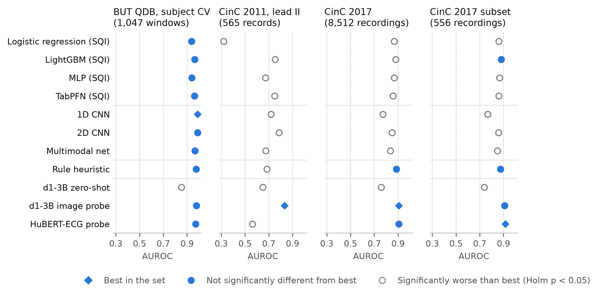
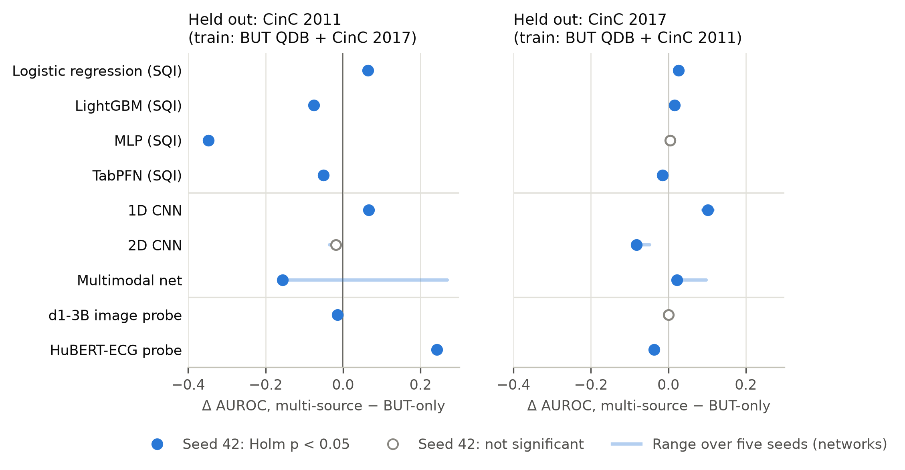
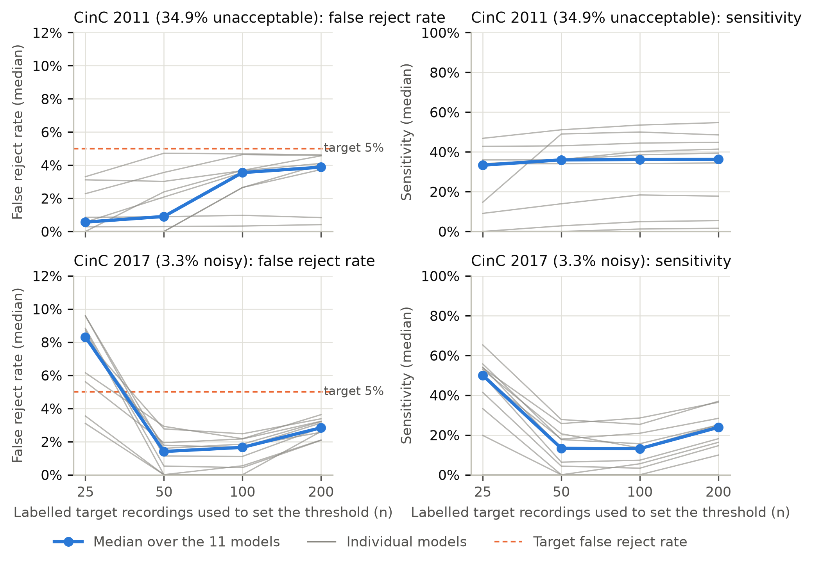

# Evaluating LiquidAI d1-3B for ECG usability screening: a patient-independent, multi-dataset benchmark

## Abstract

**Objective.** To evaluate the open vision-language decision model LiquidAI d1-3B for ECG usability screening, zero-shot and through a linear probe on its frozen representation, against task-specific, tabular and foundation-model alternatives across datasets.

**Methods.** d1-3B (3.1 billion parameters) and ten comparators (SQI logistic regression, LightGBM, MLP and TabPFN; raw-signal and image CNNs and a multimodal network; a rule-based heuristic; a HuBERT-ECG probe) were developed on BUT QDB (1,047 single-lead 10-s windows, 15 subjects) with subject-grouped cross-validation and applied unchanged to CinC 2011 (565 records) and CinC 2017 (8,512 recordings, 3.3% noisy). Multi-source training, noise stress (seven models) and local threshold re-setting were also examined; paired AUROC tests were Holm-adjusted.

**Results.** Zero-shot d1-3B was weak (AUROC 0.852 in-domain, 0.650 and 0.757 externally) and did not track noise. A linear probe on its frozen image tokens reached 0.979 in-domain and was the only model best or not significantly behind the best in every evaluation set, with the highest AUROC on CinC 2011 (0.833 vs 0.787; adjusted p = 0.015) and CinC 2017 (0.908). In-domain, ten models reached 0.938–0.989 without significant differences, yet external rankings changed; the 1D CNN fell to 0.773 on CinC 2017. Development-data thresholds did not transfer, and at 3.3% prevalence, thresholds re-set on 100 labelled recordings kept median sensitivity below 30%.

**Conclusions.** The zero-shot decisions of d1-3B are inadequate for ECG quality screening, but its frozen representation transferred most consistently across devices and labels. In-domain benchmarks did not identify the best-transferring model, and operating points need local calibration.

**Keywords:** electrocardiogram; signal quality; external validation; dataset shift; foundation models; benchmark

## 1. Introduction

Automated ECG interpretation is only as reliable as the signal it is given. In ambulatory, wearable and handheld recordings, motion artefact, electrode contact loss, baseline wander and muscle noise can make a segment unusable for rhythm analysis. A quality gate that rejects such segments, or prompts a new recording, is the first step of most analysis pipelines [1–3].

Quality assessment has moved from hand-crafted signal quality indices (SQIs) and rule-based fusion [2–4], through learned models on raw signals or images [5–8], to general-purpose multimodal foundation models that can be prompted without task-specific training [9]. Published results are nevertheless hard to compare, and they rarely tell a practitioner what will happen on their own device. Studies differ in the quality definition, which may be QRS detectability, full-waveform usability or 12-lead diagnostic acceptability [10–12]; in whether windows from the same subject appear in both training and test data; and in whether models are tested on any data other than their own.

Open multimodal decision models raise a specific question for this task. They are designed to answer a structured question from an image and a short text in a single forward pass, without task-specific training, but whether their decisions or their internal representations are useful for ECG quality assessment is unknown. When models are moved to new data, moreover, ranking, calibration and operating points can all change [13–15]. Cross-dataset evaluation of ECG quality models, including multi-source training, has been reported [15]. What is less often available is a comparison that evaluates many model families, including foundation-model probes, under one patient-independent protocol, with formal paired tests, on external datasets whose reference labels differ, and that also examines whether operating points transfer. Two recent developments make such a benchmark timely. Tabular foundation models such as TabPFN [16] remove most of the tuning burden from SQI classifiers, and ECG foundation models such as HuBERT-ECG [17] and ECG-FM [18] offer frozen representations that can be read out with a linear probe.

The primary aim of this study is to evaluate LiquidAI d1-3B [9], an open-weight 3.1-billion-parameter vision-language decision model, for single-lead ECG usability screening. We evaluate it in two ways: zero-shot, as the model is intended to be used, and through a linear probe on its frozen image tokens, which tests whether the representation contains task-relevant information that the zero-shot decision does not exploit. To place d1-3B in context, we compare it with ten alternatives under one patient-independent protocol with formal paired tests and multiplicity control: tabular SQI models, including a tabular foundation model; raw-signal and image CNNs and a multimodal network; a rule-based heuristic; and a linear probe on a frozen ECG foundation model. Three external evaluations with different reference labels (12-lead acceptability, single-lead rhythm classifiability at natural prevalence, and paired electrode-motion stress), together with leave-one-dataset-out multi-source training, show how much of each model's in-domain advantage survives transfer. We then analyse why transfer fails: the single-lead versus 12-lead label mismatch, changes in feature meaning between datasets (including an amplitude-quantization artefact in a common SQI), whether the rule heuristic's coefficients act as transferable priors, the effect of prevalence, and whether operating points chosen on the development data transfer. Finally, we profile computational cost separately for model inference, preprocessing and rendering.

## 2. Methods

### 2.1 Datasets

The Brno University of Technology ECG Quality Database (BUT QDB) [19, 20] served as the development dataset. It contains 18 long-term single-lead recordings from 15 subjects, sampled at 1,000 Hz. Three experts annotated the recordings into three quality classes [10]: in Class 1, full-waveform analysis is possible; in Class 2, only QRS detection is reliable; and in Class 3, QRS detection is not possible. The usability target was Class 3 versus Classes 1–2, and we used the consensus annotations (99.39 h of the 478.7 h recorded). All non-overlapping 10-s windows inside the annotation intervals formed a candidate pool of 32,956 windows (16.0% Class 3). From this pool, up to 50 usable and up to 60 unusable windows per subject were sampled evenly in time, giving 1,047 windows (297 unusable) from 17 records and 15 subjects; Class 3 occurred in 7 subjects. Windows were resampled to 500 Hz with the Fourier method.

The recently published data descriptor of BUT QDB defines a subject-independent train/test split (11 records from 8 subjects versus 7 records from 7 subjects) and a sample-level three-class evaluation [20]. It also excludes a 13-h stretch of missing signal at the start of record 105001, which is included in our 99.39 h. Our cohort and folds were defined without reference to that protocol and do not follow it: the cohort was created in October 2026, after the descriptor was published, without using its split or evaluated intervals. 59 of our 297 unusable windows lie in the excluded stretch. Two sensitivity analyses address this (section 2.4); they were specified after this count was known, but before their results were computed.

CinC 2011 Set A provided the first external evaluation, with a 12-lead label. Its records are 10-s 12-lead recordings at 500 Hz, labelled acceptable or unacceptable for 12-lead interpretation [11, 12]. Our external set is the union of six balanced subsets drawn for the transfer analyses, 565 records (197 unacceptable, 368 acceptable); five of the subsets are random, and one consists of the first 75 records of each sorted list. These are the records on which every model, including d1-3B, was run during the study; the remaining Set A records were not scored. Lead II was scored in the primary analysis, and all 12 leads were scored in a sensitivity analysis.

CinC 2017 provided a single-lead label at natural prevalence. The dataset contains 8,528 handheld single-lead recordings (300 Hz, 9–61 s), labelled normal rhythm, atrial fibrillation, other rhythm, or too noisy to classify [21]. The "too noisy" label marks recordings whose rhythm cannot be classified from the lead, and it was the unusable target. After excluding 16 recordings shorter than 10 s, 8,512 recordings remained (278 noisy, 3.3%). Each recording was split into up to three 10-s windows (23,985 windows) and resampled to 500 Hz, and the pre-specified recording score is the maximum window score.

The MIT-BIH Noise Stress Test Database (NSTDB) [22] was used for controlled stress: electrode-motion noise added to MIT-BIH records 118 and 119 at nominal SNRs of +24 to −6 dB. The noise segments (300–420 s and 540–660 s, verified against the signals) provided 264 noisy windows, namely 2 records × 6 SNR labels × 2 segments × 11 windows of 10 s starting 5 s into each segment. Each noisy window was paired with the clean base-record window at the same start time.

### 2.2 Inputs

Thirteen tabular inputs were computed per window: 11 SQIs [2–4] and two constants, window duration and sampling rate. After windowing and resampling, these two are 10 s and 500 Hz in every dataset, so they carry no information and cannot identify the dataset of origin; they were kept from the original feature set so that all tabular models share one input vector. The 11 SQIs are bSQI, the agreement of the Pan–Tompkins [23] and a difference-based QRS detector with a 50-ms tolerance; the spectral baseline-wander, high-frequency, QRS-band and powerline ratios; the saturation and flatline fractions; kurtosis and skewness; the zero-crossing rate; and the amplitude standard deviation. Amplitudes were harmonised to mV before feature extraction. Full SQI definitions, network architectures, the heuristic formula and the d1-3B prompt are given in the Supplementary Methods.

Several edge cases were handled deterministically. The extractor sets undefined (non-finite) values to 0 and clips the spectral ratios and moments to fixed ranges; clipping affected 3 (BUT QDB), 6 (CinC 2011) and 122 (CinC 2017) kurtosis or skewness values. A constant window receives flatline and saturation fractions of 1 and bSQI 0; this occurred in 65 CinC 2011 lead-II records, all unacceptable, and in no other dataset. Recordings shorter than one window were excluded (section 2.1).

Image inputs are rendered 10-s strips (513 × 257 px) with a light grid and a per-strip vertical scale (1st–99th percentile, at least 1 mV). Raw-signal models receive the 5,000-sample window, z-scored per window; the z-scoring divides by 1 when the SD is below 10^-6.

### 2.3 Models

The tabular models were an L2 logistic regression on standardised inputs; LightGBM (100 trees, depth 4, learning rate 0.05); a two-layer MLP with 64 and 32 units, each followed by batch normalisation and ReLU, with dropout 0.2 after the first layer (3,201 parameters); and TabPFN-3 [26], a pre-trained tabular foundation model building on earlier TabPFN versions [16], used without tuning. For TabPFN we used the `tabpfn` package 9.0.0 with the checkpoint file `tabpfn-v3-classifier-v3_default.ckpt` (model name TabPFN-v3, architecture `tabpfn_v3`; SHA-256 prefix d0d865d5), loaded explicitly by path, so no automatic model-version selection was involved. Inference used the package defaults (number of estimators and softmax temperature `auto`, no probability balancing), random state 42, on the CPU.

The raw-signal model was a four-block 1D CNN (167,489 parameters), the image model a four-block 2D CNN (245,697 parameters), and the multimodal model a gated fusion of a three-block image encoder and an SQI branch (131,969 parameters). The rule heuristic is a fixed logistic combination of five SQIs and two strip features with hand-set coefficients and no trainable parameters (formula in the Supplementary Methods). Its coefficients were set during the initial prototyping of the analysis code, and their independence from BUT QDB cannot be guaranteed; the heuristic's BUT QDB results are therefore reported for reference only, and its evaluation rests on the external datasets.

The zero-shot vision-language model was LiquidAI d1-3B (3.12 × 10^9 parameters) [9]. It receives the strip, a text summary of 10 of the 13 tabular inputs and a usability question, and returns class probabilities from a single forward pass without task-specific training. Two alternative prompt configurations were evaluated as a sensitivity analysis.

Two frozen foundation models were read out with linear probes. Both probes used the same classifier, a standardised L2 logistic regression whose penalty (C ∈ {10^-3, 10^-2, 10^-1, 1}) was chosen by inner subject-grouped cross-validation within the training data. The d1-3B image-token probe uses the mean image-token embedding after the multimodal projector, captured in the primary zero-shot forward pass; the final hidden state at the answer position was probed as a secondary representation. The HuBERT-ECG probe uses the time-averaged last hidden state of HuBERT-ECG base [17], a self-supervised ECG foundation model (93 M parameters). This model takes 12 leads × 5 s at 500 Hz, flattened and decimated to 6,000 samples. We placed the single lead in the lead II slot with the other leads set to zero, and averaged the embeddings of the two 5-s halves of each window. The primary preprocessing is that of the authors' public code, which we re-implemented and checked against it: a 151-tap FIR band-pass filter (0.05–47 Hz, forward-backward) followed by per-lead min-max scaling to [−1, 1] over the 10-s window. The authors do not address absent leads; their scaling maps the zero leads to −1, and this was kept. As a sensitivity analysis we report the version we ran first, before checking the authors' code, which used a Butterworth band-pass and max-abs scaling of each 5-s half, with absent leads left at 0. In a secondary analysis, the last four transformer layers of HuBERT-ECG and a linear head were fine-tuned with the rest of the model frozen. Its configuration was fixed in the analysis plan (AdamW, learning rates 10^-5 and 10^-3, 10 epochs, batch size 16, class-weighted loss, seed 42, primary preprocessing), and it was evaluated in the same folds and by BUT-only transfer, but not in LODO.

All trained networks used AdamW (learning rate and weight decay 10^-3), class-weighted binary cross-entropy, 25 epochs (MLP: 35), no early stopping and seed 42; logistic regression and LightGBM used balanced class weights. The hyperparameters of the task-specific models were fixed before any evaluation and were not tuned; TabPFN was added as a tuning-free reference for the tabular models (section 4). For the primary unchanged-transfer analyses, target evaluation data were not used for model fitting, hyperparameters, features or threshold selection, and in LODO the held-out dataset was used only for testing. In the local-adaptation experiments, labelled target recordings were split into calibration and evaluation sets within each draw. Post-hoc operating points are reported only as descriptive reference values.

### 2.4 Evaluation protocols

In-domain performance was estimated with five subject-grouped folds on BUT QDB (three subjects per fold). Scalers, probes and thresholds were fitted on training folds only; no subject appears in more than one fold, and windows do not overlap. Each fold's unusable windows came from only one or two subjects, so fold-level AUROCs would mostly reflect single subjects. In-domain performance is therefore reported as the AUROC of the pooled out-of-fold predictions, with subject-level cluster-bootstrap intervals.

Two sensitivity analyses address the official BUT QDB protocol, and both used paired comparisons with the best model (subject-level cluster bootstrap, Holm). In F1a, the pooled out-of-fold AUROC was recomputed without the 59 windows from the excluded 105001 stretch (988 windows, 238 unusable); this is evaluation-only, because the models had been trained with these windows. In F1b, the models were retrained on the cohort windows of the official training records and tested on those of the official test records, using only windows inside the officially evaluated intervals. The task remains window-level and binary (Class 3 versus Classes 1–2), so the official sample-level three-class metric is not used, and TabPFN was not run.

For single-source transfer, models were trained on all of BUT QDB and applied unchanged to the external datasets, with scalers fitted on BUT QDB only. For leave-one-dataset-out (LODO) training, models were trained on two of BUT QDB, CinC 2011 and CinC 2017 and tested on the third, with the same fixed hyperparameters. When CinC 2017 was a training source, we used all noisy recordings and 1,000 random non-noisy recordings (seed 42), 1,278 recordings in total (3,437 windows, 589 unusable), and copied the recording label to its windows. The three training sets comprised 4,002 windows (786 unusable) with BUT QDB held out, 4,484 windows (886 unusable) with CinC 2011 held out, and 1,612 windows (494 unusable) with CinC 2017 held out. The rule heuristic is not trained and is reported unchanged. The d1-3B probe was run in the same splits, with d1-3B features extracted for all 23,985 CinC 2017 windows, and the inner cross-validation that chose the probes' penalty grouped training windows by subject (BUT QDB) or recording (CinC). The seed-dependent networks (MLP, both CNNs and the multimodal net) were repeated with training seeds 1–4 in addition to 42, both for BUT-only training and for LODO. A LODO effect was called consistent if its sign agreed in all five seeds and its median magnitude was at least 0.02 (pre-specified). Logistic regression and LightGBM use a fixed random state, and the probes are deterministic given their features.

For noise stress, we computed the usable probability per SNR label and its paired change relative to the clean partner window.

Besides the default threshold (0.5), two operating rules were applied: Target 1, the maximum sensitivity at FPR ≤ 5%, and Target 2, the minimum FPR at sensitivity ≥ 80%. Thresholds were chosen in four ways: (a) post hoc on the evaluated data, as a reference only; (b) by nested cross-validation within the training subjects of each fold; (c) on pooled BUT QDB out-of-fold scores, transferred unchanged to the external datasets; and (d) locally, on n = 25, 50, 100 or 200 randomly drawn labelled target recordings (500 draws each), with evaluation on the remaining recordings. If a draw in (d) contained only one class, the transferred threshold was used and the draw was counted. In (d), Platt scaling fitted on the same draws was also compared with the uncalibrated scores by the Brier score; this analysis is descriptive.

BUT QDB precision metrics were re-weighted from the sampled prevalence (28.4%) to the natural prevalence of the candidate pool (16.0%), and also to 2.8%, the prevalence without the one record that contributes 90% of Class 3 windows. CinC 2017 was evaluated at its natural prevalence of 3.3%.

Finally, the hand-set heuristic was compared with a logistic-regression replacement using the same seven input features: a standardised L2 logistic regression fitted inside the same folds and transferred like the other models. The replacement changes the functional form as well as the coefficients, because the heuristic mixes two separate sigmoid outputs and caps two inputs (Supplementary Methods S-M3). The comparison therefore does not isolate the effect of the hand-set coefficients.

### 2.5 Statistical analysis

The positive class was unusable. Discrimination was summarised by the area under the receiver operating characteristic curve (AUROC) and average precision (AP), calibration by the Brier score, and decisions by sensitivity and the false reject rate (FR), the proportion of usable recordings flagged as unusable. With unusable as the positive class, FR equals the false-positive rate (FPR). Confidence intervals used a subject-level cluster bootstrap on BUT QDB, where windows of a subject are correlated, and a recording-level bootstrap externally (1,000–2,000 resamples).

Models were compared pairwise on identical units: on BUT QDB with a subject-level cluster bootstrap of the AUROC difference (2,000 resamples), and on the external datasets, where recordings are independent, with DeLong's test [24]. As an implementation check on one pair, the DeLong and recording-bootstrap 95% intervals for the AUROC difference were 0.015–0.060 and 0.014–0.059. Within each evaluation set, all pairwise comparisons formed one family and were Holm-adjusted [25]. The families were BUT QDB, CinC 2011, CinC 2017 and the balanced 556-recording CinC 2017 subset, each with 11 models (55 comparisons). LODO effects (multi-source versus BUT-only) were Holm-adjusted within each held-out dataset. As a sensitivity analysis, the ten comparisons with the best model of each set were also adjusted as a separate family (Table S33); this family is defined after seeing the point estimates. Each official-protocol analysis was Holm-adjusted over its own pairwise comparisons, and the three comparisons of the heuristic with its logistic-regression replacement (one per dataset) are reported unadjusted. The recording-mean aggregation, local recalibration, fine-tuning and the constant-lead check are descriptive and were not tested.

Rankings are reported only where the adjusted comparison supports them. External rankings refer to the pre-specified recording-maximum aggregation; the recording mean is a post hoc sensitivity analysis. The study is reported following TRIPOD+AI, and the completed checklist is provided as a supplementary file.

The seed repetition, the full CinC 2017 run of d1-3B, the local recalibration, the HuBERT-ECG preprocessing check, the fine-tuning and the official-protocol analyses were specified in a dated analysis plan, committed to version control before they were run; amendments made while they ran are recorded there. The study as a whole was not registered, and the original analyses had no written protocol. The plan also contained a decision rule: the statement that the d1-3B probe was never significantly behind the best would be withdrawn if the full CinC 2017 analysis contradicted it.

### 2.6 Computational cost and reproducibility

Latency was measured on an Apple M4 (10-core CPU, 10-core GPU, 16 GB) with synchronised GPU timing, in three runs of 25 windows, separating rendering, SQI extraction, resampling from the native 1,000-Hz signal, and forward passes on CPU and GPU. Table 5 times each model from the stored 500-Hz window: resampling was done offline, so the preprocessing time of the 1D CNN is near zero, and per-window z-scoring is part of its forward pass. Times from the native 1,000-Hz signal, and CPU times, are in Table S8. The foundation-model probes and TabPFN were timed with the harness of Table S8 and are reported in Table S27 rather than in Table 5.

Code, fixed seeds, pinned dependency versions, saved predictions and the scripts that generate every table are available, and every table is produced from saved outputs by script. Unit tests cover the metrics, the paired tests, fold disjointness and the feature definitions.

## 3. Results

### 3.1 In-domain AUROCs clustered above 0.93 and did not identify the best-transferring model

On BUT QDB, ten models reached a pooled out-of-fold AUROC of 0.938–0.989 (Table 1; per-model details in Table S1; 95% CIs for all 11 models in every evaluation set in Table S30). The 1D and 2D CNNs reached 0.989, the d1-3B image probe 0.979, the rule heuristic 0.977, the HuBERT-ECG probe 0.972, the multimodal net 0.967, LightGBM 0.964, TabPFN 0.962, the MLP 0.939 and logistic regression 0.938. None of these ten differed significantly from the best model after Holm adjustment (all p_Holm ≥ 0.29). This reflects limited power as much as similarity: without multiplicity adjustment, the MLP, logistic regression and TabPFN were below the 1D CNN (p = 0.006, 0.010 and 0.027), whereas with Holm adjustment restricted to the ten comparisons with the best model, a sensitivity analysis, none of them was significant (smallest adjusted p = 0.054; Table S33).

Zero-shot d1-3B (0.852) was significantly worse than the best model, the 2D CNN, the multimodal net and the d1-3B probe (all p_Holm < 0.001). The linear probe on the same model's frozen image tokens reached 0.979, an AUROC gain of 0.127 (95% CI 0.041–0.242). This shows that the representation contains useful task-relevant information that the zero-shot decision configuration does not exploit effectively.

The models differed at the decision level more than in ranking. Re-weighted to the 2.8% natural prevalence, the positive predictive value at τ = 0.5 was 0.77 for the 1D CNN, 0.71 for the 2D CNN, 0.61 for the heuristic and 0.21–0.34 for the SQI models (Table S3). Under nested threshold selection, the CNNs kept their operating points but the SQI models did not (Table S2), and sensitivity varied widely between the seven subjects with unusable windows.

Under the official protocol (Table S26), removing the 59 windows of the excluded 105001 stretch (F1a) lowered every model's AUROC slightly: from 0.989 to 0.987 for the 1D CNN, from 0.938 to 0.923 for logistic regression and from 0.852 to 0.828 for zero-shot d1-3B. No model then differed significantly from the best, so the significant deficit of zero-shot d1-3B depended in part on these near-flat windows (p_Holm = 0.368 without them). On the official test set (F1b), AUROC ranged from 0.723 (zero-shot d1-3B) to 1.000 (1D CNN and HuBERT-ECG probe), and no comparison was significant. Unusable windows occur in only three of the seven test subjects, mostly two, so this window-level binary task on the official test set is close to ceiling and cannot separate the models.

### 3.2 External rankings differ between datasets

*Table 1. Pooled AUROC of each model per evaluation set; in parentheses, the Holm-adjusted p-value of the paired comparison with the best model of that set (bold). BUT QDB: subject-level cluster bootstrap; external sets: DeLong test. Models trained on BUT QDB only. HuBERT-ECG: primary (authors') preprocessing. Positive class: unusable.*

| Model | BUT_QDB (5-fold subject CV) | CinC2011 lead II (565 records) | CinC2017 (8,512 recordings) | CinC2017 balanced subset (556 recordings) |
| :--- | :---: | :---: | :---: | :---: |
| **Logistic Regression (SQI)** | 0.938 (p = 0.450) | 0.320 (p < 0.001) | 0.868 (p = 0.001) | 0.860 (p = 0.005) |
| **LightGBM (SQI)** | 0.964 (p = 1.000) | 0.754 (p < 0.001) | 0.880 (p = 0.043) | 0.880 (p = 0.261) |
| **Independent SQI MLP** | 0.939 (p = 0.288) | 0.672 (p < 0.001) | 0.868 (p < 0.001) | 0.866 (p = 0.028) |
| **1D CNN (Raw Signal)** | **0.989** (best) | 0.719 (p < 0.001) | 0.773 (p < 0.001) | 0.767 (p < 0.001) |
| **2D CNN (Rendered Image)** | 0.989 (p = 1.000) | 0.787 (p = 0.015) | 0.850 (p < 0.001) | 0.859 (p = 0.005) |
| **SinglePass Multimodal Net** | 0.967 (p = 1.000) | 0.674 (p < 0.001) | 0.835 (p < 0.001) | 0.848 (p < 0.001) |
| **Rule-Based SQI Heuristic** | 0.977 (p = 1.000) | 0.685 (p < 0.001) | 0.887 (p = 0.481) | 0.876 (p = 0.174) |
| **LiquidAI d1-3B (Zero-Shot)** | 0.852 (p < 0.001) | 0.650 (p < 0.001) | 0.757 (p < 0.001) | 0.739 (p < 0.001) |
| **TabPFN (SQI)** | 0.962 (p = 1.000) | 0.749 (p < 0.001) | 0.858 (p < 0.001) | 0.861 (p = 0.010) |
| **HuBERT-ECG probe** | 0.972 (p = 1.000) | 0.562 (p < 0.001) | 0.907 (p = 1.000) | **0.916** (best) |
| **d1-3B image-token probe** | 0.979 (p = 1.000) | **0.833** (best) | **0.908** (best) | 0.910 (p = 1.000) |

*Figure 1. AUROC of each model in the four evaluation sets. The marker shows the outcome of the Holm-adjusted paired comparison with the best model of that set: best (diamond), not significantly different (filled) or significantly worse (open). Rows are grouped into tabular models, task-specific networks, the rule heuristic and the foundation-model approaches. Dashed line: chance. Source: Table 1.*

On CinC 2011, where lead II is scored against 12-lead labels, the d1-3B image-token probe ranked recordings best (AUROC 0.833). It was significantly better than every other model, including the 2D CNN (0.787; difference 0.046, 95% CI 0.020–0.073; p_Holm = 0.015), while the HuBERT-ECG probe was close to chance (0.562). The SQI logistic regression was inverted (0.320), and so was the logistic-regression replacement of the heuristic (0.325). Averaging the scores of all 12 leads raised AUROC for every trained model except logistic regression; over the random subsets, the mean was 0.852 for the 2D CNN and 0.877 for LightGBM (Table S5). This aggregation rule was chosen after the main analysis, but it indicates that part of the CinC 2011 gap is the single-lead versus 12-lead label mismatch.

A post hoc, descriptive check showed that 65 of the 197 unacceptable CinC 2011 records have a constant lead II. At τ = 0.5, all 65 were flagged by the heuristic, the multimodal net, zero-shot d1-3B and the d1-3B probe, and 64 of 65 by the 1D CNN, but only 1 of 65 by the 2D CNN and none by the four tabular models or the HuBERT-ECG probe. Without these records, every model's AUROC fell except those of logistic regression and the HuBERT-ECG probe, and the d1-3B probe remained highest (0.751; Table S28). BUT QDB contains no constant windows, so several trained models never saw this failure during development.

On CinC 2017, a single-lead label at natural prevalence, the d1-3B image probe had the highest AUROC (0.908). Only two models were not significantly different from it: the HuBERT-ECG probe (0.907, p_Holm = 1.000) and the rule heuristic (0.887; difference 0.020, 95% CI 0.001–0.039; p_Holm = 0.481). All other models were significantly worse: LightGBM (0.880, p_Holm = 0.043), logistic regression and the MLP (both 0.868), TabPFN (0.858), the 2D CNN (0.850), the multimodal net (0.835), the 1D CNN (0.773) and zero-shot d1-3B (0.757). The 1D CNN had been jointly best in-domain. With the post hoc recording mean instead of the maximum, every model's AUROC rose, by 0.03–0.07 (Table 3); the two probes remained highest (0.949 and 0.942), followed by the MLP (0.934), the heuristic (0.933) and LightGBM (0.930). Transfer performance therefore depends on the recording-level aggregation as well as on the model. On the balanced 556-recording subset, the HuBERT-ECG probe (0.916), the d1-3B probe (0.910), LightGBM and the heuristic were not significantly different from one another.

Across the four evaluation sets, the d1-3B image probe was the only model that was best, or not significantly different from the best, in every set. This statement was first made on the 556-recording subset, before the full CinC 2017 analysis, and the pre-specified rule would have withdrawn it; the full analysis confirmed it.

The HuBERT-ECG probe depended on preprocessing. With our first preprocessing it gave 0.987 on BUT QDB, 0.732 on CinC 2011 and 0.867 on CinC 2017; with the authors' preprocessing it gave 0.972, 0.562 and 0.907 (Table S25). In a single run, partial fine-tuning with the authors' preprocessing gave 0.969, 0.706 and 0.912. These values are descriptive: they were not tested against the probe and were not repeated across seeds.

Several SQIs reversed their association with unusability between datasets (Table S6; distributions by dataset and class in Table S31). Measured as univariate AUROC on BUT QDB versus CinC 2011, the high-frequency ratio went from 0.777 to 0.307, the powerline ratio from 0.773 to 0.312 and the zero-crossing rate from 0.727 to 0.248, whereas bSQI was informative again in CinC 2017 (0.124, i.e., low agreement marks noise). Two mechanisms contribute to these reversals. The first is asymmetric preprocessing: BUT QDB windows are Fourier-resampled from 1,000 Hz, which removes amplitude quantization, so their flatline fraction is near zero, whereas CinC 2011 lead II is used at its native 500 Hz with 5-µV steps, so its flatline fraction largely counts quantization repeats, and acceptable records already have a median of 0.28. The second, examined post hoc and descriptively (Table S32), is the constant leads. The 65 constant-lead CinC 2011 records have high-frequency, powerline and zero-crossing values of 0, which look like a clean signal under the BUT QDB associations. Without these records, the univariate AUROCs of the high-frequency ratio, powerline ratio and zero-crossing rate were 0.459, 0.465 and 0.371: the strong reversals largely disappear, but the features do not regain their BUT QDB direction and remain only weakly informative. The SQI logistic regression likewise rose from 0.320 to 0.478 without the constant-lead records (Table S28).

The hand-set heuristic outperformed its logistic-regression replacement, which used the same seven inputs (Table S22), in every evaluation: on BUT QDB, 0.977 versus 0.925 (cluster-bootstrap p = 0.001); on CinC 2011, 0.685 versus 0.325 (DeLong p < 0.001); and on CinC 2017, 0.887 versus 0.864 (DeLong p < 0.001). Because the heuristic's coefficients may not be independent of BUT QDB (section 2.3), only the two external comparisons are informative.

Under paired electrode-motion stress (Table S7), every trained model lowered its usable probability as noise increased. At 0 dB, the mean paired change was −0.93 for logistic regression, −0.90 for LightGBM, −0.85 for the multimodal net, −0.68 for the 1D CNN and −0.67 for the 2D CNN. Zero-shot d1-3B changed by at most 0.09 and did not track the noise.

### 3.3 Multi-source training helps some models and harms others

*Table 2. Leave-one-dataset-out AUROC [95% bootstrap CI] when training on the two other datasets (seed 42). Δ: paired difference from training on BUT QDB alone, with Holm adjustment within each held-out dataset. The rule heuristic has no trainable parameters. Seed repetition of the networks: Table S23.*

| Model | BUT QDB (train: CinC 2011 + CinC 2017) | CinC 2011 (train: BUT QDB + CinC 2017) | CinC 2017 (train: BUT QDB + CinC 2011) |
| :--- | :---: | :---: | :---: |
| **Logistic Regression (SQI)** | 0.457 [0.141–0.939]; Δ −0.481 (p_Holm = 0.536) | 0.385 [0.329–0.438]; Δ +0.065 (p_Holm = 0.021) | 0.895 [0.876–0.911]; Δ +0.027 (p_Holm < 0.001) |
| **LightGBM (SQI)** | 0.949 [0.906–0.982]; Δ −0.015 (p_Holm = 1.000) | 0.679 [0.632–0.725]; Δ −0.075 (p_Holm < 0.001) | 0.896 [0.880–0.909]; Δ +0.016 (p_Holm < 0.001) |
| **Independent SQI MLP** | 0.980 [0.922–0.999]; Δ +0.041 (p_Holm = 0.108) | 0.325 [0.290–0.357]; Δ −0.347 (p_Holm < 0.001) | 0.873 [0.858–0.886]; Δ +0.005 (p_Holm = 0.864) |
| **1D CNN (Raw Signal)** | 0.989 [0.973–1.000]; Δ +0.000 (p_Holm = 1.000) | 0.785 [0.743–0.826]; Δ +0.066 (p_Holm < 0.001) | 0.875 [0.859–0.891]; Δ +0.102 (p_Holm < 0.001) |
| **2D CNN (Rendered Image)** | 0.975 [0.954–0.994]; Δ −0.014 (p_Holm = 1.000) | 0.768 [0.728–0.810]; Δ −0.019 (p_Holm = 0.221) | 0.768 [0.744–0.793]; Δ −0.082 (p_Holm < 0.001) |
| **SinglePass Multimodal Net** | 0.989 [0.957–1.000]; Δ +0.023 (p_Holm = 1.000) | 0.518 [0.505–0.531]; Δ −0.156 (p_Holm < 0.001) | 0.857 [0.839–0.874]; Δ +0.022 (p_Holm < 0.001) |
| **Rule-Based SQI Heuristic** | 0.977 (fixed rule) | 0.685 (fixed rule) | 0.887 (fixed rule) |
| **LiquidAI d1-3B (Zero-Shot)** | — | — | — |
| **TabPFN (SQI)** | 0.880 [0.806–0.957]; Δ −0.082 (p_Holm = 0.536) | 0.699 [0.654–0.747]; Δ −0.050 (p_Holm = 0.008) | 0.842 [0.818–0.866]; Δ −0.015 (p_Holm = 0.003) |
| **HuBERT-ECG probe** | 0.982 [0.955–0.999]; Δ +0.010 (p_Holm = 1.000) | 0.804 [0.764–0.846]; Δ +0.242 (p_Holm < 0.001) | 0.871 [0.853–0.890]; Δ −0.036 (p_Holm < 0.001) |
| **d1-3B image-token probe** | 0.947 [0.922–0.982]; Δ −0.032 (p_Holm = 1.000) | 0.818 [0.781–0.857]; Δ −0.015 (p_Holm = 0.021) | 0.908 [0.893–0.922]; Δ +0.000 (p_Holm = 0.974) |

*Figure 2. Effect of multi-source training: AUROC when training on the two other datasets minus AUROC when training on BUT QDB alone. Markers: seed 42, filled if Holm-adjusted p < 0.05. Bars: range over five training seeds for the seed-dependent networks. Source: Table 2 and Table S23.*

Adding a second training source changed AUROC substantially, in both directions (Table 2). Across five training seeds (Table S23), four effects of the networks were consistent: the 1D CNN gained 0.066 on CinC 2011 and 0.102 on CinC 2017, the 2D CNN lost 0.023 on CinC 2011 and 0.069 on CinC 2017, the MLP lost 0.353 on CinC 2011, and the multimodal net gained 0.053 on CinC 2017. The seed-42 drop of the multimodal net on CinC 2011 (0.518) was not reproducible: across seeds, its difference ranged from −0.156 to +0.269, and its BUT-only result was itself unstable (0.500–0.674). On the BUT QDB test, the 2D CNN and the multimodal net varied widely between seeds (0.705–0.989 and 0.741–0.992).

Among the other models, logistic regression and LightGBM improved slightly on CinC 2017, and TabPFN was slightly worse on both external targets. With only CinC data for training, logistic regression no longer ranked BUT QDB windows (0.457, wide interval). The HuBERT-ECG probe gained most on CinC 2011, from 0.562 to 0.804 (p_Holm < 0.001), and lost slightly on CinC 2017 (−0.036). The d1-3B probe changed little (0.947, 0.818 and 0.908 on the three held-out datasets).

### 3.4 Operating points and prevalence

*Table 3. CinC 2017 at natural prevalence (8,512 recordings, 278 noisy), all 11 models trained on BUT QDB only. Recording maximum (pre-specified); the last column uses the recording mean (post hoc). Sens./FR: sensitivity and false reject rate at τ = 0.50; PPV/NPV: positive/negative predictive value. Bootstrap CIs for the seven main models: Table S29.*

| Model | AUROC, recording max (pre-specified) | AP, recording max | Sens. / FR at τ = 0.50 | PPV / NPV at τ = 0.50 | AUROC, recording mean (post hoc) |
| :--- | :---: | :---: | :---: | :---: | :---: |
| **Logistic Regression (SQI)** | 0.868 | 0.173 | 80.2% / 18.9% | 0.126 / 0.992 | 0.916 |
| **LightGBM (SQI)** | 0.880 | 0.234 | 67.6% / 14.6% | 0.135 / 0.987 | 0.930 |
| **Independent SQI MLP** | 0.868 | 0.140 | 86.3% / 24.0% | 0.108 / 0.994 | 0.934 |
| **1D CNN (Raw Signal)** | 0.773 | 0.064 | 92.4% / 34.5% | 0.083 / 0.996 | 0.801 |
| **2D CNN (Rendered Image)** | 0.850 | 0.137 | 89.9% / 33.8% | 0.082 / 0.995 | 0.879 |
| **SinglePass Multimodal Net** | 0.835 | 0.107 | 88.8% / 35.7% | 0.078 / 0.994 | 0.888 |
| **Rule-Based SQI Heuristic** | 0.887 | 0.182 | 18.3% / 2.5% | 0.199 / 0.973 | 0.933 |
| **LiquidAI d1-3B (Zero-Shot)** | 0.757 | 0.113 | 19.8% / 3.1% | 0.177 / 0.973 | 0.816 |
| **TabPFN (SQI)** | 0.858 | 0.210 | 68.7% / 14.2% | 0.140 / 0.988 | 0.896 |
| **HuBERT-ECG probe** | 0.907 | 0.262 | 93.2% / 26.2% | 0.107 / 0.997 | 0.942 |
| **d1-3B image-token probe** | 0.908 | 0.264 | 87.8% / 23.2% | 0.113 / 0.995 | 0.949 |

At the 3.3% prevalence of CinC 2017, the positive predictive value at the default threshold was low for all 11 models (0.08–0.20; Table 3). The heuristic had the highest positive predictive value (0.199), but at 18.3% sensitivity. Thresholds chosen on BUT QDB did not transfer (Table S4): the Target 1 rule (false reject rate ≤ 5% on BUT QDB) gave false reject rates on CinC 2017 of 15.7–54.5% for the trained models and 6.2% for the heuristic, whose sensitivity fell to 52.9%. On CinC 2011, the same thresholds gave sensitivities between 0% (MLP) and 100% at a 100% false reject rate (heuristic).

*Table 4. Target 1 thresholds (maximum sensitivity at FPR ≤ 5%) re-set on n = 100 randomly drawn labelled target recordings and evaluated on the remaining recordings (500 draws; median and 2.5–97.5 percentiles over draws). Achieved FPR is given as the share of draws with FPR ≤ 5% and ≤ 7.5%; the 7.5% level was pre-specified as a tolerance for the sampling error of a threshold chosen on n recordings. Fallback: draws without a positive recording, for which the transferred threshold was kept. Brier: uncalibrated BUT-only score versus Platt scaling fitted on the same draws; the median is over the draws in which Platt scaling could be fitted, and the number skipped (single-class draws) is in parentheses. All sample sizes: Table S24.*

| Dataset | Model | n | Transferred threshold: FPR / Sens. (median) | Local threshold: FPR median [95% range] | Local threshold: Sens. median [95% range] | Draws with FPR ≤ 5% / ≤ 7.5% (local) | Fallback draws | Brier: raw → Platt (median; Platt skipped) |
| :--- | :--- | :---: | :---: | :---: | :---: | :---: | :---: | :---: |
| CinC2011 | **Logistic Regression (SQI)** | 100 | 100.0% / 66.5% | 0.0% [0.0–0.0%] | 0.0% [0.0–0.0%] | 100% / 100% | 0 | 0.768 → 0.171 (0) |
| CinC2011 | **LightGBM (SQI)** | 100 | 4.7% / 51.2% | 4.7% [0.3–11.7%] | 50.0% [6.3–57.7%] | 65% / 82% | 0 | 0.219 → 0.180 (0) |
| CinC2011 | **Independent SQI MLP** | 100 | 0.0% / 0.0% | 1.0% [0.3–1.0%] | 36.2% [32.7–38.9%] | 100% / 100% | 0 | 0.348 → 0.228 (0) |
| CinC2011 | **1D CNN (Raw Signal)** | 100 | 30.5% / 76.1% | 2.6% [0.0–13.0%] | 1.2% [0.0–16.0%] | 67% / 81% | 0 | 0.243 → 0.202 (0) |
| CinC2011 | **2D CNN (Rendered Image)** | 100 | 10.7% / 60.6% | 4.6% [0.7–11.3%] | 18.3% [1.9–59.9%] | 61% / 74% | 0 | 0.244 → 0.174 (0) |
| CinC2011 | **SinglePass Multimodal Net** | 100 | 0.3% / 34.1% | 0.3% [0.0–0.3%] | 34.2% [31.0–37.2%] | 100% / 100% | 0 | 0.232 → 0.173 (0) |
| CinC2011 | **Rule-Based SQI Heuristic** | 100 | 100.0% / 100.0% | 3.7% [0.0–12.5%] | 40.3% [32.0–47.8%] | 66% / 83% | 0 | 0.278 → 0.195 (0) |
| CinC2011 | **LiquidAI d1-3B (Zero-Shot)** | 100 | 100.0% / 99.4% | 2.7% [0.0–7.9%] | 38.5% [31.4–43.4%] | 82% / 93% | 0 | 0.510 → 0.199 (0) |
| CinC2011 | **d1-3B image-token probe** | 100 | 11.7% / 65.0% | 3.6% [0.2–11.7%] | 53.5% [44.5–63.5%] | 70% / 85% | 0 | 0.161 → 0.142 (0) |
| CinC2011 | **TabPFN (SQI)** | 100 | 24.3% / 61.4% | 3.7% [0.2–11.1%] | 44.4% [3.1–53.2%] | 61% / 90% | 0 | 0.214 → 0.186 (0) |
| CinC2011 | **HuBERT-ECG probe** | 100 | 40.0% / 48.8% | 3.6% [0.0–13.2%] | 4.9% [0.0–18.9%] | 64% / 78% | 0 | 0.319 → 0.228 (0) |
| CinC2017 | **Logistic Regression (SQI)** | 100 | 15.7% / 74.5% | 2.5% [0.0–15.7%] | 15.6% [0.0–74.5%] | 83% / 94% | 21 | 0.145 → 0.031 (21) |
| CinC2017 | **LightGBM (SQI)** | 100 | 19.2% / 79.5% | 1.7% [0.0–19.1%] | 20.9% [0.0–79.5%] | 88% / 93% | 21 | 0.105 → 0.029 (21) |
| CinC2017 | **Independent SQI MLP** | 100 | 16.5% / 74.5% | 1.8% [0.0–16.5%] | 7.3% [0.0–74.5%] | 83% / 93% | 21 | 0.175 → 0.031 (21) |
| CinC2017 | **1D CNN (Raw Signal)** | 100 | 54.5% / 99.6% | 0.0% [0.0–54.5%] | 0.0% [0.0–99.6%] | 95% / 96% | 21 | 0.308 → 0.032 (21) |
| CinC2017 | **2D CNN (Rendered Image)** | 100 | 50.4% / 96.4% | 0.4% [0.0–50.3%] | 3.3% [0.0–96.4%] | 86% / 93% | 21 | 0.284 → 0.031 (21) |
| CinC2017 | **SinglePass Multimodal Net** | 100 | 43.1% / 92.8% | 0.0% [0.0–43.0%] | 0.0% [0.0–92.8%] | 87% / 94% | 21 | 0.303 → 0.031 (21) |
| CinC2017 | **Rule-Based SQI Heuristic** | 100 | 6.2% / 52.9% | 2.2% [0.0–7.5%] | 13.5% [0.0–62.4%] | 77% / 97% | 21 | 0.095 → 0.031 (21) |
| CinC2017 | **LiquidAI d1-3B (Zero-Shot)** | 100 | 3.1% / 19.8% | 0.5% [0.0–7.0%] | 5.5% [0.0–33.2%] | 95% / 100% | 21 | 0.091 → 0.031 (21) |
| CinC2017 | **TabPFN (SQI)** | 100 | 29.2% / 87.7% | 1.1% [0.0–29.2%] | 13.1% [0.0–87.8%] | 87% / 94% | 21 | 0.109 → 0.030 (21) |
| CinC2017 | **HuBERT-ECG probe** | 100 | 51.6% / 99.6% | 2.2% [0.0–51.6%] | 28.5% [0.0–99.6%] | 87% / 95% | 21 | 0.175 → 0.028 (21) |
| CinC2017 | **d1-3B image-token probe** | 100 | 51.1% / 98.9% | 1.7% [0.0–51.1%] | 25.3% [0.0–98.9%] | 83% / 94% | 21 | 0.162 → 0.028 (21) |

Re-setting the threshold on a small labelled target sample brought false rejections close to the target in most draws (Table 4). On CinC 2011, with n = 100, the false reject rate was at most 5% in 61–100% and at most 7.5% in 74–100% of draws, depending on the model, and the median sensitivity was 54% for the d1-3B probe, 50% for LightGBM and 40% for the heuristic. On CinC 2017, with n = 100, the false reject rate was at most 5% in 77–95% and at most 7.5% in at least 93% of draws, but the median sensitivity was only 0–29%. A draw of 100 recordings contains about three noisy recordings, so the threshold rests on very few positives, and 21 of 500 draws contained none. Even with n = 200, the median sensitivity remained 0–37% (Table S24).

*Figure 3. Thresholds re-set on n labelled target recordings (Target 1, false reject rate ≤ 5%), evaluated on the remaining recordings: median over 500 draws for each model (grey) and the median over models (blue). On CinC 2017, 229 of 500 draws at n = 25 and 82 at n = 50 contained no noisy recording and kept the transferred threshold, which explains the values at n = 25. Source: Table S24.*

Platt scaling on the drawn recordings lowered the Brier score of every model. On CinC 2017, however, the recalibrated Brier scores (0.028–0.032 at n = 100) were close to that of a constant prediction at the prevalence (0.032). This comparison suggests that much of the gain reflects a corrected probability level; it does not by itself establish that the recalibrated probabilities are well calibrated.

### 3.5 Computational cost

*Table 5. Per-window latency on an Apple M4 (median and 95th percentile of three runs of 25 windows), separating preprocessing from the forward pass.*

| Model Architecture | Parameters | Disk Weights | Execution Device | Preproc Median (p95) | Forward Median (p95) | Total Median (p95) | Total Median, Range over Runs | Preproc Share (Median of Ratios) |
| :--- | :---: | :---: | :---: | :---: | :---: | :---: | :---: | :---: |
| **Rule-Based SQI Heuristic** | 0 | 0.00 MiB | CPU | 2.58 ms (3.04 ms) | 0.22 ms (0.24 ms) | 2.81 ms (3.27 ms) | 2.60–2.83 ms | 92.3% |
| **Logistic Regression (SQI)** | 14 | 0.01 MiB | CPU | 1.34 ms (1.52 ms) | 0.18 ms (0.22 ms) | 1.52 ms (1.73 ms) | 1.51–1.54 ms | 88.4% |
| **LightGBM (SQI)** | 1,092 | 0.14 MiB | CPU | 1.32 ms (1.49 ms) | 0.17 ms (0.25 ms) | 1.48 ms (1.72 ms) | 1.48–1.55 ms | 88.4% |
| **Independent SQI MLP** | 3,201 | 0.01 MiB | Apple M4 (MPS) | 1.38 ms (1.76 ms) | 1.13 ms (1.77 ms) | 2.53 ms (3.62 ms) | 2.49–2.54 ms | 54.5% |
| **1D CNN (Raw Signal)** | 167,489 | 0.64 MiB | Apple M4 (MPS) | 0.00 ms (0.00 ms) | 1.47 ms (2.28 ms) | 1.47 ms (2.28 ms) | 1.36–1.49 ms | 0.0% |
| **2D CNN (Rendered Image)** | 245,697 | 0.94 MiB | Apple M4 (MPS) | 60.23 ms (137.53 ms) | 5.12 ms (5.63 ms) | 65.24 ms (142.53 ms) | 64.74–66.39 ms | 92.4% |
| **SinglePass Multimodal Net** | 131,969 | 0.47 MiB | Apple M4 (MPS) | 61.41 ms (128.75 ms) | 5.56 ms (6.10 ms) | 67.09 ms (134.26 ms) | 66.59–69.04 ms | 92.4% |
| **LiquidAI d1-3B (Zero-Shot)** | 3,120,000,000 | 5958.00 MiB | Apple M4 (MPS) | 63.37 ms (155.48 ms) | 828.47 ms (834.71 ms) | 891.19 ms (984.62 ms) | 891.06–893.27 ms | 7.1% |

For the image pipelines, rendering dominated: about 60 ms (92% of the total) against 5 ms for the forward pass. This cost belongs to the plotting library rather than to rasterization as such, because a direct raster renderer took 0.63 ms (Table S8); the image models, however, were not evaluated on those strips. The 1D CNN, which needs no rendering step, took 1.47 ms on the GPU from the stored 500-Hz window (Table 5) and 1.41 ms on the CPU from the native 1,000-Hz window including resampling (Table S8). d1-3B took 891 ms per window, dominated by its 828-ms forward pass. Forward-pass times of a few milliseconds on the GPU differ between our two timing scripts (section 4.1), so only order-of-magnitude differences are interpreted. Among the foundation-model approaches (Table S27), the HuBERT-ECG probe took 28.0 ms per window on MPS (64.1 ms on the CPU), of which 23.4 ms was the forward pass; the linear d1-3B probe adds 0.13 ms to the d1-3B forward pass; and TabPFN, which predicts in context over the 1,047 training windows, took 2.5 s per window on the CPU.

## 4. Discussion

The primary question concerned d1-3B, and the answer has two parts. Used as intended, zero-shot, the model was among the weakest in-domain, did not track controlled noise and flagged 564 of the 565 CinC 2011 recordings as unusable at the default threshold, so its zero-shot decisions are not adequate for ECG quality screening. Yet a linear probe on the image tokens of the same forward pass was never significantly behind the best model in any of the four evaluation sets; it was significantly better than every other model on CinC 2011 and had the highest, though not significantly higher, AUROC on the full CinC 2017 set. The representation of this general-purpose model therefore contains task-relevant information that transferred more consistently across devices and label definitions than any task-specific model, but the zero-shot decision configuration does not exploit it effectively. The probe shows that this information is present; it does not identify every reason for the zero-shot failure. Reading out the representation requires labelled development data and carries the inference cost of the full 3.1-billion-parameter model (891 ms per window on our hardware), so the practical value of d1-3B lies in its representation rather than its decisions.

The second finding concerns benchmarking itself, and it is negative and practical. On a patient-independent in-domain benchmark, ten of eleven models did not differ significantly from the highest-AUROC model after multiplicity adjustment, yet their external rankings disagreed with one another. With 15 subjects, the absence of a significant difference does not establish equivalent performance. In-domain accuracy is necessary, but it does not select a model for a new device. The CNNs illustrate this: the 1D and 2D CNNs were jointly best on BUT QDB, yet the 1D CNN was the worst trained model on CinC 2017, and the 2D CNN, second on CinC 2011, was significantly behind the heuristic, LightGBM and both probes on CinC 2017.

The SQI analyses explain part of this pattern. Reversals in feature–outcome associations can undermine unchanged transfer, particularly for classifiers that rely strongly on those associations. TabPFN, which removes the tuning question for the tabular models, did not improve on their external results, which suggests that the selected feature representation contributes to the observed transfer limitations. The quantization artefact in the flatline fraction is a concrete example of a feature whose meaning depends on the acquisition chain, here including our own preprocessing: resampling removed quantization from BUT QDB but not from CinC 2011. Such a feature should be redefined, for example on a minimum duration of constant signal at a quantization-aware tolerance, before it is used across devices.

The hand-set rule outperformed a logistic-regression replacement using the same seven inputs. The results are consistent with the rule providing useful inductive biases, namely that low detector agreement, high noise power, saturation and flatline imply poor quality. Two caveats limit this interpretation. The replacement also changes the functional form, so the performance difference cannot be attributed solely to the hand-set coefficients. In addition, the coefficients were set during initial prototyping and their independence from BUT QDB cannot be guaranteed, so the in-domain comparison is not informative and the interpretation rests on CinC 2011 and CinC 2017.

The HuBERT-ECG probe matched the best models in-domain and on CinC 2017, but it was near chance on CinC 2011 with the authors' preprocessing. Changing the filter and scaling moved its CinC 2011 AUROC from 0.732 to 0.562 and its CinC 2017 AUROC from 0.867 to 0.907, so for frozen foundation models preprocessing is a model parameter that must be reported and that can change conclusions. In a single, untested run, partial fine-tuning gave 0.706 on CinC 2011, above the probe's 0.562; whether this reproduces across seeds is unknown. Both observations are plausible for a model pre-trained on 12-lead recordings and given one lead among eleven constant leads, and a multi-lead input would test this directly. Probing frozen representations is cheap and is a reasonable first adaptation step before fine-tuning, although its inference cost is that of the full foundation model.

Multi-source development is often recommended for robustness [15]. Here it helped the raw-signal CNN substantially and consistently across seeds, but it harmed the 2D CNN on both external targets and the MLP on CinC 2011. Three features of the design are likely to contribute. The training sources carry different labels (single-lead classifiability, 12-lead acceptability and expert three-class quality), and they have very different sizes. Moreover, the source labels are transferred to single-lead 10-s windows: CinC 2017 recording labels are copied to every window, and CinC 2011 12-lead labels are assigned to lead II, which may be clean when another lead is not. This weak and partly noisy supervision may contribute to the losses of the 2D CNN and the HuBERT-ECG probe. For a deployment, the training sources and their label definitions matter as much as their number.

Four implications follow for deployment. First, thresholds must be set on the target population, because neither post-hoc nor nested thresholds from BUT QDB carried over. At low prevalence, however, local recalibration needs enough labelled positives rather than a fixed number of recordings: 100–200 recordings controlled false rejections but left sensitivity poorly determined, so an enriched calibration sample would be needed, for example one that oversamples flagged recordings for review. Second, precision at realistic prevalence is low unless sensitivity is sacrificed, so a quality gate should be judged by its false reject rate per hour of usable signal and by the cost of a missed unusable segment, not by AUROC. Third, the rendering step of image-based quality models is a removable engineering cost, not an intrinsic one. Fourth, a deployed quality gate needs an explicit check for constant or disconnected signals: several trained models, including the tabular models and the 2D CNN, scored completely flat CinC 2011 leads as usable, because no such signal occurred in the development data.

### 4.1 Limitations

First, the development cohort has 15 subjects, and unusable windows occur in only 7. Subject-grouped folds prevent identity leakage, but they cannot add diversity, and in-domain non-significance partly reflects limited power. With unusable windows in only 7 subject clusters, the cluster-bootstrap intervals of the AUROC differences are wide; in sensitivity analysis F1a, even a 0.159 difference was not significant after adjustment.

Second, windows were sampled by quota (28.4% unusable), so precision is reported re-weighted. The primary analysis does not follow the official BUT QDB protocol [20]: it includes 59 unusable windows from a stretch of missing signal that the protocol excludes, and these windows slightly inflate in-domain AUROC (Table S26). Because our models output window-level binary scores, the official sample-level three-class metrics were not computed.

Third, the label definitions differ by design. CinC 2011 labels judge the whole 12-lead recording, while we score one lead, and CinC 2017 labels judge rhythm classifiability per recording. No large multi-lead dataset with lead-wise usability labels was available.

Fourth, the task-specific models were not tuned. TabPFN addresses this for the tabular models, but for the networks untuned hyperparameters may understate in-domain and transfer performance.

Fifth, seed 42 is the reported run. Seeds 1–4 of the CNNs changed in-domain AUROC by at most 0.02 but changed default-threshold sensitivity on CinC substantially, and the multimodal net gave constant outputs on CinC 2011 in three of four additional seeds (Table S9). LODO was repeated over five seeds for the networks (Table S23), whereas TabPFN and the fine-tuned HuBERT-ECG are single runs; the probes are deterministic given their features, and the CinC 2017 training subset of LODO was drawn once.

Sixth, the foundation-model scope is limited. Only two foundation models were probed with a linear read-out, HuBERT-ECG was also partially fine-tuned with one fixed configuration, d1-3B was not fine-tuned, few-shot prompting was not tested, and ECG-FM [18] was not evaluated. HuBERT-ECG preprocessing follows the authors' code, but the placement of a single lead among absent leads is our choice, and the results depend on preprocessing (Table S25). HuBERT-ECG weights are licensed for non-commercial use. The pre-training corpora of d1-3B and HuBERT-ECG (9.1 million 12-lead ECGs) were not checked record by record, so overlap with the public evaluation datasets, as unlabelled signals, could not be verified or excluded.

Seventh, several analyses were post hoc. The d1-3B linear probe, central to our conclusions about d1-3B, was introduced in an earlier revision of this study, after the zero-shot results were known; the statement that it was never significantly behind the best was, however, subject to a pre-specified decision rule for the full CinC 2017 analysis (section 2.5). The 12-lead aggregation rules and the CinC 2017 window mean were chosen after the main analysis and are reported as sensitivity analyses. The heuristic's logistic-regression replacement, TabPFN, the HuBERT-ECG probe and LODO were added during revision, after the single-source results were known, and did not change any earlier result. The later additions (seeds, full CinC 2017 d1-3B, local recalibration, HuBERT-ECG preprocessing check and fine-tuning) were committed to a dated analysis plan before being run, and the HuBERT-ECG primary result changed as a consequence of the pre-specified preprocessing rule.

Eighth, latency reflects one machine and Python implementations, and TabPFN was timed on the CPU only. Table 5 and Table S8 come from different scripts and runs: in Table 5 the models are timed one after another in one process, whereas the later script of Table S8 interleaves CPU and MPS passes per window and excludes the first window. Their MPS forward times of 1–6 ms differ by up to 2.3 ms in either direction (1D CNN 1.47 vs 2.80 ms; 2D CNN 5.12 vs 2.92 ms). Part of the image-model difference is explained by caching: the image models cache each decoded and resized strip after first use, so decoding and resizing fall inside the timed forward pass for 19 of 25 windows in Table 5, but only in the first of three runs in Table S8 (2D CNN on MPS: run median 3.75 ms, against 2.90 ms in the cached runs). The remaining differences, including the 1D CNN's, are unexplained, so MPS forward times at this scale are treated as harness-dependent; the conclusions rest only on differences of an order of magnitude, namely rendering of about 60 ms versus the forward pass, and 828 ms for d1-3B.

Ninth, the NSTDB SNR labels are nominal, and there is one noisy record per label and base record. Tenth, external rankings depend on the recording-level aggregation (Table 3), and part of the CinC 2011 discrimination comes from 65 records with a constant lead II (Table S28).

Finally, performance was not assessed across demographic subgroups. BUT QDB reports the sex and age of its 15 healthy subjects (10 female and 8 male recordings, 21–83 years) [20], but with unusable windows in only 7 subjects a subgroup analysis would not be informative, and demographic information was not used for the CinC datasets. Whether performance differs by sex, age or device population is therefore unknown.

## 5. Conclusions

The zero-shot decisions of LiquidAI d1-3B were not adequate for ECG usability screening, but a linear probe on its frozen image tokens was the only model never significantly behind the best across a patient-independent development set and three external evaluations, with the highest AUROC on CinC 2011 and CinC 2017. The value of this general-purpose model for ECG quality assessment therefore lies in its representation rather than its decisions. More broadly, in-domain performance did not identify the model that transferred best: the 1D CNN, jointly best in-domain, was the worst trained model on CinC 2017; a hand-set rule outperformed a logistic-regression replacement using the same inputs and had a higher AUROC on CinC 2017 than every task-specific model; and an ECG foundation model's probe was sensitive to its preprocessing. Multi-source training had model-specific effects, consistent across seeds for the CNNs. Operating points chosen on development data did not transfer, and at low prevalence, local recalibration on 100–200 labelled recordings controlled false rejections but not sensitivity. ECG quality models should therefore be evaluated externally, on data whose labels match the intended use, with thresholds set locally.

## Ethics, funding and competing interests

This study is a secondary analysis of public, de-identified PhysioNet datasets [11, 19, 21, 22], collected under the approvals stated by their providers (for BUT QDB, IRB Protocol EC:EK:05b/2018 of Brno University of Technology [19, 20]). No new data were collected from human participants, and ethical approval was not required for this secondary analysis. This research received no specific grant from any funding agency in the public, commercial or not-for-profit sectors. The author declares no competing interests. There was no patient or public involvement.

Generative-AI tools were used in three distinct roles. Antigravity (Google) produced an initial version of the analysis code and of the manuscript draft. Claude Code (Anthropic) was used to audit and correct that code, including independent recomputation of the reported metrics; to write the later analysis, table, figure and verification scripts; and to revise the manuscript text. Perplexity was used as an LLM-as-a-judge to review successive manuscript versions. Each critique was checked against the stored outputs before any change was accepted. The author takes full responsibility for the content.

## Data and code availability

All datasets are public on PhysioNet [11, 19, 21, 22]. Code, saved predictions, pinned dependency versions, the dated analysis plan and the scripts that generate every table and figure are available at https://github.com/mkuntalp-ops/d13b-ecg-sqi. The d1-3B (Liquid AI), HuBERT-ECG and TabPFN weights are obtained from their providers under their own licences.

## References

[1] Satija U, Ramkumar B, Manikandan MS. A review of signal processing techniques for electrocardiogram signal quality assessment. IEEE Rev Biomed Eng. 2018;11:36–52. doi:10.1109/RBME.2018.2810957

[2] Clifford GD, Behar J, Li Q, Rezek I. Signal quality indices and data fusion for determining clinical acceptability of electrocardiograms. Physiol Meas. 2012;33(9):1419–1433. doi:10.1088/0967-3334/33/9/1419

[3] Orphanidou C, Bonnici T, Charlton P, Clifton D, Vallance D, Tarassenko L. Signal-quality indices for the electrocardiogram and photoplethysmogram: derivation and applications to wireless monitoring. IEEE J Biomed Health Inform. 2015;19(3):832–838. doi:10.1109/JBHI.2014.2338351

[4] Li Q, Mark RG, Clifford GD. Robust heart rate estimation from multiple asynchronous noisy sources using signal quality indices and a Kalman filter. Physiol Meas. 2008;29(1):15–32. doi:10.1088/0967-3334/29/1/002

[5] Liu F, Xia S, Wei S, Chen L, Ren Y, et al. Wearable electrocardiogram quality assessment using wavelet scattering and LSTM. Front Physiol. 2022;13:905447. doi:10.3389/fphys.2022.905447

[6] Hu Y, Liu Q, Zhou Z, Xu W, Tang H. A paralleled multi-task learning-based framework for single-lead ECG fine-grained noise localization, denoising and signal quality assessment. Sensors. 2025;25(23):7152. doi:10.3390/s25237152

[7] Huang X, Zhang F, Fan H, Chang H, Zhou B, Li Z. Pseudo anomalies enhanced deep support vector data description for electrocardiogram quality assessment. Comput Biol Med. 2024;170:107928. doi:10.1016/j.compbiomed.2024.107928

[8] Herraiz ÁH, et al. A deep learning approach for featureless robust quality assessment of intermittent atrial fibrillation recordings from portable and wearable devices. Entropy. 2020;22(7):733. doi:10.3390/e22070733

[9] Liquid AI. LiquidAI/d1-3B: open-weight edge multimodal decision model. Hugging Face; 2026. Revision 051bcc464b01b9f92942b364d9586b0ef5912432. https://huggingface.co/LiquidAI/d1-3B

[10] Smital L, Haider CR, Vitek M, et al. Real-time quality assessment of long-term ECG signals recorded by wearables in free-living conditions. IEEE Trans Biomed Eng. 2020;67(10):2721–2734. doi:10.1109/TBME.2020.2969719

[11] Silva I, Moody GB, Celi L. Improving the quality of ECGs collected using mobile phones: the PhysioNet/Computing in Cardiology Challenge 2011. Comput Cardiol. 2011;38:273–276.

[12] PhysioNet/Computing in Cardiology Challenge 2011: challenge protocol. https://moody-challenge.physionet.org/2011/

[13] Subbaswamy A, Saria S. From development to deployment: dataset shift, causality, and shift-stable models in health AI. Biostatistics. 2020;21(2):345–352. doi:10.1093/biostatistics/kxz041

[14] Guo LL, et al. Evaluation of domain generalization and adaptation on improving model robustness to temporal dataset shift in clinical medicine. Sci Rep. 2022;12:2726. doi:10.1038/s41598-022-06484-1

[15] Moeyersons J, Smets E, Morales J, et al. Artefact detection and quality assessment of ambulatory ECG signals. Comput Methods Programs Biomed. 2019;182:105050. doi:10.1016/j.cmpb.2019.105050

[16] Hollmann N, Müller S, Purucker L, et al. Accurate predictions on small data with a tabular foundation model. Nature. 2025;637(8045):319–326. doi:10.1038/s41586-024-08328-6

[17] Coppola E, Savardi M, Massussi M, Adamo M, Metra M, Signoroni A. HuBERT-ECG as a self-supervised foundation model for broad and scalable cardiac applications. medRxiv. 2024. doi:10.1101/2024.11.14.24317328 (preprint)

[18] McKeen K, Masood S, Toma A, Rubin B, Wang B. ECG-FM: an open electrocardiogram foundation model. JAMIA Open. 2025;8(5):ooaf122. doi:10.1093/jamiaopen/ooaf122

[19] Nemcova A, Smisek R, Opravilová K, Vitek M, Smital L, Maršánová L. Brno University of Technology ECG Quality Database (BUT QDB), version 1.0.0. PhysioNet; 2020. doi:10.13026/kah4-0w24

[20] Smital L, Nemcova A, Saclova L, Smisek R, Opravilova K, Filipenska M, Vitek M. Real-world 24h+ ECG dataset with quality annotations and motion context. Sci Data. 2026. doi:10.1038/s41597-026-07905-w

[21] Clifford GD, Liu C, Moody B, Lehman LH, Silva I, Li Q, Johnson AE, Mark RG. AF classification from a short single lead ECG recording: the PhysioNet/Computing in Cardiology Challenge 2017. Comput Cardiol. 2017;44. doi:10.22489/CinC.2017.065-469

[22] Moody GB, Muldrow WE, Mark RG. A noise stress test for arrhythmia detectors. Comput Cardiol. 1984;11:381–384.

[23] Pan J, Tompkins WJ. A real-time QRS detection algorithm. IEEE Trans Biomed Eng. 1985;BME-32(3):230–236. doi:10.1109/TBME.1985.325532

[24] DeLong ER, DeLong DM, Clarke-Pearson DL. Comparing the areas under two or more correlated receiver operating characteristic curves: a nonparametric approach. Biometrics. 1988;44(3):837–845.

[25] Holm S. A simple sequentially rejective multiple test procedure. Scand J Stat. 1979;6(2):65–70.

[26] Grinsztajn L, Flöge K, Key O, et al. TabPFN-3: technical report. arXiv:2605.13986. 2026.
