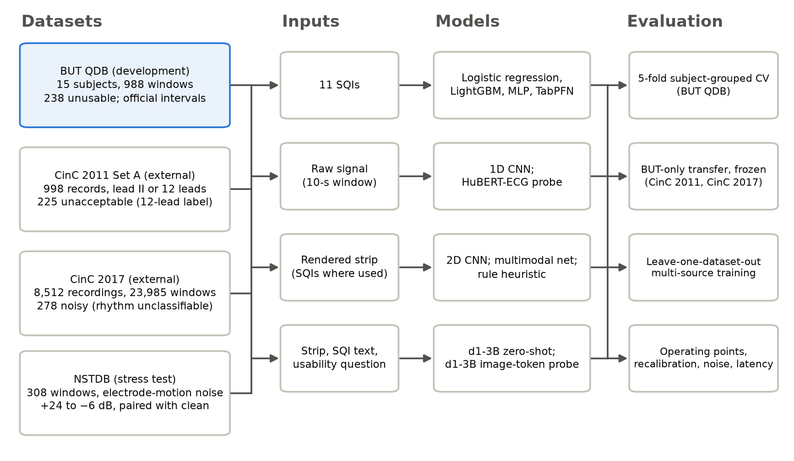
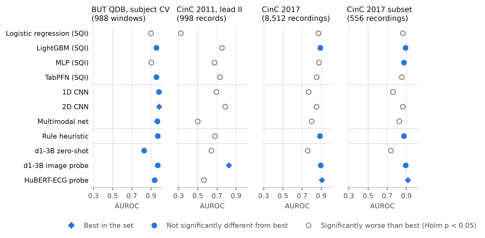
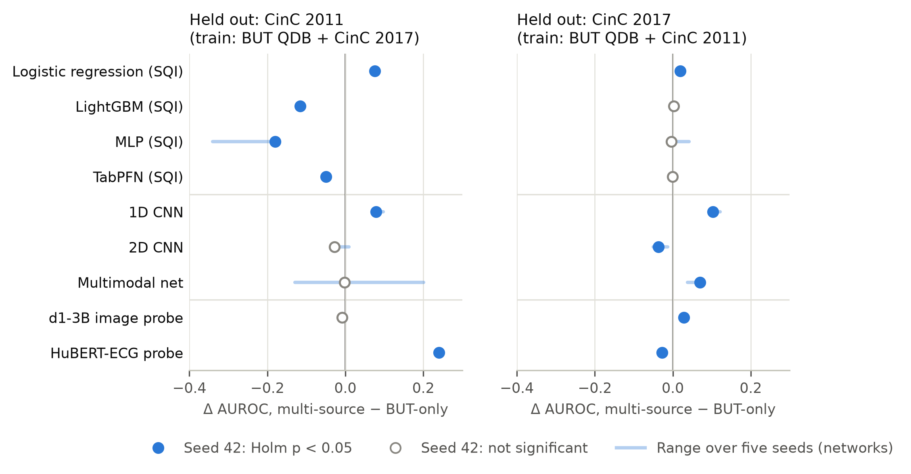
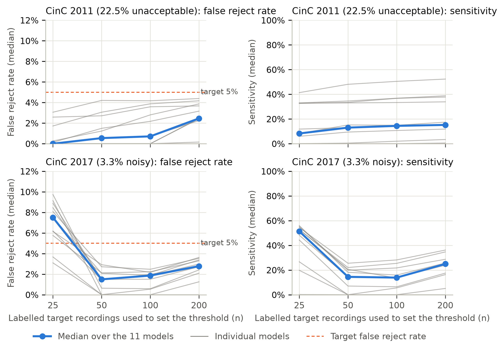

# In-domain performance did not identify the electrocardiogram quality models that ranked best on heterogeneous external datasets: a retrospective benchmark

Mehmet Kuntalp^1,\*^

^1^ Department of Electrical and Electronics Engineering, Dokuz Eylül University, Tınaztepe Campus, Buca, 35160 İzmir, Turkey

\* Corresponding author: mehmet.kuntalp@deu.edu.tr (ORCID 0000-0002-3381-9026)

## Abstract

Quality checks decide which electrocardiogram (ECG) segments are analysed, yet models are usually compared on data resembling their development data. We asked whether in-domain performance identifies the best-ranking models on other datasets. Eleven approaches, from signal-quality-index classifiers and neural networks to a zero-shot vision-language model and frozen foundation-model probes, were fitted or evaluated on 988 windows from 15 people (subject-grouped cross-validation) and applied unchanged to external datasets of 998 and 8,512 recordings. In-domain, eight approaches, one a hand-set rule possibly informed by these data, reached areas under the receiver operating characteristic curve (AUROC) of 0.938–0.985, none differing significantly from the best. Retrospectively, rank agreement with external performance was moderate on one dataset (Spearman ρ = 0.61) and not detected on the other (ρ = −0.02): a raw-signal network fell from second to tenth, and an ECG foundation-model probe rose from eighth to first, a result lost when 53 omitted development windows were restored. Without 73 flat-lead recordings, the leaders' AUROC difference fell from 0.037 to 0.024, losing significance, and recording length alone gave an AUROC of 0.698. Two of 22 transferred thresholds met their false-reject target. ECG quality models should be compared externally, with artefacts checked and thresholds evaluated locally.

**Keywords:** electrocardiogram; signal quality; external validation; dataset shift; foundation models; benchmark

## Introduction

Automated ECG interpretation is only as reliable as the signal it is given. Deep networks can now classify rhythm from single-lead ambulatory recordings [1] and diagnose abnormalities from 12-lead ECGs [2], but in ambulatory, wearable and handheld recordings motion artefact, electrode contact loss, baseline wander and muscle noise can make a segment unusable for analysis. A quality gate that rejects such segments, or prompts a new recording, is the first step of most analysis pipelines [3–5]. Its errors have direct costs: monitors in intensive care generate a large alarm burden [6], and signal quality indices have been used to reduce false arrhythmia alarms [7].

Quality assessment has moved through three generations. The first used hand-crafted signal quality indices (SQIs) and rule-based fusion [4, 5, 8], with many variants developed around the 2011 PhysioNet Challenge [9–13] and later for single-lead and portable recordings [14, 15]. The second learned from raw signals, spectrograms or images [16–21]. The third is under way: multimodal networks have combined ECG with text for quality assessment [22], and a self-supervised foundation model has been proposed to cope with low-quality photoplethysmography [23].

Foundation models are the natural next candidates for this task because they arrive already trained. ECG-specific models [24–28] offer pre-trained representations that can be fine-tuned or, frozen, read out with a linear probe, tabular foundation models such as TabPFN [29] remove most of the tuning burden from SQI classifiers, and multimodal systems have been applied to zero-shot ECG classification and to ECG report generation [30–32]. Open-weight vision-language decision models such as LiquidAI d1-3B [33] go further, answering a structured question from an image and a short text in one forward pass without task-specific training.

The evidence needed to judge such models is difficult to assemble. Studies differ in the quality definition, which may be QRS detectability, full-waveform usability or 12-lead diagnostic acceptability [34–36]; in whether windows from the same subject appear in both training and test data; and in whether models are tested on data other than their own. When models move to new data, discrimination, calibration and operating points can all change [37–39]. Cross-dataset evaluation of ECG quality models has been reported [39, 40], and standardised benchmarks now compare how ECG foundation-model representations transfer across downstream tasks [41]; less often available is a comparison that puts many model families, including foundation-model representations, under one subject-grouped protocol, with paired tests, on external datasets with different reference labels.

This study asks two questions. First, does in-domain performance under a subject-grouped protocol identify the ECG usability models that rank best on other datasets, whose acquisition, quality label and evaluation unit differ from those of the development data? Second, under dataset shift, do frozen foundation-model representations hold up better than classifiers built for the task? We compare eleven approaches under one protocol (Fig. 1): tabular SQI models, including a tabular foundation model; raw-signal, image and multimodal networks; a rule heuristic; zero-shot d1-3B; and linear probes on the frozen representations of d1-3B and of the ECG foundation model HuBERT-ECG. The intended use is an automatic gate before downstream ECG analysis, not a replacement for clinical interpretation. The contribution is an evaluation of this task, model set and failure mechanisms, not a new model or the first external evaluation of ECG quality models.

*Figure 1. Data flow and evaluation design. Counts are windows or recordings after the exclusions described in Methods. Source: cohort manifests and Supplementary Table S28.*

## Results

### In-domain AUROCs clustered above 0.93 and did not separate the models

On BUT QDB, eight models reached a pooled out-of-fold AUROC of 0.938–0.985 (Table 1; 95% CIs for all 11 models in Supplementary Table S28). None of the seven below the 2D CNN (0.985) differed significantly from it after Holm adjustment (all p_Holm ≥ 0.640), which reflects limited power as much as similarity: without multiplicity adjustment the multimodal net and the HuBERT-ECG probe were below the 2D CNN (p = 0.043 and 0.016). The AUROC differences of these seven from the 2D CNN ranged from −0.046 to −0.002, and the lower limits of their unadjusted 95% cluster-bootstrap intervals ranged from −0.142 to −0.047, so differences of that size cannot be excluded with 15 subjects (Supplementary Table S50). The MLP (0.904; difference −0.081, 95% CI −0.204 to −0.017) and logistic regression (0.899; −0.086, 95% CI −0.184 to −0.021) were below the best (both p_Holm = 0.028): no resample reversed the sign, so the unadjusted p is the 1/n floor of 0.0005. With one added to the tail count and to the number of resamples, no pair could reach p_Holm < 0.05 with 2,000 resamples (Supplementary Table S53), but with 20,000 both comparisons remained significant (p_Holm = 0.022 and 0.031; Supplementary Table S54). Their 95% intervals exclude zero but are wide, and both differences stayed negative with any one subject left out (Supplementary Table S57). The rule heuristic (0.971) may not be independent of BUT QDB (its fold-fitted logistic-regression replacement reached 0.905; Supplementary Table S20), and HuBERT-ECG's documented pre-training data do not include BUT QDB, whereas d1-3B's are unknown (Supplementary Table S51). None of the 28 pairwise comparisons among these eight models was significant after Holm adjustment over all 55 pairs (all p_Holm ≥ 0.615). Zero-shot d1-3B reached 0.828, whereas a linear probe on its frozen image tokens reached 0.971 (gain 0.143, 95% CI 0.040–0.264; p_Holm = 0.440).

The models differed at the decision level more than in ranking (Supplementary Table S32): projected to the 2.14% prevalence of the official intervals (Methods), the positive predictive value at τ = 0.5 ranged from 0.15 to 0.67 for the eight models in Supplementary Table S3, and sensitivity intervals were wide because unusable windows come from 7 subjects (Supplementary Table S12).

### In-domain rank did not reliably identify the models that ranked best externally

*Table 1. Pooled AUROC of each model per evaluation set, for the primary development cohort (988 windows) and, side by side, for the quota sensitivity cohort (1,041 windows: the 53 omitted unusable windows of subject 105 restored and the nine fitted models refitted; Supplementary Table S49); external columns give the scores of the models developed on that cohort. In parentheses, the Holm-adjusted p-value (all 55 pairs) of the paired comparison with the best model of that set and cohort (bold). BUT QDB: subject-level cluster bootstrap with 2,000 resamples and the 1/n floor (values of 0.028 are at the floor; for the two primary-cohort comparisons at the floor, 20,000 resamples with one added to the tail count gave 0.022 for the MLP and 0.031 for logistic regression, Supplementary Table S54; this was not repeated for the sensitivity cohort); external sets: DeLong test. Fitted models were trained on BUT QDB only; the rule heuristic and zero-shot d1-3B were not fitted, so their external scores are the same in both cohorts. Positive class: unusable.*

| Model | BUT QDB, 988 | BUT QDB, 1,041 | CinC 2011 lead II, 988 | CinC 2011 lead II, 1,041 | CinC 2017, 988 | CinC 2017, 1,041 | CinC 2017 balanced, 988 | CinC 2017 balanced, 1,041 |
| :--- | :---: | :---: | :---: | :---: | :---: | :---: | :---: | :---: |
| **Logistic Regression (SQI)** | 0.899 (0.028) | 0.937 (0.702) | 0.322 (< 0.001) | 0.325 (< 0.001) | 0.870 (0.004) | 0.868 (0.001) | 0.863 (0.009) | 0.861 (0.046) |
| **LightGBM (SQI)** | 0.957 (1.000) | 0.966 (1.000) | 0.752 (< 0.001) | 0.761 (< 0.001) | 0.891 (0.844) | 0.888 (0.255) | 0.892 (1.000) | 0.888 (1.000) |
| **Independent SQI MLP** | 0.904 (0.028) | 0.932 (0.264) | 0.675 (< 0.001) | 0.683 (< 0.001) | 0.876 (0.031) | 0.851 (< 0.001) | 0.875 (0.132) | 0.857 (0.028) |
| **1D CNN (Raw Signal)** | 0.983 (1.000) | 0.988 (1.000) | 0.695 (< 0.001) | 0.690 (< 0.001) | 0.768 (< 0.001) | 0.769 (< 0.001) | 0.761 (< 0.001) | 0.762 (< 0.001) |
| **2D CNN (Rendered Image)** | **0.985** (best) | **0.993** (best) | 0.787 (0.003) | 0.785 (0.004) | 0.850 (< 0.001) | 0.848 (< 0.001) | 0.862 (0.009) | 0.859 (0.002) |
| **SinglePass Multimodal Net** | 0.966 (1.000) | 0.968 (1.000) | 0.500 (< 0.001) | 0.500 (< 0.001) | 0.799 (< 0.001) | 0.811 (< 0.001) | 0.826 (< 0.001) | 0.824 (< 0.001) |
| **Rule-Based SQI Heuristic** | 0.971 (1.000) | 0.976 (1.000) | 0.678 (< 0.001) | 0.678 (< 0.001) | 0.887 (0.525) | 0.887 (0.368) | 0.876 (0.164) | 0.876 (0.723) |
| **LiquidAI d1-3B (Zero-Shot)** | 0.828 (0.051) | 0.850 (0.028) | 0.641 (< 0.001) | 0.641 (< 0.001) | 0.757 (< 0.001) | 0.757 (< 0.001) | 0.739 (< 0.001) | 0.739 (< 0.001) |
| **TabPFN (SQI)** | 0.956 (1.000) | 0.963 (1.000) | 0.731 (< 0.001) | 0.755 (< 0.001) | 0.853 (< 0.001) | 0.859 (< 0.001) | 0.853 (0.002) | 0.862 (0.052) |
| **HuBERT-ECG probe** | 0.938 (0.640) | 0.981 (1.000) | 0.562 (< 0.001) | 0.759 (< 0.001) | **0.906** (best) | 0.880 (0.003) | **0.916** (best) | 0.892 (1.000) |
| **d1-3B image-token probe** | 0.971 (1.000) | 0.977 (1.000) | **0.824** (best) | **0.828** (best) | 0.894 (0.844) | **0.908** (best) | 0.893 (1.000) | **0.911** (best) |

*Figure 2. AUROC of each model in the four evaluation sets. The marker shows the outcome of the Holm-adjusted paired comparison with the best model of that set: best (diamond), not significantly different (filled; not evidence of equivalence) or significantly worse (open). On BUT QDB the two open markers rest on the 1/n floor of the bootstrap p-value with 2,000 resamples; both remained significant with 20,000 resamples and one added to the tail count (Supplementary Table S54). Primary cohort; the 1,041-window cohort is in Table 1. Rows are grouped into tabular models, task-specific networks, the rule heuristic and the foundation-model approaches. Dashed line: chance. Source: Table 1.*

Ranking the 11 models by AUROC in each set (Supplementary Table S44; descriptive, post hoc) shows how little of the in-domain order carried over. The Spearman correlation between in-domain and external AUROC was 0.61 on CinC 2011 and −0.02 on CinC 2017, and between the two external datasets 0.19; with 11 models these correlations are imprecise. Resampling BUT QDB subjects and external recordings for all models together (2,000 paired bootstrap resamples; post hoc, conditional on the fitted models) gave 95% intervals of 0.06 to 0.75 for CinC 2011, −0.35 to 0.32 for CinC 2017 and 0.04 to 0.31 between the external datasets (Supplementary Table S44). The CinC 2011 interval excludes zero but is wide, so part of the in-domain order carried over there, whereas the CinC 2017 interval is compatible with no association. The in-domain leader also led CinC 2011 in 11 of 2,000 resamples and CinC 2017 in none of the 2,000 (not observed, which does not make the probability zero; tie handling in Supplementary Table S44). Selecting the in-domain leader cost 0.037 AUROC on CinC 2011 and 0.057 on CinC 2017 relative to the best model of each dataset. These losses are retrospective, because each external best model was identified on the same records. Without the rule heuristic the correlations were 0.62 and −0.05. The 1D CNN was second in-domain (0.983), fifth on CinC 2011 and tenth on CinC 2017 (0.768); the 2D CNN, first in-domain, was second on CinC 2011 and eighth on CinC 2017; and the HuBERT-ECG probe, eighth in-domain (0.938), was ninth on CinC 2011 and first on CinC 2017.

On CinC 2011 (Supplementary Table S28), where lead II is scored against 12-lead labels, the d1-3B image-token probe (chosen after results were known; Methods) ranked recordings best (AUROC 0.824, 95% CI 0.789–0.856) and was significantly better than all ten other models (all p_Holm ≤ 0.003), including the 2D CNN (0.787; difference 0.037, 95% CI 0.018–0.057). The HuBERT-ECG probe was close to chance (0.562), and a secondary probe of the d1-3B decision state was inverted (0.422; Supplementary Table S18). The SQI logistic regression was also inverted (0.322), and the multimodal net gave every record the same score (0.500), an input-scaling artefact of this seed (Supplementary Tables S9 and S36).

*Table 2. CinC 2017 at natural prevalence (8,512 recordings, 278 noisy), fitted models trained on BUT QDB only (the rule heuristic and zero-shot d1-3B were not fitted). Recording maximum (primary); the last column uses the recording mean (sensitivity analysis). Sens./FR: sensitivity and false reject rate at τ = 0.50; PPV/NPV: positive/negative predictive value. Confidence intervals for decision metrics: Supplementary Table S32.*

| Model | AUROC, recording max (pre-specified) | AP, recording max | Sens. / FR at τ = 0.50 | PPV / NPV at τ = 0.50 | AUROC, recording mean (post hoc) |
| :--- | :---: | :---: | :---: | :---: | :---: |
| **Logistic Regression (SQI)** | 0.870 | 0.175 | 81.7% / 20.8% | 0.117 / 0.992 | 0.919 |
| **LightGBM (SQI)** | 0.891 | 0.227 | 68.0% / 12.7% | 0.154 / 0.988 | 0.939 |
| **Independent SQI MLP** | 0.876 | 0.163 | 79.1% / 16.9% | 0.136 / 0.992 | 0.933 |
| **1D CNN (Raw Signal)** | 0.768 | 0.062 | 92.4% / 36.1% | 0.080 / 0.996 | 0.797 |
| **2D CNN (Rendered Image)** | 0.850 | 0.146 | 89.2% / 35.6% | 0.078 / 0.994 | 0.875 |
| **SinglePass Multimodal Net** | 0.799 | 0.088 | 92.8% / 45.6% | 0.064 / 0.996 | 0.882 |
| **Rule-Based SQI Heuristic** | 0.887 | 0.182 | 18.3% / 2.5% | 0.199 / 0.973 | 0.933 |
| **LiquidAI d1-3B (Zero-Shot)** | 0.757 | 0.113 | 19.8% / 3.1% | 0.177 / 0.973 | 0.816 |
| **TabPFN (SQI)** | 0.853 | 0.202 | 66.5% / 13.5% | 0.143 / 0.987 | 0.890 |
| **HuBERT-ECG probe** | 0.906 | 0.248 | 92.4% / 26.3% | 0.106 / 0.997 | 0.941 |
| **d1-3B image-token probe** | 0.894 | 0.241 | 86.3% / 23.5% | 0.110 / 0.994 | 0.935 |

On CinC 2017 (Table 2; Supplementary Table S28), a single-lead label at natural prevalence, the HuBERT-ECG probe had the highest AUROC (0.906, 95% CI 0.893–0.920). Here, as throughout CinC 2017, the intervals and tests treat recordings as independent, which cannot be verified without patient identifiers (Methods). The d1-3B probe (0.894), LightGBM (0.891) and the rule heuristic (0.887) were not significantly different from it (p_Holm = 0.844, 0.844 and 0.525), and all others were significantly worse (all p_Holm ≤ 0.031), including the 1D CNN (0.768). With the recording mean instead of the maximum, every model's AUROC rose, by 0.025–0.083 (Table 2). Recording length is confounded with the label under the maximum: 110 of the 278 noisy recordings but only 490 of the 8,234 others contributed a single window, and the number of windows alone gave an AUROC of 0.698 (Supplementary Table S42; descriptive).

A post hoc sensitivity analysis restored the 53 unusable windows of subject 105 that the order of the quota and the interval restriction had left out (1,041 windows; Table 1; Supplementary Table S49; Methods). In-domain AUROC rose for every model, by 0.003–0.043, and the 2D CNN remained first (0.993); logistic regression and the MLP were no longer significantly below it (p_Holm = 0.702 and 0.264), whereas zero-shot d1-3B was, again at the 1/n floor (p_Holm = 0.028). The HuBERT-ECG probe changed most: its AUROC rose from 0.562 to 0.759 on CinC 2011 and fell from 0.906 to 0.880 on CinC 2017, where the d1-3B probe became first (0.908) and the HuBERT-ECG probe was significantly below it (p_Holm = 0.003). No other external AUROC changed by more than 0.026. The Spearman correlations between in-domain and external AUROC were 0.57 on CinC 2011 and 0.14 on CinC 2017, and between the two external datasets 0.45. The in-domain and CinC 2011 leaders and the low CinC 2017 correlation were therefore robust to these windows, whereas in-domain significance, the CinC 2017 leader and the HuBERT-ECG probe's external results were not.

By observed rank, the d1-3B image probe was fourth in-domain, first on CinC 2011 and second on CinC 2017, the only model in the top four of all three sets; with the 53 omitted development windows restored, the HuBERT-ECG probe was too (third, fourth and fourth; Supplementary Table S49). The probe was not significantly different from the best in-domain or on CinC 2017 (p_Holm = 1.000 and 0.844), but failing to reject a difference does not show equivalence, no margin of acceptable loss was specified, and the balanced CinC 2017 subset is part of the full set, so these results do not establish consistency or non-inferiority. On CinC 2011, the one set where the probe was significantly best (p_Holm = 0.003), that significance depends on the 73 constant-lead records (Supplementary Table S40).

### Flat leads, the lead–label mismatch and input scaling moved the external rankings

A descriptive check showed that 73 of the 225 unacceptable CinC 2011 records have a constant lead II (Supplementary Table S26). At τ = 0.50, all 73 were flagged by the MLP, both CNNs, the multimodal net, the heuristic, zero-shot d1-3B and the d1-3B probe, and none by logistic regression, LightGBM, TabPFN or the HuBERT-ECG probe. When the paired tests were repeated on the remaining 925 records (152 unacceptable; Supplementary Table S40; post hoc), the probe's margin over the 2D CNN was no longer significant (difference 0.024, 95% CI −0.002 to 0.050; unadjusted p = 0.069, p_Holm = 0.833), while the other nine models stayed significantly below the probe (all p_Holm ≤ 0.003). Of the probe's margin of 0.037, 0.021 came from the flat records and 0.016 from the others (Supplementary Table S59), so its significance depends on records a flat-line check would identify. BUT QDB contains no constant windows, so the trained models never saw this failure during development.

Scoring all 12 leads changed the picture (Supplementary Table S5; aggregation rules chosen after the main analysis). Eight of the ten models scored on 12 leads had a higher AUROC under at least one aggregation rule, and the d1-3B image probe reached 0.951 (95% CI 0.935–0.966) with the maximum and 0.944 (95% CI 0.926–0.959) with the mean, above the best other model under each rule (both p_Holm < 0.001). Records with a flat lead contribute to this: 135 of the 998 records had at least one constant lead, and the number of constant leads alone gave an AUROC of 0.784; without them the probe reached 0.902 and 0.912 (Supplementary Table S35). The HuBERT-ECG probe, scored in the same way, did not improve on its lead II result (0.431 and 0.510, against 0.562). Part of the CinC 2011 gap is therefore the single-lead versus 12-lead label mismatch.

Several SQIs reversed their association with unusability between datasets (Supplementary Tables S6 and S29): as univariate AUROC on BUT QDB versus CinC 2011, the high-frequency ratio went from 0.722 to 0.307 and the zero-crossing rate from 0.660 to 0.256. Two mechanisms contribute: BUT QDB windows are Fourier-resampled, which removes the quantization repeats that dominate the flatline fraction of CinC 2011 lead II, and constant leads look like a clean signal under the BUT QDB associations (Supplementary Table S30). Without the constant leads the strong reversals largely disappear, but the features do not regain their BUT QDB direction.

The harmonised pipeline (Supplementary Table S46; a post hoc, results-informed sensitivity analysis described in Methods) shows how much of the CinC 2011 spread came from these input incompatibilities. With the three safeguards, logistic regression rose from 0.322 to 0.766, the multimodal net from 0.500 to 0.731 and the MLP from 0.675 to 0.761; the constant-input rule alone raised the HuBERT-ECG probe from 0.562 to 0.787 and the 1D CNN from 0.695 to 0.770. The ten models other than zero-shot d1-3B then spanned 0.731–0.824 instead of 0.322–0.824; the d1-3B probe (0.824) and the 2D CNN (0.808) remained the two highest, and zero-shot d1-3B was unchanged (0.641). In-domain AUROCs changed by at most 0.024 and CinC 2017 AUROCs by at most 0.058 (multimodal net, 0.799 to 0.858). The rank agreement between in-domain and external AUROC did not improve: the Spearman correlation was 0.49 on CinC 2011 and −0.19 on CinC 2017, against 0.61 and −0.02 with the original pipeline, while the agreement between the two external datasets rose from 0.19 to 0.43 (Supplementary Table S47). The low AUROCs of several models on CinC 2011 were therefore largely failures of the input pipeline, whereas the weak relation between in-domain and external ranking was not.

### Multi-source training helped some models and harmed others

*Table 3. Leave-one-dataset-out AUROC [95% bootstrap CI] when training on the two other datasets (seed 42). Δ: paired difference from the model trained on BUT QDB alone, with Holm adjustment within each held-out dataset. With CinC 2011 or CinC 2017 held out, a source is added to BUT QDB; with BUT QDB held out, the two-source model contains no BUT QDB data and is compared with the BUT QDB out-of-fold predictions, so that column contrasts two training regimes rather than the addition of a source. Training-set size, label granularity and windows per recording change with the sources, and the sources were not reweighted. The rule heuristic has no trainable parameters. Seed repetition of the networks: Supplementary Table S21.*

| Model | BUT QDB (train: CinC 2011 + CinC 2017) | CinC 2011 (train: BUT QDB + CinC 2017) | CinC 2017 (train: BUT QDB + CinC 2011) |
| :--- | :---: | :---: | :---: |
| **Logistic Regression (SQI)** | 0.671 [0.278–0.963]; Δ −0.228 (p_Holm = 1.000) | 0.398 [0.351–0.449]; Δ +0.076 (p_Holm = 0.004) | 0.890 [0.870–0.908]; Δ +0.020 (p_Holm = 0.036) |
| **LightGBM (SQI)** | 0.963 [0.922–0.988]; Δ +0.007 (p_Holm = 1.000) | 0.637 [0.599–0.674]; Δ −0.115 (p_Holm < 0.001) | 0.894 [0.879–0.908]; Δ +0.003 (p_Holm = 1.000) |
| **Independent SQI MLP** | 0.978 [0.920–0.999]; Δ +0.074 (p_Holm < 0.001) | 0.494 [0.482–0.505]; Δ −0.180 (p_Holm < 0.001) | 0.872 [0.856–0.886]; Δ −0.004 (p_Holm = 1.000) |
| **1D CNN (Raw Signal)** | 0.989 [0.975–0.999]; Δ +0.006 (p_Holm = 1.000) | 0.773 [0.735–0.809]; Δ +0.078 (p_Holm < 0.001) | 0.871 [0.856–0.885]; Δ +0.103 (p_Holm < 0.001) |
| **2D CNN (Rendered Image)** | 0.990 [0.979–0.998]; Δ +0.005 (p_Holm = 1.000) | 0.758 [0.720–0.794]; Δ −0.028 (p_Holm = 0.057) | 0.813 [0.789–0.837]; Δ −0.037 (p_Holm < 0.001) |
| **SinglePass Multimodal Net** | 0.736 [0.291–0.987]; Δ −0.230 (p_Holm = 1.000) | 0.498 [0.493–0.500]; Δ −0.002 (p_Holm = 0.735) | 0.870 [0.853–0.886]; Δ +0.070 (p_Holm < 0.001) |
| **Rule-Based SQI Heuristic** | 0.971 (fixed rule) | 0.678 (fixed rule) | 0.887 (fixed rule) |
| **LiquidAI d1-3B (Zero-Shot)** | — | — | — |
| **TabPFN (SQI)** | 0.918 [0.844–0.980]; Δ −0.038 (p_Holm = 1.000) | 0.682 [0.641–0.720]; Δ −0.049 (p_Holm < 0.001) | 0.852 [0.829–0.875]; Δ −0.000 (p_Holm = 1.000) |
| **HuBERT-ECG probe** | 0.988 [0.975–0.998]; Δ +0.050 (p_Holm = 0.056) | 0.802 [0.763–0.838]; Δ +0.240 (p_Holm < 0.001) | 0.879 [0.861–0.896]; Δ −0.028 (p_Holm < 0.001) |
| **d1-3B image-token probe** | 0.923 [0.870–0.990]; Δ −0.048 (p_Holm = 1.000) | 0.816 [0.780–0.849]; Δ −0.008 (p_Holm = 0.286) | 0.922 [0.911–0.933]; Δ +0.028 (p_Holm < 0.001) |

*Figure 3. Effect of multi-source training: AUROC when training on the two other datasets minus AUROC when training on BUT QDB alone. For BUT QDB, the two-source model replaces the BUT QDB training data rather than adding to it (Table 3). Markers: seed 42, filled if Holm-adjusted p < 0.05. Bars: range over five training seeds for the seed-dependent networks (a range, not a confidence interval). Source: Table 3 and Supplementary Table S21.*

Changing the training sources changed AUROC substantially, in both directions (Table 3, Fig. 3). Across five training seeds (Supplementary Table S21), five effects of the networks were consistent (medians over seeds): the 1D CNN gained 0.078 on CinC 2011 and 0.116 on CinC 2017, the multimodal net gained 0.053 on CinC 2017, the 2D CNN lost 0.037 on CinC 2017, and the MLP lost 0.186 on CinC 2011. The HuBERT-ECG probe gained most on CinC 2011, from 0.562 to 0.802 (p_Holm < 0.001), whereas LightGBM lost 0.115 there. The d1-3B probe was stable on CinC 2011 (0.816, Δ −0.008, p_Holm = 0.286) and gained on CinC 2017 (0.922, Δ +0.028, p_Holm < 0.001).

### Transferred thresholds rarely met their target, and calibration did not transfer

Thresholds chosen on the pooled BUT QDB scores for a false reject rate of at most 5% (Target 1) gave false reject rates of 3.1–58.1% across the 11 models on CinC 2017 and 0.0–100.0% on CinC 2011 (Supplementary Table S4). Two of these 22 thresholds met the target, the same two with the models of the 1,041-window cohort (Supplementary Table S60): that of the MLP on CinC 2011 (false reject rate 0.0%, sensitivity 32.9%) and that of zero-shot d1-3B on CinC 2017 (3.1%, 19.8%), so meeting the false-reject target did not imply useful detection. On CinC 2017 the transfer also changed the evaluation unit from a window to the maximum over up to three windows of a recording, so these results do not separate dataset shift from the change of unit. At the 3.3% prevalence of CinC 2017, the positive predictive value at the default threshold was low for all 11 models (0.064–0.199; Table 2), and the calibration intercept was negative for all of them (−2.47 to −14.75; Supplementary Table S32), indicating systematic overestimation of unusable risk after moving from 24.1% to 3.3% prevalence.

Re-setting the threshold on a small labelled target sample kept false rejections near the target in most draws, but often by rejecting nothing (Fig. 4; Supplementary Tables S22 and S48). On CinC 2011, with n = 100, the false reject rate was at most 5% in 63–100% and at most 7.5% in 88–100% of draws, depending on the model, and the median sensitivity was 50.5% for the d1-3B probe, 37% for the heuristic and 14% for LightGBM. On CinC 2017, with n = 100, the false reject rate was at most 5% in 77–95% and at most 7.5% in at least 93% of draws, but the median sensitivity was only 0–28%. The local threshold flagged no held-out recording in 17–95% of these draws, depending on the model, so a false reject rate of at most 5% together with a sensitivity above zero was reached in only 0–70% of them. A draw of 100 recordings contains about three noisy recordings, and 21 of 500 draws contained none. Even with n = 200, the median sensitivity remained 0–36%. Platt scaling lowered the Brier score of every model, but on CinC 2017 the recalibrated scores (0.029–0.032 at n = 100) were close to that of a constant prediction at the prevalence (0.032).

*Figure 4. Thresholds re-set on n labelled target recordings (Target 1, false reject rate ≤ 5%), evaluated on the remaining recordings: median over 500 draws for each model (grey) and the median over models (blue). On CinC 2017, 229 of 500 draws at n = 25 and 82 at n = 50 contained no noisy recording and kept the transferred threshold, which explains the values at n = 25. Medians of 0% for both the false reject rate and the sensitivity do not show that the same draws flagged no recording; the share of draws whose threshold flagged no held-out recording, and the share meeting the target with a sensitivity above zero, are given in Supplementary Table S22. Source: Supplementary Table S22.*

### On PTB-XL the probe exceeded the 2D CNN but discriminated annotated noise weakly

In a frozen test on PTB-XL (Supplementary Table S38; 300 records with global noise and 300 clean; no record had a constant lead), the d1-3B image probe reached an AUROC of 0.579 (95% CI 0.533–0.628) with the maximum and 0.592 (95% CI 0.547–0.641) with the mean, against 0.501 and 0.521 for the 2D CNN. The probe was higher under both rules (both p_Holm = 0.001), so the hypothesis fixed in the plan was supported. It was nevertheless significantly behind the HuBERT-ECG probe (0.736 with the maximum) and LightGBM (0.689; both p_Holm < 0.001; Supplementary Table S39), and under the maximum rule no model exceeded an AUROC of 0.736 on this outcome.

## Discussion

The first question was whether in-domain performance identifies the ECG usability models that rank best on other datasets, and in the settings examined it did not do so reliably. Those settings differ from the development data in acquisition, outcome definition, input-to-label correspondence and evaluation unit at once (Methods), so the result shows instability of the ordering across heterogeneous evaluations and does not isolate the effect of distribution shift on a fixed target. On a subject-grouped in-domain benchmark, no significant difference was detected among eight models after multiplicity adjustment (all p_Holm ≥ 0.615), yet their external rankings disagreed. The bootstrap interval of the rank correlation with CinC 2017 was wide (−0.35 to 0.32), but in almost no resample did the in-domain leader also lead an external dataset. With 15 subjects, the absence of a significant difference does not establish equivalent performance. The ranking question was placed first after the results were known (Deviations from the analysis plan, item 9), so this comparison is retrospective. In-domain accuracy is necessary, but it does not select a model for a new device: the 2D and 1D CNNs were the two highest in-domain, yet on CinC 2017 the 1D CNN was below every other trained model and the 2D CNN was significantly behind the leader (p_Holm < 0.001). With the 53 omitted windows of one subject restored, the in-domain leader was the same and the correlation with CinC 2017 remained low (0.14; Supplementary Table S49).

External rankings were also fragile for reasons unrelated to the models. On CinC 2011, the difference between the two leading models was significant only with the 73 records that have a constant lead II (p_Holm = 0.003; without them 0.833), although their order did not change, and scoring one lead against a 12-lead label limited most models; on CinC 2017 the recording maximum penalised short recordings, which were more often noisy. A harmonised pipeline with three post hoc input safeguards removed most of the between-model spread on CinC 2011 but not the weak relation between in-domain and external ranking, so statements about individual model families on that dataset describe the tested pipelines. Three checks follow for external evaluations of quality models: report performance without constant or disconnected inputs, which a deployed gate should also flag, stratify by recording length when recordings contribute different numbers of windows, and match the scored input to the unit that the label describes.

The second question was whether frozen foundation-model representations hold up under shift better than classifiers built for the task, and the answer is qualified. The representation of a general-purpose vision-language model, read out by a linear probe, was the only approach in the top four of all three sets, but its CinC 2011 margin over the 2D CNN was significant only with the constant-lead records, and it was significantly behind two models on the PTB-XL proxy outcome (both p_Holm < 0.001). Yet the same model's zero-shot decisions were among the weakest, and the ECG-specific foundation model HuBERT-ECG, best on CinC 2017, was near chance on CinC 2011 unless constant leads were flagged by rule. Both of its external results changed when the 53 omitted windows were restored (Supplementary Table S49). Being a foundation model did not guarantee robustness: transfer depended on the configuration tested (the representation read out, its input and the adaptation budget), not on model class, and the design does not separate these factors.

Used as intended, zero-shot, d1-3B flagged 997 of the 998 CinC 2011 records as unusable at the default threshold and was the weakest model on CinC 2017, so in the input and prompting configurations tested its decisions are not adequate for ECG quality screening. The probe shows that task-relevant information is present in the representation; it does not identify every reason for the zero-shot failure. Reading out the representation requires labelled development data and the full 3.1-billion-parameter model, at roughly one second per window on comparable hardware. The HuBERT-ECG probe illustrates the role of the input: a constant-input rule applied before the model raised its CinC 2011 lead II AUROC to 0.787 (Supplementary Table S46), so the near-chance value reflects constant leads that the probe did not flag rather than its representation as a whole.

The SQI analyses explain part of this pattern. TabPFN, used without tuning, did not improve on the external results of the other tabular models, which is compatible with the feature representation, or the implementation of individual features such as bSQI, whose second-difference detector double-counted beats in acceptable CinC 2011 records (Supplementary Tables S29 and S55), rather than the classifier, limiting transfer. The quantization artefact in the flatline fraction shows that a feature's meaning can depend on the acquisition chain, including our own preprocessing, and no feature definition can supply a failure mode absent from the development data. The hand-set rule heuristic outperformed a logistic-regression replacement using the same seven inputs on all three datasets (Supplementary Table S20), but the replacement also drops the rule's functional form, including its input caps, and the rule's coefficients may not be independent of BUT QDB, so this comparison does not isolate an inductive bias. Unweighted multi-source development, which improved results in an earlier cross-dataset study [39], helped the raw-signal CNN consistently but harmed the 2D CNN on CinC 2017 and the MLP on CinC 2011; different label definitions across the sources are one untested explanation, because the design does not separate source diversity from training-set size, label granularity or weighting. Rejecting one labelled CinC 2017 recording in ten improved a rhythm classifier's macro-F1 by less than 0.01 under every quality model, but this analysis cannot measure a gate's main benefit, keeping unlabellable recordings from the classifier. On PTB-XL, HuBERT-ECG, near chance on CinC 2011 and pre-trained on PTB-XL signals, was best, further evidence that rankings depend on the dataset and the label, although its noise annotations mark recordings that were still interpreted and are only a proxy for unusability.

Three implications follow for deployment. First, thresholds and calibration must be evaluated on the target population; local re-setting with up to 200 labelled recordings did not reliably give useful sensitivity here, and at low prevalence local recalibration needs enough labelled positives rather than a fixed number of recordings [42]. Second, precision at realistic prevalence is low unless sensitivity is sacrificed, so a quality gate should be judged by its false reject rate per hour of usable signal and by the cost of a missed unusable segment, not by AUROC. Third, the rendering step of image-based quality models is a removable engineering cost: a direct raster renderer was about two orders of magnitude faster than the plotting library and preserved the 2D CNN's discrimination.

The study has limitations. The development cohort is small: BUT QDB has 15 subjects, with unusable windows in only 7, so in-domain non-significance partly reflects limited power. Windows were sampled by quota, so precision metrics are reported as conditional projections. The quota was drawn before the restriction to the official intervals, which left one subject with 1 unusable window instead of 54; restoring them changed the CinC 2017 leader and the external results of the HuBERT-ECG probe, and this sensitivity analysis covered discrimination and threshold transfer only (Supplementary Tables S49 and S60). Performance was not assessed across demographic subgroups or device populations; the unusable BUT QDB windows come from 7 subjects, too few for subgroup estimates. The reference labels differ by design. The task-specific models were not tuned, whereas the penalty of the probes was chosen by inner cross-validation, so the comparison is between specified pipelines with different adaptation budgets, not between the best attainable versions of each model family; HuBERT-ECG received one lead in a 12-lead input, and other missing-lead adaptations [31] were not tested. The reported networks use one seed with seed variation reported separately, d1-3B was not fine-tuned, and other ECG foundation models [24–27] were not evaluated. TabPFN-3 was trained on synthetic data. HuBERT-ECG's documented pre-training data include PTB-XL, probably except the test fold that holds 73 of the 600 primary PTB-XL records, on which its AUROC was 0.791 (95% CI 0.679–0.893; Supplementary Table S58), but no other evaluation dataset; d1-3B's are undocumented (Supplementary Table S51). The NSTDB SNR labels are nominal, latency was measured on one machine, and the gating analysis used one untuned classifier on one dataset. Several analyses were decided after results were seen (Methods), so the external evaluations should not be read as fully independent confirmation.

In this retrospective benchmark of heterogeneous external settings, in-domain performance did not reliably identify the ECG quality models that ranked best, and the rankings depended on flat leads, recording length and the aggregation rule. ECG quality models should therefore be evaluated externally, on data whose labels match the intended use, with dataset artefacts checked and thresholds evaluated locally.

## Methods

### Datasets

The Brno University of Technology ECG Quality Database (BUT QDB) [43, 44] served as the development dataset. It contains 18 long-term single-lead recordings from 15 subjects, sampled at 1,000 Hz. The 15 subjects (9 women and 6 men) were aged 21–83 years (median 37) [43]. Three experts annotated the recordings [44] into the three quality classes of an earlier study [34]: in Class 1, full-waveform analysis is possible; in Class 2, only QRS detection is reliable; and in Class 3, QRS detection is not possible. The usability target was Class 3 versus Classes 1–2. We used the consensus annotations inside the intervals evaluated by the official protocol of the dataset's descriptor [44], which excludes a 13-h stretch of missing signal at the start of record 105001. The non-overlapping 10-s windows inside these intervals number 28,276 (605 Class 3, 2.14%). The cohort was drawn as a quota sample of up to 50 usable and up to 60 unusable windows per subject, evenly spaced in time over all annotated intervals; the 59 sampled windows outside the official intervals, all unusable and all from record 105001, were then removed (Deviations from the analysis plan). This left 988 windows (238 unusable, 24.1%) from 17 records and 15 subjects. Because the quota was applied before the restriction, subject 105 contributes 1 unusable window, although 54 Class 3 windows of that subject lie inside the official intervals (Supplementary Table S43); a sensitivity analysis with these windows restored is described in Evaluation protocols. Unusable windows occur in 7 subjects (Supplementary Table S12). Windows were resampled to 500 Hz with the Fourier method.

CinC 2011 Set A provided the first external evaluation, with a 12-lead label. Its 998 labelled records (225 unacceptable, 22.5%; 773 acceptable) are 10-s 12-lead recordings at 500 Hz, labelled acceptable or unacceptable for 12-lead interpretation [35, 36]. Lead II was scored in the primary analysis, and all 12 leads in a sensitivity analysis.

CinC 2017 provided a single-lead label at natural prevalence. The dataset contains 8,528 handheld single-lead recordings (300 Hz, 9–61 s), labelled normal rhythm, atrial fibrillation, other rhythm, or too noisy to classify [45]. The "too noisy" label marks recordings whose rhythm cannot be classified from the lead, and it was the unusable target. Labels were those of REFERENCE-v3.csv, the last of the four label versions published with the challenge, which marks 279 recordings as noisy (the original labels, REFERENCE-v0.csv, mark 46, and REFERENCE-v2.csv, the file inside the training archive, 284); the label file used agreed with REFERENCE-v3.csv for all 8,528 recordings (Supplementary Table S52). After excluding 16 recordings shorter than 10 s (one of them noisy), 8,512 recordings remained (278 noisy, 3.3%). Each recording was split into up to three 10-s windows (23,985 windows) and resampled to 500 Hz; the primary recording score is the maximum window score.

The MIT-BIH Noise Stress Test Database (NSTDB) [46] was used for controlled stress: electrode-motion noise added to MIT-BIH records 118 and 119 at nominal SNRs of +24 to −6 dB. The noise segments (300–420 s and 540–660 s, verified against the signals) provided 264 noisy windows, namely 2 records × 6 SNR labels × 2 segments × 11 windows of 10 s starting 5 s into each segment. Each noisy window was paired with the clean base-record window at the same start time (44 clean windows). Fig. 1 summarises the data flow.

The external evaluations differ from the development setting in more than the data distribution. Acquisition changes (a wearable recorder, 12-lead resting ECGs, a handheld device); the outcome definition changes (QRS detectability, 12-lead diagnostic acceptability, rhythm classifiability, annotated noise in recordings that were still interpreted); the correspondence between the scored input and the label changes (one lead scored against a 12-lead label); and the evaluation unit changes (a window, or a recording aggregated over one to three windows). These sources of variation are not separated by the design. The comparison therefore describes how stable the ordering of models is across heterogeneous evaluation settings; it is not a test of how well in-domain performance selects a model for one fixed target.

### Inputs

Eleven SQIs [4, 5, 8] were computed per window and form the tabular input of every SQI-based model: bSQI, the agreement, with a 50-ms tolerance, of a difference-based QRS detector and a simplified re-implementation of the Pan–Tompkins detector [47] (band-pass filtering, differentiation, squaring and moving-window integration as in the original, but a single global threshold in place of its adaptive thresholds and search-back); the spectral baseline-wander, high-frequency, QRS-band and powerline ratios; the saturation and flatline fractions; kurtosis and skewness; the zero-crossing rate; and the amplitude standard deviation. Amplitudes were harmonised to mV before feature extraction. Full SQI definitions, network architectures, the heuristic formula and the d1-3B prompt are given in the Supplementary Methods.

Edge cases were handled deterministically. The extractor sets undefined (non-finite) values to 0 and clips the spectral ratios and moments to fixed ranges; clipping affected 3 (BUT QDB), 15 (CinC 2011) and 122 (CinC 2017) kurtosis or skewness values. A constant window receives flatline and saturation fractions of 1 and bSQI 0; this occurred in 73 CinC 2011 lead-II records, all unacceptable, and in no other single-lead evaluation set; in the 12-lead CinC 2011 analysis, 135 records had at least one constant lead, 6 of them acceptable (Supplementary Table S35). Recordings shorter than one window were excluded (Datasets).

Image inputs are rendered 10-s strips (513 × 257 px) with a light grid and a per-strip vertical scale (1st–99th percentile, at least 1 mV). Raw-signal models receive the 5,000-sample window, z-scored per window; the z-scoring divides by 1 when the SD is below 10^-6.

### Models

The tabular models were an L2 logistic regression on standardised inputs; LightGBM (100 trees, depth 4, learning rate 0.05); a two-layer MLP with 64 and 32 units, each followed by batch normalisation and ReLU, with dropout 0.2 after the first layer (3,073 parameters); and TabPFN-3 [48], a pre-trained tabular foundation model building on earlier TabPFN versions [29], used without tuning. For TabPFN we used the `tabpfn` package 9.0.0 with the checkpoint file `tabpfn-v3-classifier-v3_default.ckpt` (model name TabPFN-v3, architecture `tabpfn_v3`; SHA-256 prefix d0d865d5), loaded explicitly by path, so no automatic model-version selection was involved. Inference used the package defaults (number of estimators and softmax temperature `auto`, no probability balancing), random state 42, on the CPU.

The raw-signal model was a four-block 1D CNN (167,489 parameters), the image model a four-block 2D CNN (245,697 parameters), and the multimodal model a gated fusion of a three-block image encoder and an SQI branch (131,841 parameters). The rule heuristic is a fixed weighted mixture of two sigmoid scores, one from five SQIs and one from two strip-image features, with hand-set coefficients and no trainable parameters (Supplementary Information, Rule heuristic). Its coefficients were set during the initial prototyping of the analysis code, and their independence from BUT QDB cannot be guaranteed. To obtain a leakage-free in-domain estimate, the same seven inputs were also given to a standardised L2 logistic regression (C = 1, no tuning) fitted inside the same folds and transferred like the other models. This replacement changes the functional form as well as the coefficients, because the heuristic mixes two separate sigmoid outputs and caps two inputs. The hand-set rule is retained in the paired-comparison families because it is the deployable artefact.

The zero-shot vision-language model was LiquidAI d1-3B (3.12 × 10^9 parameters) [33], an open-weight decision model built on LFM2.5-VL-3B with a SigLIP2 NaFlex shape-optimized 400M image encoder. It receives the strip, a text summary of 10 inputs (eight SQIs, window duration and sampling rate) and a usability question, and returns class probabilities from a single forward pass without task-specific training. Two alternative prompt configurations were evaluated as a sensitivity analysis.

Two frozen foundation models were read out with linear probes. Both probes used the same classifier, a standardised L2 logistic regression whose penalty (C ∈ {10^-3, 10^-2, 10^-1, 1}) was chosen by inner subject-grouped cross-validation within the training data. The d1-3B image-token probe uses the mean image-token embedding after the multimodal projector, captured in the primary zero-shot forward pass; the final hidden state at the answer position was probed as a secondary representation. The HuBERT-ECG probe uses the time-averaged last hidden state of HuBERT-ECG base [28], a self-supervised ECG foundation model (93 M parameters). This model takes 12 leads × 5 s at 500 Hz, flattened and decimated to 6,000 samples. We placed the single lead in the lead II slot with the other leads set to zero, and averaged the embeddings of the two 5-s halves of each window. Preprocessing follows the authors' public code, which we re-implemented and checked against it: a 151-tap FIR band-pass filter (0.05–47 Hz, forward-backward) followed by per-lead min-max scaling to [−1, 1] over the 10-s window. The authors do not address absent leads; their scaling maps the zero leads to −1, and this was kept. In a secondary analysis, the last four transformer layers of HuBERT-ECG and a linear head were fine-tuned with the rest of the model frozen (AdamW, learning rates 10^-5 and 10^-3, 10 epochs, batch size 16, class-weighted loss, seed 42), and evaluated in the same folds and by BUT-only transfer, but not in leave-one-dataset-out training. For the 12-lead sensitivity analysis of CinC 2011, each lead was placed in turn in the lead II slot, as for every other model. As a secondary analysis, the record's real 12 leads were also given in one input, ordered I, II, III, aVR, aVL, aVF, V1–V6; the CinC 2011 files store aVF before aVL, and the order the model expects is not stated in its documentation, so this order is an assumption. The probe had been fitted on single-lead inputs only, so this analysis applies it to an input structure it was not fitted on (Supplementary Note).

The task-specific networks (CNNs, multimodal net and MLP) used AdamW (learning rate and weight decay 10^-3), class-weighted binary cross-entropy, 25 epochs (MLP: 35), no early stopping and seed 42; logistic regression and LightGBM used balanced class weights. The hyperparameters of the task-specific models were fixed and not tuned. For the primary unchanged-transfer analyses, target evaluation data were not used for model fitting, hyperparameters or threshold selection, and in leave-one-dataset-out training the held-out dataset was used only for testing. In the local-adaptation experiments, labelled target recordings were split into calibration and evaluation sets within each draw. Post-hoc operating points are reported only as descriptive reference values.

### Evaluation protocols

In-domain performance was estimated with five subject-grouped folds on BUT QDB (three subjects per fold). Scalers, probes and thresholds were fitted on training folds only; no subject appears in more than one fold, and windows do not overlap. Each fold's unusable windows came from only one or two subjects, so fold-level AUROCs would mostly reflect single subjects. In-domain performance is therefore reported as the AUROC of the pooled out-of-fold predictions, with subject-level cluster-bootstrap intervals. Pooling compares scores across folds, so differences in score scale between the fold models can affect it; the within-subject AUROCs (Supplementary Table S41) are free of this and of differences in prevalence between subjects, and the two summaries answer different questions (ordering windows across the cohort, and separating windows within a person). The intervals and tests resample subjects for the saved out-of-fold predictions and do not include the variability of refitting the models on new development samples.

A secondary analysis followed the official train/test partition of BUT QDB [44] (11 records from 8 subjects versus 7 records from 7 subjects): models were retrained on the 546 cohort windows of the official training records (146 unusable) and tested on the 442 windows of the official test records (92 unusable). The task remains window-level and binary, so the official sample-level three-class metric is not used.

For single-source transfer, models were trained on all of BUT QDB and applied unchanged to the external datasets, with scalers fitted on BUT QDB only. For leave-one-dataset-out (LODO) training, models were trained on two of BUT QDB, CinC 2011 and CinC 2017 and tested on the third, with the same fixed hyperparameters. When CinC 2017 was a training source, we used all noisy recordings and 1,000 random non-noisy recordings (seed 42), 1,278 recordings in total (3,437 windows, 589 unusable), and copied the recording label to its windows. Training windows from the sources were pooled without source weights; class weights, where used, were computed on the pooled training set. The three training sets comprised 4,435 windows (814 unusable) with BUT QDB held out, 4,425 windows (827 unusable) with CinC 2011 held out, and 1,986 windows (463 unusable) with CinC 2017 held out. The rule heuristic is not trained and is reported unchanged. The d1-3B probe was run in the same splits, with features extracted for all 23,985 CinC 2017 windows, and the probes' inner cross-validation grouped training windows by subject (BUT QDB) or recording (CinC). The seed-dependent networks (MLP, both CNNs and the multimodal net) were repeated with training seeds 1–4 in addition to 42, both for BUT-only training and for LODO. A LODO effect was called consistent if its sign agreed in all five seeds and its median magnitude was at least 0.02. Logistic regression and LightGBM use a fixed random state, and the probes are deterministic given their features.

For noise stress, we computed the usable probability per SNR label and its paired change relative to the clean partner window.

Besides the default threshold (0.5), two operating rules were applied: Target 1, the maximum sensitivity at FPR ≤ 5%, and Target 2, the minimum FPR at sensitivity ≥ 80%. Thresholds were chosen in four ways: (a) post hoc on the evaluated data, as a reference only (Supplementary Tables S10 and S14); (b) by nested cross-validation within the training subjects of each fold; (c) on pooled BUT QDB out-of-fold scores, transferred unchanged to the external datasets; and (d) locally, on n = 25, 50, 100 or 200 randomly drawn labelled target recordings (500 draws each), with evaluation on the remaining recordings. If a draw in (d) contained only one class, the transferred threshold was used and the draw was counted. In (d), Platt scaling fitted on the same draws was also compared with the uncalibrated scores by the Brier score; this analysis is descriptive.

BUT QDB precision metrics were projected from the sampled prevalence (24.1%) to the prevalence inside the official intervals (2.14%, the primary reference because it matches the study population). The projection changes the class ratio only: it assumes that the score distributions within each class in the quota cohort hold for all eligible windows, which the sampling does not guarantee, because subjects are not represented within each class in proportion to their eligible windows (Supplementary Table S43). The projected values are therefore conditional projections, not estimates of performance in the full eligible population. A projection to 16.0%, the prevalence over all annotated intervals including the excluded stretch, is tabulated only for continuity with the earlier version and is not interpreted. CinC 2017 was evaluated at its natural prevalence of 3.3%.

Two further secondary analyses addressed the image pipeline and one input. To test whether the rendering step can be removed, the 2D CNN was retrained from scratch on strips drawn by a direct raster renderer (PIL) instead of the plotting library, in the same folds and by BUT-only transfer. To test a flatline definition insensitive to amplitude quantization, an exploratory analysis replaced the flatline input of the three SQI models with the fraction of samples lying inside any window of at least 1.0 s with a peak-to-peak amplitude of at most 0.02 mV; both constants were fixed from physiological reasoning without tuning (Deviations from the analysis plan).

Three further post hoc analyses followed a dated written plan (Deviations from the analysis plan). First, a frozen test used PTB-XL v1.0.3 [49], which was not used to develop any model here, although HuBERT-ECG was pre-trained on part of it (Supplementary Table S51), with one record per patient and the 500-Hz signals. From the metadata alone (seed 42) we sampled 300 records with annotated global noise (`static_noise` or `burst_noise` containing "alles" or "noisy recording"), 300 with partial noise annotations (any entry in `static_noise`, `burst_noise` or `electrodes_problems`, and not global) and 300 clean records (no entry in these columns or in `baseline_drift`), with no patient entering twice. Records with baseline drift only and 501 records handled in an early pilot were excluded; a separate manuscript by the author uses PTB-XL features for a different task, and no model or threshold from it was used. Ten models, fitted on the 988 BUT QDB windows only and unchanged (all except TabPFN), scored each of the 12 leads (10,800 windows), and the recording score was the maximum or the mean over the leads. These noise columns mark noise in recordings that were still interpreted, so the outcome is a proxy for unusability; the sampled prevalence is artificial, so no threshold or precision metric is interpreted. The primary endpoint was the AUROC for global noise versus clean. The primary tests compared the d1-3B image probe with the 2D CNN under each rule (DeLong, Holm over two), and the hypothesis counted as supported only if the probe was higher with p_Holm < 0.05 under both. Secondary analyses compared the probe with the other nine models (both rules, Holm over 18 tests), gave the AUROC for partial noise versus clean without tests, and repeated the AUROC without records having a constant lead (descriptive).

Second, the effect of a quality gate on a downstream task was measured on the 8,234 CinC 2017 recordings with a rhythm label. A 3-class (normal, atrial fibrillation, other) 1D CNN with fixed architecture and no tuning was trained on the existing 10-s windows (5-fold cross-validation stratified by rhythm, with folds by recording, seed 42), and a recording's probability was the mean over its windows. The quality scores were the recording-maximum scores of the primary analysis, from models fitted on BUT QDB only, which never saw rhythm labels. The endpoint was the macro-F1 over the three rhythms on the recordings retained after rejecting the 10% with the highest quality score (primary), or 5% or 20% (secondary); a fixed fraction avoids choosing a threshold. The change from no rejection was compared with random rejection of the same fraction (1,000 repetitions), with 95% bootstrap intervals over recordings (2,000 resamples), without tests. Recordings labelled too noisy have no rhythm label and could not enter, so the main expected effect of a gate, removing them, is not measured.

Third, the constant score of the multimodal net on CinC 2011 was diagnosed descriptively: the standardised inputs were compared with BUT QDB, and CinC 2011 lead II was rescored with each input stream alone and with the flatline input replaced by the quantization-insensitive measure.

A fourth post hoc analysis, requested in review, separated known input incompatibilities from model behaviour (harmonised pipeline; Supplementary Tables S46 and S47). Its three safeguards are applied without target labels, and their definition was written and committed to the repository before any harmonised score was computed. They were nevertheless designed with knowledge of the earlier external results: the constant-input rule responds to the constant leads found in CinC 2011, the flatline measure was developed after the first external evaluation, and the clipping bound is that of the scaler-sensitivity analysis, whose CinC 2011 results had already been seen (Supplementary Table S15). The analysis is therefore a results-informed sensitivity analysis and not a pre-specified or independent validation. (G1) A window whose signal has zero standard deviation is scored as unusable before any model; this rule is applied to all 11 models. (G2) The flatline input is replaced by the quantization-insensitive measure defined above, for the models with tabular inputs (logistic regression, LightGBM, the MLP, TabPFN and the SQI branch of the multimodal net) and for the heuristic, whose coefficients are unchanged. (G3) Standardised inputs are clipped to [−3, 3] using training statistics, the bound of the scaler-sensitivity analysis (Supplementary Table S15), for the same models except the heuristic. Folds, hyperparameters and seed are those of the primary analysis, and the MLP and the multimodal net were also refitted with seeds 1–4 for transfer. The CNNs and the two probes have no tabular input and were not refitted. Zero-shot d1-3B has no fitted tabular branch but receives the eight SQIs as text in its prompt (Models); these values were left unchanged, because the model has no scaler to which G3 could apply and a prompt with the G2 flatline value was not tested, so only G1 applies to it. Original and harmonised AUROCs are compared with paired intervals (cluster bootstrap on BUT QDB, DeLong externally) without multiplicity adjustment. The analysis is descriptive and does not replace the primary unchanged-transfer results.

A fifth post hoc analysis, requested in review, examined the cohort quota (quota sensitivity analysis; Supplementary Table S49). Because the quota had been drawn before the restriction to the official intervals, subject 105 is represented by 1 unusable window in the primary cohort, although 54 of its Class 3 windows are inside those intervals (Supplementary Table S43). The quota was re-drawn with the same sampling function on the candidate windows inside the official intervals. This gave a sensitivity cohort of 1,041 windows (291 unusable) that differs from the primary cohort only by 53 added unusable windows of subject 105; every subject kept its fold. All 11 approaches were applied with the code, hyperparameters and seed of the primary analysis: the nine fitted models were refitted, and the rule heuristic and zero-shot d1-3B, which are not fitted, only scored the added windows, so their external scores are the same. The plan, with the cohort rule and the four statements to be checked (the models not significantly below the in-domain best, the leader of each external dataset, the comparison of the d1-3B probe with the 2D CNN on CinC 2011, and the rank correlations), was written before any model had scored the added windows, but with all primary results known. The analysis covers discrimination only: thresholds, calibration, multi-source training, the 12-lead analysis, the harmonised pipeline, PTB-XL and NSTDB were not repeated. In-domain comparisons use the tests of the primary analysis; external differences from the primary model of the same type are given with DeLong intervals without multiplicity adjustment. Refitting the primary cohort with the same code reproduced the stored predictions of the seven models trained by the cross-validation script exactly, so the differences reflect the added windows and not run-to-run variation. The primary cohort and the primary results are unchanged.

Three further post hoc analyses, requested in review, used saved predictions and stored inputs only; no model was refitted and no feature was changed. First, the 55 BUT QDB pairs were resampled 20,000 times with the generator and seed of the primary analysis, so that the first 2,000 resamples are the primary ones, whose counts reproduced every stored p-value exactly; p = 2 × (smaller tail count + 1) / (n + 1), which has no 1/n floor, was Holm-adjusted over the 55 pairs (Supplementary Table S54). Second, the two detectors of bSQI were recomputed on BUT QDB and CinC 2011 lead II (equal to the stored feature within 10^-6) and compared with the XQRS and GQRS detectors of the wfdb package, with a 150-ms matching tolerance and with the second-difference detector applied after a 40-Hz low-pass filter (Supplementary Table S55). Third, the medians and univariate AUROCs of the stored SQIs were compared between the PTB-XL records with global noise and the clean records, for lead II and for the mean over the 12 leads (Supplementary Table S56). The second and third analyses are descriptive.

Four further post hoc analyses, requested in review, used saved scores only; no model was refitted. First, each BUT QDB subject was left out of the pooled out-of-fold evaluation in turn, to show how much the in-domain estimates depend on single subjects (Supplementary Table S57). Second, the PTB-XL AUROCs were recomputed on the records of the PTB-XL test fold (strat_fold 10), which the HuBERT-ECG developers' description implies was not used in its pre-training, and on folds 1–9 (Supplementary Table S58). Third, the CinC 2011 AUROC was split exactly into the contributions of flat and non-flat unacceptable records, each ranked against the same acceptable records (Supplementary Table S59). Fourth, the Target 1 threshold transfer was repeated with the models of the 1,041-window cohort (Supplementary Table S60). An inventory of the analyses, with the cohort each used and when each was decided, is given in Supplementary Table S61.

### Statistical analysis

The positive class was unusable. Discrimination was summarised by the area under the receiver operating characteristic curve (AUROC) and average precision (AP), calibration by the Brier score and by the calibration intercept and slope on the logit scale (probabilities clipped to [10^-6, 1 − 10^-6]; ideal values 0 and 1 [42]), and decisions by sensitivity and the false reject rate (FR), the proportion of usable recordings flagged as unusable. With unusable as the positive class, FR equals the false-positive rate (FPR). A negative intercept indicates overestimated risk and a slope below 1 indicates predictions that are too extreme [42]; the intercept is interpreted only externally, because calibration-in-the-large is uninformative at internal validation [42]. The intercept was obtained as the root of its score equation, which is finite whenever both classes occur, and the slope by Newton–Raphson with step halving; a slope is reported as not identifiable when a model gives every unit the same score, and as not estimable when a direct check of the scores and labels shows complete or quasi-complete separation, under which the maximum-likelihood slope does not exist [50]; a fit that failed without separation would be reported as not converged, which did not occur (Supplementary Table S32). Confidence intervals used a subject-level cluster bootstrap on BUT QDB, where windows of a subject are correlated, and a recording-level bootstrap externally (1,000–2,000 resamples).

Models were compared pairwise on identical units: on BUT QDB with a subject-level cluster bootstrap of the AUROC difference (2,000 resamples; percentile-bootstrap p-value, defined below), and on the external datasets with DeLong's test, which treats recordings as independent; CinC 2017 has no patient identifiers, so repeated recordings of one person cannot be excluded there and the external intervals and tests are conditional on this assumption [51]. The bootstrap p-value is twice the smaller of the shares of resamples with an AUROC difference of at most 0 and of at least 0, with resamples whose subjects contain only one class discarded (none were, in any of the 55 pairs) and a floor of 1/n for n valid resamples (0.0005 for n = 2,000). It is an approximate percentile-tail calculation: it does not resample under a null hypothesis, and with tail counting, ties and the floor it need not equal an exact inversion of the reported percentile interval. With 2,000 resamples the smallest attainable Holm-adjusted value over 55 pairs is 0.0275 under this floor and 0.055 if one is added to the smaller tail count and to the number of valid resamples, so Holm-adjusted significance on BUT QDB depends on that convention (Supplementary Table S53 gives the counts and both conventions for all 55 pairs). As a post hoc sensitivity analysis, all 55 pairs were repeated with 20,000 resamples and the plus-one convention, whose smallest attainable Holm-adjusted value is 0.0055 (Supplementary Table S54). The resample counts and unrounded p-values of the comparisons with the best model are given in Supplementary Table S50. As an implementation check on one pair (d1-3B probe versus 2D CNN on CinC 2011), the DeLong and recording-bootstrap 95% intervals for the AUROC difference were 0.018–0.057 and 0.017–0.057. Within each evaluation set, all pairwise comparisons formed one family and were Holm-adjusted [52]. The families were BUT QDB, CinC 2011, CinC 2017 and the balanced 556-recording CinC 2017 subset (all 278 noisy recordings and 278 sampled non-noisy recordings), each with 11 models (55 comparisons). LODO effects (multi-source versus BUT-only) were Holm-adjusted within each held-out dataset. As a sensitivity analysis, the ten comparisons with the best model of each set were also adjusted as a separate family (Supplementary Table S31); this family is defined after seeing the point estimates. The official-partition analysis and the raster comparison were each Holm-adjusted over their own comparisons, and the three comparisons of the heuristic with its logistic-regression replacement (one per dataset) are reported unadjusted. The recording-mean aggregation, the 12-lead scores of the models other than the two probes, local recalibration, fine-tuning, the constant-lead counts and AUROCs (Supplementary Tables S26 and S35) and the flatline analysis are descriptive and were not tested. The 12-lead scores of each probe were tested in one family of four DeLong comparisons with Holm adjustment: for the d1-3B probe, each aggregation rule against the best other model under that rule and against the probe's own lead II score; for the HuBERT-ECG probe, each rule against the d1-3B probe and against its own lead II score (Supplementary Table S5). Three analyses were added after an independent audit of the code and results (Deviations from the analysis plan): the CinC 2011 family of 55 paired DeLong tests was repeated without the records that have a constant lead II, with the same Holm adjustment (Supplementary Table S40); AUROC was computed inside each BUT QDB subject that has both classes (Supplementary Table S41); and CinC 2017 AUROC was stratified by the number of windows per recording (Supplementary Table S42). The last two are descriptive. The agreement of model rankings between evaluation sets was summarised by the Spearman correlation of the 11 AUROCs (Supplementary Table S44); this summary is descriptive and post hoc, and with 11 models it is imprecise. Its uncertainty was estimated, at the request of a reviewer, by a paired bootstrap that resampled BUT QDB subjects and external recordings for all models together (2,000 resamples, seed 42), giving percentile intervals for the correlations, the share of resamples in which the in-domain leader also led an external set, and the external AUROC lost by selecting the in-domain leader. The models were not refitted, so these intervals do not include training variability. The same summaries were repeated without the rule heuristic.

All tests were two-sided, and a difference is called significant when its Holm-adjusted p-value (p_Holm) within the stated family is below 0.05; DeLong p-values are reported to three decimals, with values below 0.001 given as p < 0.001, whereas the bootstrap p-values on BUT QDB are approximate, as described above. Rank positions are reported descriptively; one model is called better than another only where the Holm-adjusted comparison supports it. External rankings refer to the recording-maximum aggregation; the recording mean is a sensitivity analysis. The paired bootstrap intervals for the rank correlations hold the fitted models fixed and do not include refitting, cohort or pipeline variability; the harmonised-pipeline and quota analyses gave correlations between the external datasets of 0.43 and 0.45, outside the interval of 0.04 to 0.31 (Supplementary Tables S47 and S49). The study is reported following TRIPOD+AI [53], and the completed checklist is provided as a supplementary file.

### Deviations from the analysis plan

The study was not registered, and the original analyses had no written protocol. The analyses reported here followed a dated written plan kept with the code. Several decisions were nevertheless taken after results had been seen, so the external evaluations cannot be regarded as fully blind. (1) The primary BUT QDB cohort originally had 1,047 windows, including 59 windows from the stretch later excluded by the official protocol, all of them unusable. They were removed and every model retrained; folds were unchanged. (2) CinC 2011 originally comprised 565 of the Set A records, used during development of the analysis; the full 998-record set replaced it, and the earlier subset analyses were dropped. (3) Window duration and sampling rate, constant after resampling, were removed from the tabular input (13 to 11 inputs). (4) The d1-3B linear probe was introduced after the zero-shot results were known, and the statement that it is never significantly behind the best was first made on the earlier cohort. Two representations were probed in the same run and reported together; the image-token probe was carried forward as the primary probe after both results were available, and this choice was not pre-specified. (5) The 12-lead aggregation rules and the CinC 2017 window mean were chosen after the main analysis; the d1-3B and HuBERT-ECG probes were scored on 12 leads after the other models' 12-lead results were known, with the same rules and with their paired tests fixed beforehand, and the analysis excluding records with a constant lead was added after its first results; and TabPFN, the HuBERT-ECG probe and LODO were added after the single-source results were known. (6) The quantization-insensitive flatline measure was conceived after the CinC 2011 results; it is exploratory, its definition was written down before it was applied to CinC data, and a companion saturation measure was withdrawn after failing a synthetic test. (7) The PTB-XL test, the gating analysis and the multimodal diagnosis were added during revision, when all other results were known. Their plan was written before PTB-XL signals were scored by any model of this study, apart from the excluded pilot records, and before the gating analysis was run, and it fixed the sampling, models, endpoints and tests; no model, threshold, sampling or outcome definition was changed after these results were seen. (8) After an independent audit of the code and saved predictions, when all results were known, three sensitivity analyses were added from saved predictions without refitting any model: the paired tests on CinC 2011 without constant-lead records, the per-subject AUROCs on BUT QDB, and the stratification of CinC 2017 by number of windows (Supplementary Tables S40–S42). The audit also showed that the cohort quota had been applied before the restriction to the official intervals (Datasets; Supplementary Table S43). (9) The framing of the paper was changed after all results were known. The earlier version asked only whether foundation-model representations transfer better than task-specific classifiers; the question whether in-domain performance identifies the models that transfer, with the rank comparison of Supplementary Table S44, was placed first during revision. No analysis was removed, and several secondary analyses were moved to the Supplementary Information. (10) After an independent scientific review of the manuscript, the harmonised-pipeline analysis was added; its safeguards, models and reported quantities were written and committed before any harmonised score was computed, but they were chosen with knowledge of the earlier external results (Evaluation protocols). The latency of the heuristic was re-measured from the same input boundary as the image models, the prevalence-adjusted precision metrics were relabelled as conditional projections, four references were replaced by their published versions and one preprint cited only as related work was removed; the two remaining non-peer-reviewed sources, which describe models used here (HuBERT-ECG and TabPFN-3) and for which searches on 13 November 2026 found no peer-reviewed version, were then replaced by citations of the exact model releases used. Model hyperparameters were not changed after any of these steps. (11) For this journal the main text was shortened after all results were known; the analyses and paragraphs removed from the main text are reported unchanged in the Supplementary Information, and no analysis was added or removed. (12) After a further review, when all results were known, the following were added or corrected from saved outputs without refitting any model: paired-bootstrap intervals for the rank agreement and for in-domain selection, with and without the rule heuristic (Supplementary Table S44); the share of local-threshold draws that flagged no recording (Supplementary Table S22); the sex and age of the development cohort; and the calibration solver, whose earlier undamped Newton fit had reported four estimable CinC 2011 intercepts as not estimable, with slope statuses now assigned by a direct check for separation in the scores and labels rather than from optimiser behaviour (Supplementary Table S32). (13) After a further review, when all results were known, the quota sensitivity analysis was added (Evaluation protocols; Supplementary Table S49). Its plan, with the cohort rule, the models and the four statements to be checked, was written and approved before any model had scored the 53 added windows. The nine fitted models were refitted on the sensitivity cohort; the primary cohort, models, thresholds and results were not changed, and the analyses other than discrimination were not repeated. Results on the earlier cohort remain in the project's version history. (14) After a further review, when all results were known, the following were added from saved outputs and public documentation without refitting any model: the resample counts and unrounded p-values of the in-domain bootstrap comparisons with the best model (Supplementary Table S50), the version of the CinC 2017 label file (Supplementary Table S52) and the documented training data of the pre-trained checkpoints (Supplementary Table S51); statements on rank agreement, flat leads, the d1-3B probe, multi-source training and threshold transfer were narrowed to what the analyses test. After a second review the bootstrap audit was extended to all 55 in-domain pairs with a convention-sensitivity p-value from the same resamples (Supplementary Table S53), and the in-domain differences significant only at the 1/n floor were described as dependent on that convention. (15) After a further review, when all results were known, the following were added from saved predictions and stored inputs without refitting any model or changing any feature: the 55 in-domain bootstrap comparisons with 20,000 resamples and the plus-one convention (Supplementary Table S54), with which the description of the in-domain differences as dependent on the convention was withdrawn; diagnostics of the bSQI detectors and of the SQI inputs on PTB-XL (Supplementary Tables S55 and S56); and the AUROCs of the 1,041-window cohort beside those of the primary cohort in Table 1. The primary cohort, the p-value convention of the primary analysis and the primary results were not changed. (16) After the same review, the documented pre-training data of HuBERT-ECG were checked in the developers' preprint (version 4), which lists PTB-XL among them; the PTB-XL fold of each sampled record was then counted (Supplementary Table S51), and the statements on pre-training exposure were revised. No analysis was changed. (17) After a further review, when all results were known, the following were added from saved scores without refitting any model: the subject-influence analysis, the PTB-XL AUROCs by fold, the decomposition of the CinC 2011 AUROC by flat records and the threshold transfer with the 1,041-window cohort (Supplementary Tables S57–S60), and an inventory of the analyses (Supplementary Table S61). The title now describes the study as a retrospective benchmark, and the abstract and conclusion recommend evaluating thresholds locally rather than setting them locally.

### Computational cost and reproducibility

Latency was measured on an Apple M4 (10-core CPU, 10-core GPU, 16 GB) with synchronised GPU timing, in one session with no other computation running: three runs of 25 windows, separating rendering, SQI extraction, resampling from the native 1,000-Hz signal, and forward passes on CPU and GPU. Supplementary Table S45 times each model from the stored 500-Hz window: resampling was done offline, so the preprocessing time of the 1D CNN is near zero, and per-window z-scoring is part of its forward pass. Times from the native 1,000-Hz signal, and CPU times, are in Supplementary Table S8. The foundation-model probes and TabPFN were timed with the harness of Supplementary Table S8 and are reported in Supplementary Table S25.

Code, fixed seeds, pinned dependency versions, saved predictions and the scripts that generate every table are available, and every table is produced from saved outputs by script. Unit tests cover the metrics, the paired tests, fold disjointness and the feature definitions.

### Ethics

This study is a secondary analysis of publicly available, de-identified datasets distributed on PhysioNet [35, 43, 45, 46] and of PTB-XL [49]; no new data were collected from human participants. BUT QDB was collected under approval of the Institutional Review Board of the Faculty of Electrical Engineering and Communication, Brno University of Technology (IRB Protocol EC:EK:05b/2018), with informed written consent from all subjects, as stated by the data providers [43, 44]. The publication of the anonymous PTB-XL data in an open-access database was approved by the institutional ethics committee of its providers (PTB-2020-1) [49]. CinC 2011, CinC 2017 and NSTDB are distributed openly without personal identifiers; their documentation does not describe the consent procedure. No additional ethical approval was sought for this secondary analysis of openly distributed, de-identified data, and all analyses were performed in accordance with the data use terms of the providers. Patients and the public were not involved in the design, conduct or reporting of this study.

### Use of generative AI tools

Generative-AI tools were used under the author's direction. Claude Code (Anthropic; Claude Opus 5.5) wrote and ran the analysis, table, figure and verification code and drafted and revised the manuscript text. Antigravity (Google; Gemini 4 Argon) was used to check code. Perplexity (GPT-6.1 Sol) was used to review manuscript drafts for errors and consistency. Critiques were checked against the stored outputs before changes were accepted. The author reviewed and approved the final manuscript and takes full responsibility for its content.

## Data availability

All datasets are public on PhysioNet [35, 43, 45, 46, 49]. The saved predictions and label files used in the analyses are available with the code.

## Code availability

Code, saved predictions, pinned dependency versions, the dated analysis plan and the scripts that generate every table and figure are available at https://github.com/mkuntalp-ops/d13b-ecg-sqi. The analyses, tables and figures reported here correspond to commit a21e70b89d2448565624f15be6d6ec98caebdaca on the branch `v2-revision-2026-11` (analysis version). The quota sensitivity analysis (Supplementary Table S49) was added afterwards and corresponds to commit a31d7800f76c7acdb0cb6e87b388ee1e8f3b6047 of the same branch; the scripts behind Supplementary Tables S50 and S52–S60, which read saved predictions, stored inputs and label files only, were added afterwards to the same branch. Rerunning `evaluation/paired_comparisons.py`, `evaluation/bootstrap_p_audit.py` and `evaluation/local_threshold_triviality.py` on the saved predictions reproduced the stored paired tests, Holm adjustments, bootstrap resample counts and local-threshold summaries byte for byte (`evaluation/regeneration_check.py`; log in `results/v2_2026-11/regeneration_check.txt`). The size and SHA-256 value of every saved output, manuscript file and analysis script of this version are listed in `results/v2_2026-11/submission_manifest.csv` (`evaluation/submission_manifest.py`). An archived release is [ARCHIVE DOI, TO BE ADDED AT SUBMISSION]. The d1-3B (Liquid AI), HuBERT-ECG and TabPFN weights are obtained from their providers under their own licences.

## References

1. Hannun, A. Y. et al. Cardiologist-level arrhythmia detection and classification in ambulatory electrocardiograms using a deep neural network. *Nat. Med.* **25**, 65–69 (2019). https://doi.org/10.1038/s41591-018-0268-3

2. Ribeiro, A. H. et al. Automatic diagnosis of the 12-lead ECG using a deep neural network. *Nat. Commun.* **11**, 1760 (2020). https://doi.org/10.1038/s41467-020-15432-4

3. Satija, U., Ramkumar, B. & Manikandan, M. S. A review of signal processing techniques for electrocardiogram signal quality assessment. *IEEE Rev. Biomed. Eng.* **11**, 36–52 (2018). https://doi.org/10.1109/RBME.2018.2810957

4. Clifford, G. D., Behar, J., Li, Q. & Rezek, I. Signal quality indices and data fusion for determining clinical acceptability of electrocardiograms. *Physiol. Meas.* **33**, 1419–1433 (2012). https://doi.org/10.1088/0967-3334/33/9/1419

5. Orphanidou, C. et al. Signal-quality indices for the electrocardiogram and photoplethysmogram: derivation and applications to wireless monitoring. *IEEE J. Biomed. Health Inform.* **19**, 832–838 (2015). https://doi.org/10.1109/JBHI.2014.2338351

6. Drew, B. J. et al. Insights into the problem of alarm fatigue with physiologic monitor devices: a comprehensive observational study of consecutive intensive care unit patients. *PLoS One* **9**, e110274 (2014). https://doi.org/10.1371/journal.pone.0110274

7. Behar, J., Oster, J., Li, Q. & Clifford, G. D. ECG signal quality during arrhythmia and its application to false alarm reduction. *IEEE Trans. Biomed. Eng.* **60**, 1660–1666 (2013). https://doi.org/10.1109/TBME.2013.2240452

8. Li, Q., Mark, R. G. & Clifford, G. D. Robust heart rate estimation from multiple asynchronous noisy sources using signal quality indices and a Kalman filter. *Physiol. Meas.* **29**, 15–32 (2008). https://doi.org/10.1088/0967-3334/29/1/002

9. Hayn, D., Jammerbund, B. & Schreier, G. QRS detection based ECG quality assessment. *Physiol. Meas.* **33**, 1449–1461 (2012). https://doi.org/10.1088/0967-3334/33/9/1449

10. Johannesen, L. & Galeotti, L. Automatic ECG quality scoring methodology: mimicking human annotators. *Physiol. Meas.* **33**, 1479–1489 (2012). https://doi.org/10.1088/0967-3334/33/9/1479

11. Jekova, I., Krasteva, V., Christov, I. & Abächerli, R. Threshold-based system for noise detection in multilead ECG recordings. *Physiol. Meas.* **33**, 1463–1477 (2012). https://doi.org/10.1088/0967-3334/33/9/1463

12. Chen, Y. & Yang, H. Self-organized neural network for the quality control of 12-lead ECG signals. *Physiol. Meas.* **33**, 1399–1418 (2012). https://doi.org/10.1088/0967-3334/33/9/1399

13. Morgado, E. et al. Quality estimation of the electrocardiogram using cross-correlation among leads. *Biomed. Eng. Online* **14**, 59 (2015). https://doi.org/10.1186/s12938-015-0053-1

14. Zhao, Z. & Zhang, Y. SQI quality evaluation mechanism of single-lead ECG signal based on simple heuristic fusion and fuzzy comprehensive evaluation. *Front. Physiol.* **9**, 727 (2018). https://doi.org/10.3389/fphys.2018.00727

15. Zhu, Z. et al. Quality evaluation of signals collected by portable ECG devices using dimensionality reduction and flexible model integration. *Physiol. Meas.* **41**, 105001 (2020). https://doi.org/10.1088/1361-6579/abba0b

16. Liu, F. et al. Wearable electrocardiogram quality assessment using wavelet scattering and LSTM. *Front. Physiol.* **13**, 905447 (2022). https://doi.org/10.3389/fphys.2022.905447

17. Hu, Y., Liu, Q., Zhou, Z., Xu, W. & Tang, H. A paralleled multi-task learning-based framework for single-lead ECG fine-grained noise localization, denoising and signal quality assessment. *Sensors* **25**, 7152 (2025). https://doi.org/10.3390/s25237152

18. Huang, X. et al. Pseudo anomalies enhanced deep support vector data description for electrocardiogram quality assessment. *Comput. Biol. Med.* **170**, 107928 (2024). https://doi.org/10.1016/j.compbiomed.2024.107928

19. Herraiz, Á. H. et al. A deep learning approach for featureless robust quality assessment of intermittent atrial fibrillation recordings from portable and wearable devices. *Entropy* **22**, 733 (2020). https://doi.org/10.3390/e22070733

20. Shahriari, Y. et al. Electrocardiogram signal quality assessment based on structural image similarity metric. *IEEE Trans. Biomed. Eng.* **65**, 745–753 (2018). https://doi.org/10.1109/TBME.2017.2717876

21. Liu, G., Han, X., Tian, L., Zhou, W. & Liu, H. ECG quality assessment based on hand-crafted statistics and deep-learned S-transform spectrogram features. *Comput. Methods Programs Biomed.* **208**, 106269 (2021). https://doi.org/10.1016/j.cmpb.2021.106269

22. Nguyen, H. D. & Phan, D. T. CMA-ECG: cross-modal attention for enhanced ECG quality assessment and denoising. *Physiol. Meas.* **46**, 115001 (2025). https://doi.org/10.1088/1361-6579/ae15e4

23. Ding, C. et al. SiamQuality: a ConvNet-based foundation model for photoplethysmography signals. *Physiol. Meas.* **45**, 085004 (2024). https://doi.org/10.1088/1361-6579/ad6747

24. Vaid, A. et al. A foundational vision transformer improves diagnostic performance for electrocardiograms. *npj Digit. Med.* **6**, 108 (2023). https://doi.org/10.1038/s41746-023-00840-9

25. Na, Y., Park, M., Tae, Y. & Joo, S. Guiding masked representation learning to capture spatio-temporal relationship of electrocardiogram. in *International Conference on Learning Representations (ICLR)* https://proceedings.iclr.cc/paper_files/paper/2024/hash/412fb8623bf8b6d56fb6285ea295447e-Abstract-Conference.html (2024).

26. Li, J. et al. An electrocardiogram foundation model built on over 10 million recordings. *NEJM AI* **2**, AIoa2401033 (2025). https://doi.org/10.1056/AIoa2401033

27. McKeen, K., Masood, S., Toma, A., Rubin, B. & Wang, B. ECG-FM: an open electrocardiogram foundation model. *JAMIA Open* **8**, ooaf122 (2025). https://doi.org/10.1093/jamiaopen/ooaf122

28. Coppola, E. et al. HuBERT-ECG base (model weights and code). *Hugging Face* https://huggingface.co/Edoardo-Coppola/hubert-ecg-base (revision 8ffa1ad3593366ca45f5351d75317d4ff8f14465, licence CC BY-NC 4.0, 2024).

29. Hollmann, N. et al. Accurate predictions on small data with a tabular foundation model. *Nature* **637**, 319–326 (2025). https://doi.org/10.1038/s41586-024-08328-6

30. Liu, C. et al. Zero-shot ECG classification with multimodal learning and test-time clinical knowledge enhancement. in *Proceedings of the 41st International Conference on Machine Learning* (*Proc. Mach. Learn. Res.* **235**) 31949–31963 (2024).

31. Liu, C. et al. Knowledge-enhanced multimodal ECG representation learning with arbitrary-lead inputs. in *Findings of the Association for Computational Linguistics: EMNLP 2025* 7298–7316 https://doi.org/10.18653/v1/2025.findings-emnlp.385 (2025).

32. Zhao, Y., Kang, J., Zhang, T., Han, P. & Chen, T. ECG-Chat: a large ECG-language model for cardiac disease diagnosis. in *2025 IEEE International Conference on Multimedia and Expo (ICME)* 1–6 https://doi.org/10.1109/ICME59968.2025.11209476 (2025).

33. Liquid AI. LiquidAI/d1-3B: open-weight edge multimodal decision model. *Hugging Face* https://huggingface.co/LiquidAI/d1-3B (revision 051bcc464b01b9f92942b364d9586b0ef5912432, 2026).

34. Smital, L. et al. Real-time quality assessment of long-term ECG signals recorded by wearables in free-living conditions. *IEEE Trans. Biomed. Eng.* **67**, 2721–2734 (2020). https://doi.org/10.1109/TBME.2020.2969719

35. Silva, I., Moody, G. B. & Celi, L. Improving the quality of ECGs collected using mobile phones: the PhysioNet/Computing in Cardiology Challenge 2011. *Comput. Cardiol.* **38**, 273–276 (2011).

36. PhysioNet/Computing in Cardiology Challenge 2011: challenge protocol. *PhysioNet* https://moody-challenge.physionet.org/2011/ (2011).

37. Subbaswamy, A. & Saria, S. From development to deployment: dataset shift, causality, and shift-stable models in health AI. *Biostatistics* **21**, 345–352 (2020). https://doi.org/10.1093/biostatistics/kxz041

38. Guo, L. L. et al. Evaluation of domain generalization and adaptation on improving model robustness to temporal dataset shift in clinical medicine. *Sci. Rep.* **12**, 2726 (2022). https://doi.org/10.1038/s41598-022-06484-1

39. Moeyersons, J. et al. Artefact detection and quality assessment of ambulatory ECG signals. *Comput. Methods Programs Biomed.* **182**, 105050 (2019). https://doi.org/10.1016/j.cmpb.2019.105050

40. Elgendi, M., van der Bijl, K. & Menon, C. An open-source graphical user interface-embedded automated electrocardiogram quality assessment: a balanced class representation approach. *Diagnostics* **13**, 3479 (2023). https://doi.org/10.3390/diagnostics13223479

41. Lunelli, R. et al. BenchECG and xECG: a benchmark and baseline for ECG foundation models. *npj Digit. Med.* (2026). https://doi.org/10.1038/s41746-026-03196-y

42. Van Calster, B., McLernon, D. J., van Smeden, M., Wynants, L. & Steyerberg, E. W. Calibration: the Achilles heel of predictive analytics. *BMC Med.* **17**, 230 (2019). https://doi.org/10.1186/s12916-019-1466-7

43. Nemcova, A. et al. Brno University of Technology ECG Quality Database (BUT QDB), version 1.0.0. *PhysioNet* https://doi.org/10.13026/kah4-0w24 (2020).

44. Smital, L. et al. Real-world 24h+ ECG dataset with quality annotations and motion context. *Sci. Data* **13**, 1567 (2026). https://doi.org/10.1038/s41597-026-07905-w

45. Clifford, G. D. et al. AF classification from a short single lead ECG recording: the PhysioNet/Computing in Cardiology Challenge 2017. *Comput. Cardiol.* **44** (2017). https://doi.org/10.22489/CinC.2017.065-469

46. Moody, G. B., Muldrow, W. E. & Mark, R. G. A noise stress test for arrhythmia detectors. *Comput. Cardiol.* **11**, 381–384 (1984).

47. Pan, J. & Tompkins, W. J. A real-time QRS detection algorithm. *IEEE Trans. Biomed. Eng.* **BME-32**, 230–236 (1985). https://doi.org/10.1109/TBME.1985.325532

48. Prior Labs. TabPFN-3 classifier checkpoint tabpfn-v3-classifier-v3_default.ckpt, used with the tabpfn Python package 9.0.0. *Hugging Face* https://huggingface.co/Prior-Labs/tabpfn_3 (revision 24a16a89d245878b846555110985634aa2e656d7, 2026).

49. Wagner, P. et al. PTB-XL, a large publicly available electrocardiography dataset. *Sci. Data* **7**, 154 (2020). https://doi.org/10.1038/s41597-020-0495-6

50. Albert, A. & Anderson, J. A. On the existence of maximum likelihood estimates in logistic regression models. *Biometrika* **71**, 1–10 (1984). https://doi.org/10.1093/biomet/71.1.1

51. DeLong, E. R., DeLong, D. M. & Clarke-Pearson, D. L. Comparing the areas under two or more correlated receiver operating characteristic curves: a nonparametric approach. *Biometrics* **44**, 837–845 (1988).

52. Holm, S. A simple sequentially rejective multiple test procedure. *Scand. J. Stat.* **6**, 65–70 (1979).

53. Collins, G. S. et al. TRIPOD+AI statement: updated guidance for reporting clinical prediction models that use regression or machine learning methods. *BMJ* **385**, e078378 (2024). https://doi.org/10.1136/bmj-2023-078378

## Author contributions

M.K. conceived and designed the study, curated the data, directed and checked the analyses, which were coded and run with generative-AI assistance (Use of generative AI tools), interpreted the results, and wrote and revised the manuscript with that assistance.

## Funding

This research received no specific grant from any funding agency in the public, commercial or not-for-profit sectors.

## Additional information

**Competing interests.** The author declares no competing interests.

**Supplementary information** accompanies this paper; the completed TRIPOD+AI checklist is provided as a separate supplementary file.
