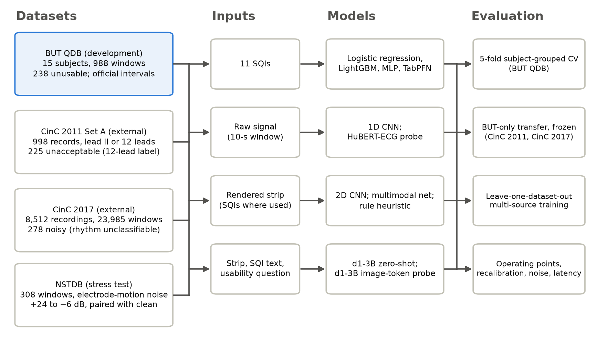
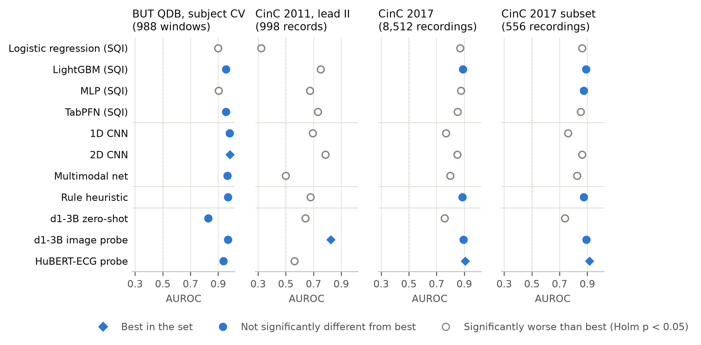
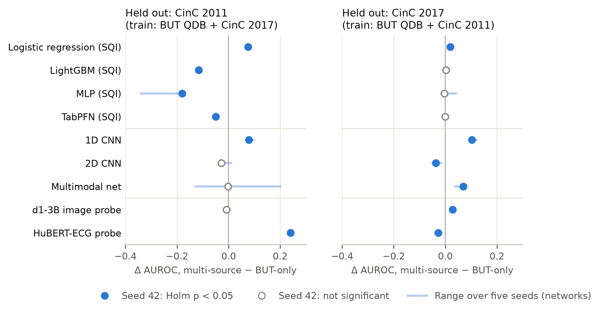
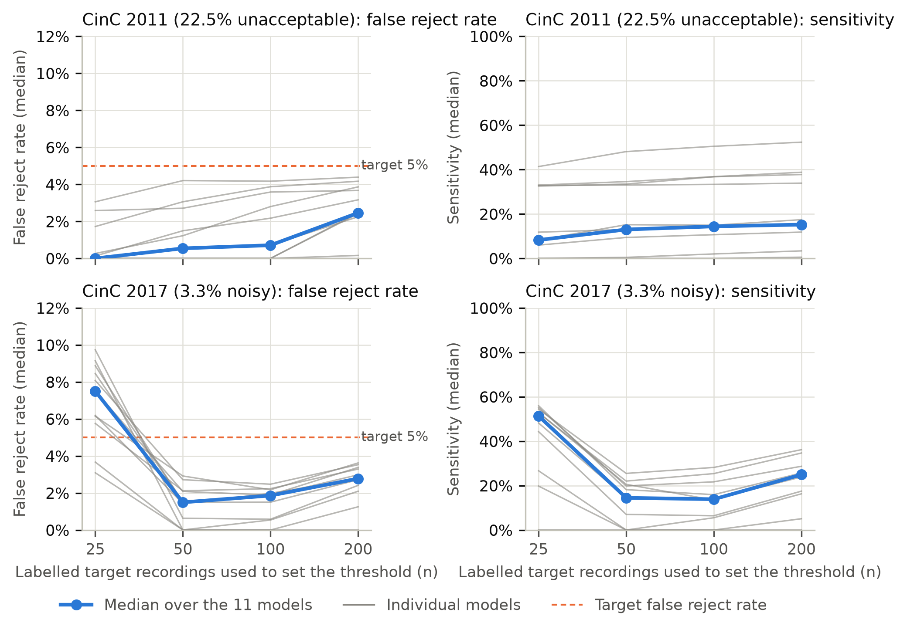

# Foundation-model representations versus task-specific classifiers for ECG usability screening under dataset shift: a patient-independent, multi-dataset benchmark

## Abstract

**Objective.** To test whether frozen foundation-model representations transfer across electrocardiogram (ECG) datasets better than task-specific classifiers for usability screening, and whether a multimodal model can screen zero-shot.

**Methods.** Eleven approaches (signal-quality-index models; raw-signal, image and multimodal networks; a rule heuristic; zero-shot LiquidAI d1-3B; probes on frozen d1-3B and HuBERT-ECG) were developed on BUT QDB (988 10-s windows, 15 subjects) with subject-grouped cross-validation and applied unchanged to CinC 2011 (998 records), CinC 2017 (8,512 recordings, 3.3% noisy) and, post hoc, PTB-XL (600 records; annotated-noise proxy).

**Results.** In-domain, eight approaches (one hand-set) reached AUROC 0.938–0.985, none significantly below best. Zero-shot d1-3B was weak (0.828 in-domain; 0.641 and 0.757 externally). The d1-3B probe alone was never significantly behind the best across BUT QDB, CinC 2011 and full/balanced CinC 2017. It was highest on CinC 2011 (0.824 versus 0.787; Holm-adjusted p = 0.003; 0.951 post hoc with 12 leads), but not significantly without 73 flat-lead records (0.740 versus 0.716; p = 0.069). HuBERT-ECG was highest on CinC 2017 (0.906), near chance on CinC 2011 (0.562). On PTB-XL the probe exceeded the 2D CNN (0.579 versus 0.501; adjusted p = 0.001) but was weak and significantly below HuBERT-ECG (0.736). At 3.3% prevalence, thresholds re-set on 100 labelled recordings kept median sensitivity below 30%.

**Conclusions.** Zero-shot d1-3B was inadequate as tested; a probe on its frozen representation transferred most consistently to usability labels, weakly to annotated noise. Foundation-model representations did not transfer uniformly, in-domain results did not identify the best-transferring model, and thresholds need local calibration.

**Keywords:** electrocardiogram; signal quality; external validation; dataset shift; foundation models; benchmark

## 1. Introduction

Automated ECG interpretation is only as reliable as the signal it is given. Deep networks can now classify rhythm from single-lead ambulatory recordings [1] and diagnose abnormalities from 12-lead ECGs [2], but in ambulatory, wearable and handheld recordings motion artefact, electrode contact loss, baseline wander and muscle noise can make a segment unusable for analysis. A quality gate that rejects such segments, or prompts a new recording, is the first step of most analysis pipelines [3–5]. Its errors have direct costs: monitors in intensive care generate a large alarm burden [6], and signal quality indices have been used to reduce false arrhythmia alarms [7].

Quality assessment has moved through three generations. The first used hand-crafted signal quality indices (SQIs) and rule-based fusion [4, 5, 8], with many variants developed around the 2011 PhysioNet Challenge: measures from basic signal properties and QRS detection [9], a first step that rejects macroscopic errors such as absent or saturated signals [10], noise-specific threshold tests [11], vectorcardiographic features with a self-organizing map [12], cross-covariance among leads [13], and later heuristic SQI fusion for single-lead signals [14] and feature reduction for portable devices [15]. The second learned from raw signals, spectrograms or images [16–21]. The third is under way: multimodal networks have combined ECG with text for quality assessment [22], and a self-supervised foundation model has been proposed for low-quality photoplethysmography [23].

Foundation models are the natural next candidates for this task because they arrive already trained. ECG-specific models [24–28] offer frozen representations that can be read out with a linear probe, tabular foundation models such as TabPFN [29] remove most of the tuning burden from SQI classifiers, and multimodal systems have been applied to zero-shot ECG classification and to reading ECG images [30–33]. Open-weight vision-language decision models such as LiquidAI d1-3B [34] go further: they are designed to answer a structured question from an image and a short text in a single forward pass, with no task-specific training. Whether such models can replace task-specific classifiers for ECG quality is unknown.

The evidence needed to answer this is difficult to assemble. Studies differ in the quality definition, which may be QRS detectability, full-waveform usability or 12-lead diagnostic acceptability [35–37]; in whether windows from the same subject appear in both training and test data; and in whether models are tested on data other than their own. When models move to new data, ranking, calibration and operating points can all change [38–40]. Cross-dataset evaluation of ECG quality models, including multi-source training, has been reported [40]; less often available is a comparison that puts many model families, including foundation-model representations, under one patient-independent protocol, with formal paired tests, on external datasets with different reference labels, and that also examines whether operating points transfer.

This study asks one question: under dataset shift, do frozen foundation-model representations hold up better than classifiers built for the task? We compare eleven approaches under one protocol: tabular SQI models, including a tabular foundation model; raw-signal, image and multimodal networks; a rule heuristic; zero-shot d1-3B; and linear probes on the frozen representations of d1-3B and of the ECG foundation model HuBERT-ECG. The intended use is an automatic gate placed before downstream ECG analysis, whose output would be used by developers and operators of such pipelines to discard a segment or request a new recording; it is not intended to replace clinical interpretation. Three external evaluations with different reference labels (12-lead acceptability, single-lead rhythm classifiability at natural prevalence, and paired electrode-motion stress), together with leave-one-dataset-out multi-source training, show how much of each in-domain advantage survives transfer. We then examine why transfer fails, whether operating points and calibration transfer, and what each pipeline costs to run.

## 2. Methods

### 2.1 Datasets

The Brno University of Technology ECG Quality Database (BUT QDB) [41, 42] served as the development dataset. It contains 18 long-term single-lead recordings from 15 subjects, sampled at 1,000 Hz. Three experts annotated the recordings into three quality classes [35]: in Class 1, full-waveform analysis is possible; in Class 2, only QRS detection is reliable; and in Class 3, QRS detection is not possible. The usability target was Class 3 versus Classes 1–2. We used the consensus annotations inside the intervals evaluated by the official protocol of the dataset's descriptor [42], which excludes a 13-h stretch of missing signal at the start of record 105001. The non-overlapping 10-s windows inside these intervals number 28,276 (605 Class 3, 2.14%). The cohort was drawn as a quota sample of up to 50 usable and up to 60 unusable windows per subject, evenly spaced in time over all annotated intervals; the 59 sampled windows outside the official intervals, all unusable and all from record 105001, were then removed (section 2.6). This left 988 windows (238 unusable, 24.1%) from 17 records and 15 subjects. Because the quota was applied before the restriction, subject 105 contributes 1 unusable window, although 54 Class 3 windows of that subject lie inside the official intervals (Table S43). Unusable windows occur in 7 subjects (Table S12). Windows were resampled to 500 Hz with the Fourier method.

CinC 2011 Set A provided the first external evaluation, with a 12-lead label. Its 998 labelled records (225 unacceptable, 22.5%; 773 acceptable) are 10-s 12-lead recordings at 500 Hz, labelled acceptable or unacceptable for 12-lead interpretation [36, 37]. Lead II was scored in the primary analysis, and all 12 leads in a sensitivity analysis.

CinC 2017 provided a single-lead label at natural prevalence. The dataset contains 8,528 handheld single-lead recordings (300 Hz, 9–61 s), labelled normal rhythm, atrial fibrillation, other rhythm, or too noisy to classify [43]. The "too noisy" label marks recordings whose rhythm cannot be classified from the lead, and it was the unusable target. After excluding 16 recordings shorter than 10 s, 8,512 recordings remained (278 noisy, 3.3%). Each recording was split into up to three 10-s windows (23,985 windows) and resampled to 500 Hz; the primary recording score is the maximum window score.

The MIT-BIH Noise Stress Test Database (NSTDB) [44] was used for controlled stress: electrode-motion noise added to MIT-BIH records 118 and 119 at nominal SNRs of +24 to −6 dB. The noise segments (300–420 s and 540–660 s, verified against the signals) provided 264 noisy windows, namely 2 records × 6 SNR labels × 2 segments × 11 windows of 10 s starting 5 s into each segment. Each noisy window was paired with the clean base-record window at the same start time (44 clean windows). Figure 1 summarises the data flow.

*Figure 1. Data flow and evaluation design. Counts are windows or recordings after the exclusions described in section 2.1. Source: cohort manifests and Table S28.*

### 2.2 Inputs

Eleven SQIs [4, 5, 8] were computed per window and form the tabular input of every SQI-based model: bSQI, the agreement of the Pan–Tompkins [45] and a difference-based QRS detector with a 50-ms tolerance; the spectral baseline-wander, high-frequency, QRS-band and powerline ratios; the saturation and flatline fractions; kurtosis and skewness; the zero-crossing rate; and the amplitude standard deviation. Amplitudes were harmonised to mV before feature extraction. Full SQI definitions, network architectures, the heuristic formula and the d1-3B prompt are given in the Supplementary Methods.

Edge cases were handled deterministically. The extractor sets undefined (non-finite) values to 0 and clips the spectral ratios and moments to fixed ranges; clipping affected 3 (BUT QDB), 15 (CinC 2011) and 122 (CinC 2017) kurtosis or skewness values. A constant window receives flatline and saturation fractions of 1 and bSQI 0; this occurred in 73 CinC 2011 lead-II records, all unacceptable, and in no other dataset. Recordings shorter than one window were excluded (section 2.1).

Image inputs are rendered 10-s strips (513 × 257 px) with a light grid and a per-strip vertical scale (1st–99th percentile, at least 1 mV). Raw-signal models receive the 5,000-sample window, z-scored per window; the z-scoring divides by 1 when the SD is below 10^-6.

### 2.3 Models

The tabular models were an L2 logistic regression on standardised inputs; LightGBM (100 trees, depth 4, learning rate 0.05); a two-layer MLP with 64 and 32 units, each followed by batch normalisation and ReLU, with dropout 0.2 after the first layer (3,073 parameters); and TabPFN-3 [46], a pre-trained tabular foundation model building on earlier TabPFN versions [29], used without tuning. For TabPFN we used the `tabpfn` package 9.0.0 with the checkpoint file `tabpfn-v3-classifier-v3_default.ckpt` (model name TabPFN-v3, architecture `tabpfn_v3`; SHA-256 prefix d0d865d5), loaded explicitly by path, so no automatic model-version selection was involved. Inference used the package defaults (number of estimators and softmax temperature `auto`, no probability balancing), random state 42, on the CPU.

The raw-signal model was a four-block 1D CNN (167,489 parameters), the image model a four-block 2D CNN (245,697 parameters), and the multimodal model a gated fusion of a three-block image encoder and an SQI branch (131,841 parameters). The rule heuristic is a fixed weighted mixture of two sigmoid scores, one from five SQIs and one from two strip-image features, with hand-set coefficients and no trainable parameters (Supplementary Methods S-M3). Its coefficients were set during the initial prototyping of the analysis code, and their independence from BUT QDB cannot be guaranteed. To obtain a leakage-free in-domain estimate, the same seven inputs were also given to a standardised L2 logistic regression (C = 1, no tuning) fitted inside the same folds and transferred like the other models. This replacement changes the functional form as well as the coefficients, because the heuristic mixes two separate sigmoid outputs and caps two inputs. The hand-set rule is retained in the paired-comparison families because it is the deployable artefact.

The zero-shot vision-language model was LiquidAI d1-3B (3.12 × 10^9 parameters) [34], an open-weight decision model built on LFM2.5-VL-3B with a SigLIP2 NaFlex shape-optimized 400M image encoder. It receives the strip, a text summary of 10 inputs (eight SQIs, window duration and sampling rate) and a usability question, and returns class probabilities from a single forward pass without task-specific training. Two alternative prompt configurations were evaluated as a sensitivity analysis.

Two frozen foundation models were read out with linear probes. Both probes used the same classifier, a standardised L2 logistic regression whose penalty (C ∈ {10^-3, 10^-2, 10^-1, 1}) was chosen by inner subject-grouped cross-validation within the training data. The d1-3B image-token probe uses the mean image-token embedding after the multimodal projector, captured in the primary zero-shot forward pass; the final hidden state at the answer position was probed as a secondary representation. The HuBERT-ECG probe uses the time-averaged last hidden state of HuBERT-ECG base [28], a self-supervised ECG foundation model (93 M parameters). This model takes 12 leads × 5 s at 500 Hz, flattened and decimated to 6,000 samples. We placed the single lead in the lead II slot with the other leads set to zero, and averaged the embeddings of the two 5-s halves of each window. Preprocessing follows the authors' public code, which we re-implemented and checked against it: a 151-tap FIR band-pass filter (0.05–47 Hz, forward-backward) followed by per-lead min-max scaling to [−1, 1] over the 10-s window. The authors do not address absent leads; their scaling maps the zero leads to −1, and this was kept. In a secondary analysis, the last four transformer layers of HuBERT-ECG and a linear head were fine-tuned with the rest of the model frozen (AdamW, learning rates 10^-5 and 10^-3, 10 epochs, batch size 16, class-weighted loss, seed 42), and evaluated in the same folds and by BUT-only transfer, but not in leave-one-dataset-out training. For the 12-lead sensitivity analysis of CinC 2011, each lead was placed in turn in the lead II slot, as for every other model. As a secondary analysis, the record's real 12 leads were also given in one input, ordered I, II, III, aVR, aVL, aVF, V1–V6; the CinC 2011 files store aVF before aVL, and the order the model expects is not stated in its documentation, so this order is an assumption.

The task-specific networks (CNNs, multimodal net and MLP) used AdamW (learning rate and weight decay 10^-3), class-weighted binary cross-entropy, 25 epochs (MLP: 35), no early stopping and seed 42; logistic regression and LightGBM used balanced class weights. The hyperparameters of the task-specific models were fixed and not tuned. For the primary unchanged-transfer analyses, target evaluation data were not used for model fitting, hyperparameters or threshold selection, and in leave-one-dataset-out training the held-out dataset was used only for testing. In the local-adaptation experiments, labelled target recordings were split into calibration and evaluation sets within each draw. Post-hoc operating points are reported only as descriptive reference values.

### 2.4 Evaluation protocols

In-domain performance was estimated with five subject-grouped folds on BUT QDB (three subjects per fold). Scalers, probes and thresholds were fitted on training folds only; no subject appears in more than one fold, and windows do not overlap. Each fold's unusable windows came from only one or two subjects, so fold-level AUROCs would mostly reflect single subjects. In-domain performance is therefore reported as the AUROC of the pooled out-of-fold predictions, with subject-level cluster-bootstrap intervals.

A secondary analysis followed the official train/test partition of BUT QDB [42] (11 records from 8 subjects versus 7 records from 7 subjects): models were retrained on the 546 cohort windows of the official training records (146 unusable) and tested on the 442 windows of the official test records (92 unusable). The task remains window-level and binary, so the official sample-level three-class metric is not used.

For single-source transfer, models were trained on all of BUT QDB and applied unchanged to the external datasets, with scalers fitted on BUT QDB only. For leave-one-dataset-out (LODO) training, models were trained on two of BUT QDB, CinC 2011 and CinC 2017 and tested on the third, with the same fixed hyperparameters. When CinC 2017 was a training source, we used all noisy recordings and 1,000 random non-noisy recordings (seed 42), 1,278 recordings in total (3,437 windows, 589 unusable), and copied the recording label to its windows. The three training sets comprised 4,435 windows (814 unusable) with BUT QDB held out, 4,425 windows (827 unusable) with CinC 2011 held out, and 1,986 windows (463 unusable) with CinC 2017 held out. The rule heuristic is not trained and is reported unchanged. The d1-3B probe was run in the same splits, with features extracted for all 23,985 CinC 2017 windows, and the probes' inner cross-validation grouped training windows by subject (BUT QDB) or recording (CinC). The seed-dependent networks (MLP, both CNNs and the multimodal net) were repeated with training seeds 1–4 in addition to 42, both for BUT-only training and for LODO. A LODO effect was called consistent if its sign agreed in all five seeds and its median magnitude was at least 0.02. Logistic regression and LightGBM use a fixed random state, and the probes are deterministic given their features.

For noise stress, we computed the usable probability per SNR label and its paired change relative to the clean partner window.

Besides the default threshold (0.5), two operating rules were applied: Target 1, the maximum sensitivity at FPR ≤ 5%, and Target 2, the minimum FPR at sensitivity ≥ 80%. Thresholds were chosen in four ways: (a) post hoc on the evaluated data, as a reference only (Tables S10 and S14); (b) by nested cross-validation within the training subjects of each fold; (c) on pooled BUT QDB out-of-fold scores, transferred unchanged to the external datasets; and (d) locally, on n = 25, 50, 100 or 200 randomly drawn labelled target recordings (500 draws each), with evaluation on the remaining recordings. If a draw in (d) contained only one class, the transferred threshold was used and the draw was counted. In (d), Platt scaling fitted on the same draws was also compared with the uncalibrated scores by the Brier score; this analysis is descriptive.

BUT QDB precision metrics were re-weighted from the sampled prevalence (24.1%) to the natural prevalence inside the official intervals (2.14%, the primary reference because it matches the study population), and also to 16.0%, the prevalence over all annotated intervals including the excluded stretch. CinC 2017 was evaluated at its natural prevalence of 3.3%.

Two further secondary analyses addressed the image pipeline and one input. To test whether the rendering step can be removed, the 2D CNN was retrained from scratch on strips drawn by a direct raster renderer (PIL) instead of the plotting library, in the same folds and by BUT-only transfer. To test a flatline definition insensitive to amplitude quantization, an exploratory analysis replaced the flatline input of the three SQI models with the fraction of samples lying inside any window of at least 1.0 s with a peak-to-peak amplitude of at most 0.02 mV; both constants were fixed from physiological reasoning without tuning (section 2.6).

Three further post hoc analyses followed a dated written plan (section 2.6). First, a frozen test used PTB-XL v1.0.3 [47], which was not used to develop any model here, with one record per patient and the 500-Hz signals. From the metadata alone (seed 42) we sampled 300 records with annotated global noise (`static_noise` or `burst_noise` containing "alles" or "noisy recording"), 300 with partial noise annotations (any entry in `static_noise`, `burst_noise` or `electrodes_problems`, and not global) and 300 clean records (no entry in these columns or in `baseline_drift`), with no patient entering twice. Records with baseline drift only and 501 records handled in an early pilot were excluded; a separate manuscript by the author uses PTB-XL features for a different task, and no model or threshold from it was used. Ten models, fitted on the 988 BUT QDB windows only and unchanged (all except TabPFN), scored each of the 12 leads (10,800 windows), and the recording score was the maximum or the mean over the leads. These noise columns mark noise in recordings that were still interpreted, so the outcome is a proxy for unusability; the sampled prevalence is artificial, so no threshold or precision metric is interpreted. The primary endpoint was the AUROC for global noise versus clean. The primary tests compared the d1-3B image probe with the 2D CNN under each rule (DeLong, Holm over two), and the hypothesis counted as supported only if the probe was higher with p_Holm < 0.05 under both. Secondary analyses compared the probe with the other nine models (both rules, Holm over 18 tests), gave the AUROC for partial noise versus clean without tests, and repeated the AUROC without records having a constant lead (descriptive).

Second, the effect of a quality gate on a downstream task was measured on the 8,234 CinC 2017 recordings with a rhythm label. A 3-class (normal, atrial fibrillation, other) 1D CNN with fixed architecture and no tuning was trained on the existing 10-s windows (5-fold cross-validation stratified by rhythm, with folds by recording, seed 42), and a recording's probability was the mean over its windows. The quality scores were the recording-maximum scores of the primary analysis, from models fitted on BUT QDB only, which never saw rhythm labels. The endpoint was the macro-F1 over the three rhythms on the recordings retained after rejecting the 10% with the highest quality score (primary), or 5% or 20% (secondary); a fixed fraction avoids choosing a threshold. The change from no rejection was compared with random rejection of the same fraction (1,000 repetitions), with 95% bootstrap intervals over recordings (2,000 resamples), without tests. Recordings labelled too noisy have no rhythm label and could not enter, so the main expected effect of a gate, removing them, is not measured.

Third, the constant score of the multimodal net on CinC 2011 was diagnosed descriptively: the standardised inputs were compared with BUT QDB, and CinC 2011 lead II was rescored with each input stream alone and with the flatline input replaced by the quantization-insensitive measure.

### 2.5 Statistical analysis

The positive class was unusable. Discrimination was summarised by the area under the receiver operating characteristic curve (AUROC) and average precision (AP), calibration by the Brier score and by the calibration intercept and slope on the logit scale (probabilities clipped to [10^-6, 1 − 10^-6]; ideal values 0 and 1 [48]), and decisions by sensitivity and the false reject rate (FR), the proportion of usable recordings flagged as unusable. With unusable as the positive class, FR equals the false-positive rate (FPR). A negative intercept indicates overestimated risk and a slope below 1 indicates predictions that are too extreme [48]; the intercept is interpreted only externally, because calibration-in-the-large is uninformative at internal validation [48]. Confidence intervals used a subject-level cluster bootstrap on BUT QDB, where windows of a subject are correlated, and a recording-level bootstrap externally (1,000–2,000 resamples).

Models were compared pairwise on identical units: on BUT QDB with a subject-level cluster bootstrap of the AUROC difference (2,000 resamples; a bootstrap p-value is reported no lower than its resolution, 0.0005), and on the external datasets, where recordings are independent, with DeLong's test [49]. As an implementation check on one pair (d1-3B probe versus 2D CNN on CinC 2011), the DeLong and recording-bootstrap 95% intervals for the AUROC difference were 0.018–0.057 and 0.017–0.057. Within each evaluation set, all pairwise comparisons formed one family and were Holm-adjusted [50]. The families were BUT QDB, CinC 2011, CinC 2017 and the balanced 556-recording CinC 2017 subset (all 278 noisy recordings and 278 sampled non-noisy recordings), each with 11 models (55 comparisons). LODO effects (multi-source versus BUT-only) were Holm-adjusted within each held-out dataset. As a sensitivity analysis, the ten comparisons with the best model of each set were also adjusted as a separate family (Table S31); this family is defined after seeing the point estimates. The official-partition analysis and the raster comparison were each Holm-adjusted over their own comparisons, and the three comparisons of the heuristic with its logistic-regression replacement (one per dataset) are reported unadjusted. The recording-mean aggregation, 12-lead aggregation, local recalibration, fine-tuning, constant-lead check and flatline analysis are descriptive and were not tested. Three analyses were added after an independent audit of the code and results (section 2.6): the CinC 2011 family of 55 paired DeLong tests was repeated without the records that have a constant lead II, with the same Holm adjustment (Table S40); AUROC was computed inside each BUT QDB subject that has both classes (Table S41); and CinC 2017 AUROC was stratified by the number of windows per recording (Table S42). The last two are descriptive.

Rankings are reported only where the adjusted comparison supports them. External rankings refer to the recording-maximum aggregation; the recording mean is a sensitivity analysis. The study is reported following TRIPOD+AI [51], and the completed checklist is provided as a supplementary file.

### 2.6 Deviations from the analysis plan

The study was not registered, and the original analyses had no written protocol. The analyses reported here followed a dated written plan kept with the code. Several decisions were nevertheless taken after results had been seen, so the external evaluations cannot be regarded as fully blind. (1) The primary BUT QDB cohort originally had 1,047 windows, including 59 windows from the stretch later excluded by the official protocol, all of them unusable. They were removed and every model retrained; folds were unchanged. (2) CinC 2011 originally comprised 565 of the Set A records, used during development of the analysis; the full 998-record set replaced it, and the earlier subset analyses were dropped. (3) Window duration and sampling rate, constant after resampling, were removed from the tabular input (13 to 11 inputs). (4) The d1-3B linear probe was introduced after the zero-shot results were known, and the statement that it is never significantly behind the best was first made on the earlier cohort. Two representations were probed in the same run, including on the earlier CinC 2011 subset, and no record made before those results names the image tokens as primary; the choice of the image-token probe over the decision-state probe should therefore be regarded as informed by the results. (5) The 12-lead aggregation rules and the CinC 2017 window mean were chosen after the main analysis; the d1-3B and HuBERT-ECG probes were scored on 12 leads after the other models' 12-lead results were known, with the same rules and with their paired tests fixed beforehand, and the analysis excluding records with a constant lead was added after its first results; and TabPFN, the HuBERT-ECG probe and LODO were added after the single-source results were known. (6) The quantization-insensitive flatline measure was conceived after the CinC 2011 results; it is exploratory, its definition was written down before it was applied to CinC data, and a companion saturation measure was withdrawn after failing a synthetic test. (7) The PTB-XL test, the gating analysis and the multimodal diagnosis were added during revision, when all other results were known. Their plan was written before PTB-XL signals were scored by any model of this study, apart from the excluded pilot records, and before the gating analysis was run, and it fixed the sampling, models, endpoints and tests; no model, threshold, sampling or outcome definition was changed after these results were seen. (8) After an independent audit of the code and saved predictions, when all results were known, three sensitivity analyses were added from saved predictions without refitting any model: the paired tests on CinC 2011 without constant-lead records, the per-subject AUROCs on BUT QDB, and the stratification of CinC 2017 by number of windows (Tables S40–S42). The audit also showed that the cohort quota had been applied before the restriction to the official intervals (section 2.1; Table S43). Model hyperparameters were not changed after any of these steps. Results on the earlier cohort remain in the project's version history.

### 2.7 Computational cost and reproducibility

Latency was measured on an Apple M4 (10-core CPU, 10-core GPU, 16 GB) with synchronised GPU timing, in one session with no other computation running: three runs of 25 windows, separating rendering, SQI extraction, resampling from the native 1,000-Hz signal, and forward passes on CPU and GPU. Table 5 times each model from the stored 500-Hz window: resampling was done offline, so the preprocessing time of the 1D CNN is near zero, and per-window z-scoring is part of its forward pass. Times from the native 1,000-Hz signal, and CPU times, are in Table S8. The foundation-model probes and TabPFN were timed with the harness of Table S8 and are reported in Table S25.

Code, fixed seeds, pinned dependency versions, saved predictions and the scripts that generate every table are available, and every table is produced from saved outputs by script. Unit tests cover the metrics, the paired tests, fold disjointness and the feature definitions.

## 3. Results

### 3.1 In-domain AUROCs clustered above 0.93 and did not identify the best-transferring model

On BUT QDB, eight models reached a pooled out-of-fold AUROC of 0.938–0.985 (Table 1; per-model details in Table S1; 95% CIs for all 11 models in every evaluation set in Table S28). The 2D CNN reached 0.985, the 1D CNN 0.983, the rule heuristic and the d1-3B image probe 0.971, the multimodal net 0.966, LightGBM 0.957, TabPFN 0.956 and the HuBERT-ECG probe 0.938. None of the seven below the 2D CNN differed significantly from it after Holm adjustment (all p_Holm ≥ 0.640), which reflects limited power as much as similarity: without multiplicity adjustment the multimodal net and the HuBERT-ECG probe were below the 2D CNN (p = 0.043 and 0.016). The MLP (0.904) and logistic regression (0.899) were significantly below the best (both p_Holm = 0.028; no resample reversed the sign, so the unadjusted p is at its floor of 0.0005). Only 7 subjects have both classes, and inside them the models differed mainly in subject 111 (Table S41): there both CNNs kept an AUROC of 0.959–0.961, whereas the heuristic, LightGBM, logistic regression, the MLP, zero-shot d1-3B and the HuBERT-ECG probe had 0.689–0.765. Subject 105 has a single unusable window, which every model ranked first.

Because the coefficients of the rule heuristic may not be independent of BUT QDB, its in-domain estimate should be read with its leakage-free replacement: logistic regression on the same seven inputs, fitted inside the folds, reached 0.905 (Table S20).

Zero-shot d1-3B reached 0.828. Its deficit relative to the 2D CNN (0.157; 95% CI 0.045–0.304) was significant without adjustment (p = 0.001) and with the ten-comparison family (p_Holm = 0.008), but not over all 55 pairs (p_Holm = 0.051). The linear probe on the same model's frozen image tokens reached 0.971, a gain of 0.143 (95% CI 0.040–0.264; unadjusted p = 0.010, p_Holm = 0.440). The zero-shot prompt mattered: the image-only variant reached 0.918, but at τ = 0.50 it flagged 81.3% of usable windows (Table S17).

The models differed at the decision level more than in ranking (Table S32). Re-weighted to the 2.14% prevalence of the official intervals, the positive predictive value at τ = 0.5 was 0.67 for the 1D CNN, 0.53 for the 2D CNN, 0.51 for the heuristic, and 0.15–0.25 for the logistic regression, LightGBM and MLP models (Table S3). Sensitivity intervals were wide (for example 2D CNN 83.2%, 95% CI 51.9–100.0%) because unusable windows come from 7 subjects, and sensitivity varied widely between them (Table S12). Under nested threshold selection for Target 1, the 1D CNN and the heuristic stayed within 1 percentage point of the post-hoc sensitivity, whereas the 2D CNN, LightGBM, logistic regression and the multimodal net lost 5–21 points (Table S2).

Treating Class 2 as unusable as well (431 unusable windows) left the 2D CNN unchanged (0.985) and lowered zero-shot d1-3B to 0.760 and the multimodal net to 0.852 (Table S11). Under the official partition (Table S24), AUROC ranged from 0.723 (zero-shot d1-3B) to 1.000 (1D CNN and HuBERT-ECG probe), and no comparison with the best model was significant (all p_Holm = 1.000). Unusable windows occur in only three of the seven test subjects, mostly two, so this binary task on the official test set is close to ceiling and cannot separate the models.

### 3.2 External rankings differ between datasets

*Table 1. Pooled AUROC of each model per evaluation set; in parentheses, the Holm-adjusted p-value of the paired comparison with the best model of that set (bold). BUT QDB: subject-level cluster bootstrap; external sets: DeLong test. Models trained on BUT QDB only. Positive class: unusable.*

| Model | BUT_QDB (5-fold subject CV) | CinC2011 lead II (998 records) | CinC2017 (8,512 recordings) | CinC2017 balanced subset (556 recordings) |
| :--- | :---: | :---: | :---: | :---: |
| **Logistic Regression (SQI)** | 0.899 (p = 0.028) | 0.322 (p < 0.001) | 0.870 (p = 0.004) | 0.863 (p = 0.009) |
| **LightGBM (SQI)** | 0.957 (p = 1.000) | 0.752 (p < 0.001) | 0.891 (p = 0.844) | 0.892 (p = 1.000) |
| **Independent SQI MLP** | 0.904 (p = 0.028) | 0.675 (p < 0.001) | 0.876 (p = 0.031) | 0.875 (p = 0.132) |
| **1D CNN (Raw Signal)** | 0.983 (p = 1.000) | 0.695 (p < 0.001) | 0.768 (p < 0.001) | 0.761 (p < 0.001) |
| **2D CNN (Rendered Image)** | **0.985** (best) | 0.787 (p = 0.003) | 0.850 (p < 0.001) | 0.862 (p = 0.009) |
| **SinglePass Multimodal Net** | 0.966 (p = 1.000) | 0.500 (p < 0.001) | 0.799 (p < 0.001) | 0.826 (p < 0.001) |
| **Rule-Based SQI Heuristic** | 0.971 (p = 1.000) | 0.678 (p < 0.001) | 0.887 (p = 0.525) | 0.876 (p = 0.164) |
| **LiquidAI d1-3B (Zero-Shot)** | 0.828 (p = 0.051) | 0.641 (p < 0.001) | 0.757 (p < 0.001) | 0.739 (p < 0.001) |
| **TabPFN (SQI)** | 0.956 (p = 1.000) | 0.731 (p < 0.001) | 0.853 (p < 0.001) | 0.853 (p = 0.002) |
| **HuBERT-ECG probe** | 0.938 (p = 0.640) | 0.562 (p < 0.001) | **0.906** (best) | **0.916** (best) |
| **d1-3B image-token probe** | 0.971 (p = 1.000) | **0.824** (best) | 0.894 (p = 0.844) | 0.893 (p = 1.000) |

*Figure 2. AUROC of each model in the four evaluation sets. The marker shows the outcome of the Holm-adjusted paired comparison with the best model of that set: best (diamond), not significantly different (filled) or significantly worse (open). Rows are grouped into tabular models, task-specific networks, the rule heuristic and the foundation-model approaches. Dashed line: chance. Source: Table 1.*

On CinC 2011 (Table S13), where lead II is scored against 12-lead labels, the d1-3B image-token probe ranked recordings best (AUROC 0.824, 95% CI 0.789–0.856) and was significantly better than all ten other models, including the 2D CNN (0.787; difference 0.037, 95% CI 0.018–0.057; p_Holm = 0.003). The other foundation-model probe, HuBERT-ECG, was close to chance (0.562). The secondary probe of the d1-3B decision state was inverted (0.422; Table S18), which suggests that the useful information is in the image tokens rather than in the decision state. The multimodal net gave every record the same score (0.500), and the SQI logistic regression was inverted (0.322), as was its replacement for the heuristic (0.330). Across seeds 1–4 the multimodal net reached 0.501–0.671 (Table S9), so this value is seed-dependent. The constant score has an identifiable cause (descriptive diagnosis; Table S36). Flatline fractions in BUT QDB are near zero (SD 0.00013) because of the Fourier resampling described below, so the quantization repeats of CinC 2011 lead II gave standardised flatline inputs with a median of 2,286 SDs, all 998 records lying beyond 10 SDs. With the SQI stream alone the net again returned one score for every record. With the image stream alone the same fitted net reached 0.801, and replacing only the flatline input by the quantization-insensitive measure gave 798 distinct scores and 0.719. The value of 0.500 is therefore an input-scaling artefact in this seed and says nothing about the image stream.

Scoring all 12 leads changed the picture (Table S5; aggregation rules chosen after the main analysis; logistic regression, LightGBM, MLP, both CNNs, the multimodal net, the heuristic, zero-shot d1-3B and the two foundation-model probes; TabPFN was not scored on 12 leads). Averaging the leads gave 0.882 for the 2D CNN, 0.854 for LightGBM and 0.840 for the MLP, and the maximum gave 0.842 for the heuristic, 0.838 for the MLP and 0.813 for zero-shot d1-3B. The d1-3B image probe, fitted on BUT QDB only and scored on 12 leads after these results were known, reached 0.951 (95% CI 0.935–0.966) with the maximum and 0.944 (95% CI 0.926–0.959) with the mean. This exceeded the best other model under each rule: the heuristic with the maximum (difference 0.109, 95% CI 0.076–0.143) and the 2D CNN with the mean (difference 0.062, 95% CI 0.044–0.080; both p_Holm < 0.001, DeLong, Holm over four tests that also compared each rule with the probe's own lead II result, both also p_Holm < 0.001). Records with a flat lead contribute to this: 135 of the 998 records had at least one constant lead (129 of them unacceptable), and the number of constant leads alone gave an AUROC of 0.784. In a descriptive analysis without these records (863 records, 96 unacceptable; Table S35) the probe reached 0.902 with the maximum and 0.912 with the mean, against 0.854 and 0.878 for the 2D CNN. The HuBERT-ECG probe, scored on each lead in the same way, did not improve on its lead II result of 0.562: it reached 0.431 with the maximum and 0.510 with the mean, 0.520 and 0.434 below the d1-3B probe (both p_Holm < 0.001). Without the records with a constant lead its AUROC was 0.683 and 0.805. Given the real 12 leads in one input, it reached 0.267, below chance; its probe had been fitted on single-lead inputs only, so it was applied here to a kind of input it had not been fitted on. Logistic regression remained inverted under every aggregation. The gains indicate that part of the CinC 2011 gap is the single-lead versus 12-lead label mismatch.

A descriptive check showed that 73 of the 225 unacceptable CinC 2011 records have a constant lead II (Table S26). At τ = 0.50, all 73 were flagged by the MLP, both CNNs, the multimodal net, the heuristic, zero-shot d1-3B and the d1-3B probe, and none by logistic regression, LightGBM, TabPFN or the HuBERT-ECG probe. Without these records, AUROC fell for most models, the d1-3B probe remaining highest (0.740), followed by the 2D CNN (0.716) and the HuBERT-ECG probe (0.684), whose AUROC rose. When the paired tests were repeated on the remaining 925 records (152 unacceptable; Table S40; post hoc), the probe's margin over the 2D CNN was no longer significant (difference 0.024, 95% CI −0.002 to 0.050; unadjusted p = 0.069, p_Holm = 0.833), while the other nine models stayed significantly below the probe (all p_Holm ≤ 0.003). The probe's significant advantage over the 2D CNN on lead II therefore rests on records that a flat-line check alone would identify. BUT QDB contains no constant windows, so the trained models never saw this failure during development.

On CinC 2017 (Tables 3 and S27), a single-lead label at natural prevalence, the HuBERT-ECG probe had the highest AUROC (0.906, 95% CI 0.893–0.920). Three models were not significantly different from it: the d1-3B probe (0.894, p_Holm = 0.844), LightGBM (0.891, p_Holm = 0.844) and the rule heuristic (0.887, p_Holm = 0.525). All others were significantly worse: the MLP (0.876, p_Holm = 0.031), logistic regression (0.870, p_Holm = 0.004), TabPFN (0.853), the 2D CNN (0.850), the multimodal net (0.799), the 1D CNN (0.768) and zero-shot d1-3B (0.757). The 1D CNN had been second in-domain. With the recording mean instead of the maximum, every model's AUROC rose, by 0.025–0.083 (Table 3); the HuBERT-ECG probe (0.941), LightGBM (0.939) and the d1-3B probe (0.935) were highest. Recording length is confounded with the label under the maximum: 110 of the 278 noisy recordings but only 490 of the 8,234 others contributed a single window, and the number of windows alone gave an AUROC of 0.698 (Table S42; descriptive). Among the 7,561 recordings with three windows (143 noisy), the maximum gave 0.953 for the HuBERT-ECG probe, 0.951 for the heuristic, 0.929 for logistic regression, 0.924 for the d1-3B probe and 0.923 for LightGBM, so both the absolute values and the order of the leading models depend on recording length as well as on the rule. On the balanced 556-recording subset (Table S19), the HuBERT-ECG probe (0.916) was best, and the d1-3B probe (0.893), LightGBM (0.892), the heuristic (0.876) and the MLP (0.875) were not significantly different from it.

Across the four evaluation sets, the d1-3B image probe was the only model that was best, or not significantly different from the best, in every set. The two CinC 2017 sets are not independent of each other, and the claim rests on failing to reject differences in three of the four sets, so it is a statement of consistency, not of superiority. On CinC 2011, the one set where the probe was significantly best, that significance depends on the 73 constant-lead records (Table S40). It does not extend to the PTB-XL test (section 3.6).

In a single run of partial fine-tuning, HuBERT-ECG reached 0.947 on BUT QDB, 0.655 on CinC 2011 and 0.910 on CinC 2017 (Table S23). These values are descriptive: they were not tested against the probe and were not repeated across seeds.

Several SQIs reversed their association with unusability between datasets (Table S6; distributions by dataset and class in Table S29). As univariate AUROC on BUT QDB versus CinC 2011, the high-frequency ratio went from 0.722 to 0.307, the powerline ratio from 0.717 to 0.311 and the zero-crossing rate from 0.660 to 0.256. Two mechanisms contribute. The first is asymmetric preprocessing: BUT QDB windows are Fourier-resampled from 1,000 Hz, which removes exact repeats of consecutive sample values, so their flatline fraction is near zero, whereas CinC 2011 lead II is used at its native 500 Hz with 5-µV steps, so its flatline fraction largely counts quantization repeats, and acceptable records already have a median of 0.287. The second is the constant leads, which have high-frequency, powerline and zero-crossing values of 0 and so look like a clean signal under the BUT QDB associations (Table S30). Without those records the three AUROCs were 0.454, 0.461 and 0.379: the strong reversals largely disappear, but the features do not regain their BUT QDB direction. The SQI logistic regression likewise rose from 0.322 to 0.477 without them (Table S26). A descriptive input-sensitivity check on CinC 2011 (Table S15) points the same way: without the saturation and flatline inputs, logistic regression reached 0.759 and the MLP 0.778, and clipping standardised inputs to [−3, 3] alone gave logistic regression 0.760, so out-of-range inputs drive much of its failure.

Replacing the flatline input by the quantization-insensitive measure (exploratory; Table S34) changed CinC 2011 AUROC from 0.675 to 0.737 for the MLP, from 0.322 to 0.431 for logistic regression and from 0.752 to 0.759 for LightGBM, with changes of at most 0.012 on BUT QDB and at most 0.011 on CinC 2017 (no confidence intervals or tests were computed). The new measure is 0 in all 988 BUT QDB windows and therefore carries no information in training, so its effect is equivalent to removing the artefact-driven input, and logistic regression remained inverted. The definition does not resolve the transfer failure.

The hand-set heuristic outperformed its logistic-regression replacement in every evaluation (Table S20): on BUT QDB, 0.971 versus 0.905 (cluster-bootstrap p = 0.001); on CinC 2011, 0.678 versus 0.330 (DeLong p < 0.001); and on CinC 2017, 0.887 versus 0.864 (DeLong p < 0.001). Because the heuristic's coefficients may not be independent of BUT QDB, only the two external comparisons are informative.

Under paired electrode-motion stress (Tables S7 and S16), every trained model lowered its usable probability as noise increased. At 0 dB, the mean paired change was −0.94 for logistic regression, −0.90 for LightGBM, −0.84 for the multimodal net, −0.75 for the 2D CNN and −0.59 for the 1D CNN. Zero-shot d1-3B changed by at most 0.09 and did not track the noise.

### 3.3 Multi-source training helps some models and harms others

*Table 2. Leave-one-dataset-out AUROC [95% bootstrap CI] when training on the two other datasets (seed 42). Δ: paired difference from training on BUT QDB alone, with Holm adjustment within each held-out dataset. The rule heuristic has no trainable parameters. Seed repetition of the networks: Table S21.*

| Model | BUT QDB (train: CinC 2011 + CinC 2017) | CinC 2011 (train: BUT QDB + CinC 2017) | CinC 2017 (train: BUT QDB + CinC 2011) |
| :--- | :---: | :---: | :---: |
| **Logistic Regression (SQI)** | 0.671 [0.278–0.963]; Δ −0.228 (p_Holm = 1.000) | 0.398 [0.351–0.449]; Δ +0.076 (p_Holm = 0.004) | 0.890 [0.870–0.908]; Δ +0.020 (p_Holm = 0.036) |
| **LightGBM (SQI)** | 0.963 [0.922–0.988]; Δ +0.007 (p_Holm = 1.000) | 0.637 [0.599–0.674]; Δ −0.115 (p_Holm < 0.001) | 0.894 [0.879–0.908]; Δ +0.003 (p_Holm = 1.000) |
| **Independent SQI MLP** | 0.978 [0.920–0.999]; Δ +0.074 (p_Holm < 0.001) | 0.494 [0.482–0.505]; Δ −0.180 (p_Holm < 0.001) | 0.872 [0.856–0.886]; Δ −0.004 (p_Holm = 1.000) |
| **1D CNN (Raw Signal)** | 0.989 [0.975–0.999]; Δ +0.006 (p_Holm = 1.000) | 0.773 [0.735–0.809]; Δ +0.078 (p_Holm < 0.001) | 0.871 [0.856–0.885]; Δ +0.103 (p_Holm < 0.001) |
| **2D CNN (Rendered Image)** | 0.990 [0.979–0.998]; Δ +0.005 (p_Holm = 1.000) | 0.758 [0.720–0.794]; Δ −0.028 (p_Holm = 0.057) | 0.813 [0.789–0.837]; Δ −0.037 (p_Holm < 0.001) |
| **SinglePass Multimodal Net** | 0.736 [0.291–0.987]; Δ −0.230 (p_Holm = 1.000) | 0.498 [0.493–0.500]; Δ −0.002 (p_Holm = 0.735) | 0.870 [0.853–0.886]; Δ +0.070 (p_Holm < 0.001) |
| **Rule-Based SQI Heuristic** | 0.971 (fixed rule) | 0.678 (fixed rule) | 0.887 (fixed rule) |
| **LiquidAI d1-3B (Zero-Shot)** | — | — | — |
| **TabPFN (SQI)** | 0.918 [0.844–0.980]; Δ −0.038 (p_Holm = 1.000) | 0.682 [0.641–0.720]; Δ −0.049 (p_Holm < 0.001) | 0.852 [0.829–0.875]; Δ −0.000 (p_Holm = 1.000) |
| **HuBERT-ECG probe** | 0.988 [0.975–0.998]; Δ +0.050 (p_Holm = 0.056) | 0.802 [0.763–0.838]; Δ +0.240 (p_Holm < 0.001) | 0.879 [0.861–0.896]; Δ −0.028 (p_Holm < 0.001) |
| **d1-3B image-token probe** | 0.923 [0.870–0.990]; Δ −0.048 (p_Holm = 1.000) | 0.816 [0.780–0.849]; Δ −0.008 (p_Holm = 0.286) | 0.922 [0.911–0.933]; Δ +0.028 (p_Holm < 0.001) |

*Figure 3. Effect of multi-source training: AUROC when training on the two other datasets minus AUROC when training on BUT QDB alone. Markers: seed 42, filled if Holm-adjusted p < 0.05. Bars: range over five training seeds for the seed-dependent networks. Source: Table 2 and Table S21.*

Adding a second training source changed AUROC substantially, in both directions (Table 2). Across five training seeds (Table S21), five effects of the networks were consistent: the 1D CNN gained 0.078 on CinC 2011 and 0.116 on CinC 2017, the multimodal net gained 0.053 on CinC 2017, the 2D CNN lost 0.037 on CinC 2017, and the MLP lost 0.186 on CinC 2011. The 2D CNN on CinC 2011 (median −0.019) and the multimodal net on CinC 2011 (median −0.002, range −0.129 to +0.201) were not consistent. On the BUT QDB test, the multimodal net varied widely between seeds (0.736–0.970).

Among the other models, logistic regression improved on CinC 2011 (+0.076), although it remained below 0.5, and slightly on CinC 2017 (+0.020); LightGBM lost 0.115 on CinC 2011; and TabPFN lost 0.049 on CinC 2011. With only CinC data for training, logistic regression ranked BUT QDB windows poorly (0.671, 95% CI 0.278–0.963). The HuBERT-ECG probe gained most on CinC 2011, from 0.562 to 0.802 (p_Holm < 0.001), and lost slightly on CinC 2017 (−0.028, p_Holm < 0.001). The d1-3B probe was stable on CinC 2011 (0.816, Δ −0.008, p_Holm = 0.286) and gained on CinC 2017 (0.922, Δ +0.028, p_Holm < 0.001).

### 3.4 Operating points, calibration and prevalence

*Table 3. CinC 2017 at natural prevalence (8,512 recordings, 278 noisy), all 11 models trained on BUT QDB only. Recording maximum (primary); the last column uses the recording mean (sensitivity analysis). Sens./FR: sensitivity and false reject rate at τ = 0.50; PPV/NPV: positive/negative predictive value. Confidence intervals for decision metrics: Table S32.*

| Model | AUROC, recording max (pre-specified) | AP, recording max | Sens. / FR at τ = 0.50 | PPV / NPV at τ = 0.50 | AUROC, recording mean (post hoc) |
| :--- | :---: | :---: | :---: | :---: | :---: |
| **Logistic Regression (SQI)** | 0.870 | 0.175 | 81.7% / 20.8% | 0.117 / 0.992 | 0.919 |
| **LightGBM (SQI)** | 0.891 | 0.227 | 68.0% / 12.7% | 0.154 / 0.988 | 0.939 |
| **Independent SQI MLP** | 0.876 | 0.163 | 79.1% / 16.9% | 0.136 / 0.992 | 0.933 |
| **1D CNN (Raw Signal)** | 0.768 | 0.062 | 92.4% / 36.1% | 0.080 / 0.996 | 0.797 |
| **2D CNN (Rendered Image)** | 0.850 | 0.146 | 89.2% / 35.6% | 0.078 / 0.994 | 0.875 |
| **SinglePass Multimodal Net** | 0.799 | 0.088 | 92.8% / 45.6% | 0.064 / 0.996 | 0.882 |
| **Rule-Based SQI Heuristic** | 0.887 | 0.182 | 18.3% / 2.5% | 0.199 / 0.973 | 0.933 |
| **LiquidAI d1-3B (Zero-Shot)** | 0.757 | 0.113 | 19.8% / 3.1% | 0.177 / 0.973 | 0.816 |
| **TabPFN (SQI)** | 0.853 | 0.202 | 66.5% / 13.5% | 0.143 / 0.987 | 0.890 |
| **HuBERT-ECG probe** | 0.906 | 0.248 | 92.4% / 26.3% | 0.106 / 0.997 | 0.941 |
| **d1-3B image-token probe** | 0.894 | 0.241 | 86.3% / 23.5% | 0.110 / 0.994 | 0.935 |

At the 3.3% prevalence of CinC 2017, the positive predictive value at the default threshold was low for all 11 models (0.064–0.199; Table 3). The heuristic had the highest value (0.199), but at 18.3% sensitivity. Thresholds chosen on BUT QDB did not transfer (Table S4): the Target 1 rule (false reject rate ≤ 5% on BUT QDB) gave false reject rates on CinC 2017 of 7.6–58.1% for the trained models and 6.2% for the heuristic, whose sensitivity fell to 52.9%. On CinC 2011, the same thresholds gave sensitivities between 32.9% (MLP) and 100% at a false reject rate of 99.6–100% (heuristic and multimodal net).

Calibration did not transfer either (Table S32). On CinC 2017 the calibration intercept was negative for all 11 models (−2.47 to −14.75), indicating systematic overestimation of unusable risk after moving from 24.1% to 3.3% prevalence. Slopes ranged from 0.10 (1D CNN) to 2.87 (heuristic), and the HuBERT-ECG probe had the slope closest to 1 (0.93). On CinC 2011, calibration could not be estimated for the models with saturated scores.

*Table 4. Target 1 thresholds (maximum sensitivity at FPR ≤ 5%) re-set on n = 100 randomly drawn labelled target recordings and evaluated on the remaining recordings (500 draws; median and 2.5–97.5 percentiles over draws). Achieved FPR is given as the share of draws with FPR ≤ 5% and ≤ 7.5%; the 7.5% level is a tolerance for the sampling error of a threshold chosen on n recordings. Fallback: draws without a positive recording, for which the transferred threshold was kept. Brier: uncalibrated BUT-only score versus Platt scaling fitted on the same draws; the median is over the draws in which Platt scaling could be fitted, and the number skipped (single-class draws) is in parentheses. All sample sizes: Table S22.*

| Dataset | Model | n | Transferred threshold: FPR / Sens. (median) | Local threshold: FPR median [95% range] | Local threshold: Sens. median [95% range] | Draws with FPR ≤ 5% / ≤ 7.5% (local) | Fallback draws | Brier: raw → Platt (median; Platt skipped) |
| :--- | :--- | :---: | :---: | :---: | :---: | :---: | :---: | :---: |
| CinC2011 | **Logistic Regression (SQI)** | 100 | 100.0% / 67.1% | 0.0% [0.0–0.0%] | 0.0% [0.0–0.0%] | 100% / 100% | 0 | 0.849 → 0.126 (0) |
| CinC2011 | **LightGBM (SQI)** | 100 | 6.8% / 52.5% | 3.6% [0.1–8.0%] | 14.4% [0.0–54.7%] | 66% / 91% | 0 | 0.156 → 0.149 (0) |
| CinC2011 | **Independent SQI MLP** | 100 | 0.0% / 32.9% | 0.0% [0.0–0.7%] | 33.3% [30.9–36.3%] | 100% / 100% | 0 | 0.151 → 0.126 (0) |
| CinC2011 | **1D CNN (Raw Signal)** | 100 | 36.5% / 77.3% | 0.0% [0.0–9.6%] | 0.0% [0.0–5.7%] | 87% / 91% | 0 | 0.249 → 0.168 (0) |
| CinC2011 | **2D CNN (Rendered Image)** | 100 | 10.4% / 57.8% | 4.2% [0.0–8.9%] | 14.9% [0.0–56.6%] | 63% / 96% | 0 | 0.154 → 0.140 (0) |
| CinC2011 | **SinglePass Multimodal Net** | 100 | 100.0% / 100.0% | 0.0% [0.0–0.0%] | 0.0% [0.0–0.0%] | 100% / 100% | 0 | 0.774 → 0.175 (0) |
| CinC2011 | **Rule-Based SQI Heuristic** | 100 | 99.6% / 100.0% | 2.2% [0.1–9.3%] | 36.8% [31.6–44.2%] | 75% / 94% | 0 | 0.310 → 0.150 (0) |
| CinC2011 | **LiquidAI d1-3B (Zero-Shot)** | 100 | 100.0% / 99.5% | 0.0% [0.0–8.0%] | 36.8% [31.1–41.3%] | 94% / 94% | 0 | 0.603 → 0.148 (0) |
| CinC2011 | **d1-3B image-token probe** | 100 | 7.8% / 57.8% | 2.8% [0.1–9.1%] | 50.5% [37.3–58.9%] | 72% / 94% | 0 | 0.121 → 0.110 (0) |
| CinC2011 | **TabPFN (SQI)** | 100 | 21.8% / 59.2% | 3.9% [0.0–10.3%] | 10.7% [0.0–51.6%] | 63% / 95% | 0 | 0.162 → 0.154 (0) |
| CinC2011 | **HuBERT-ECG probe** | 100 | 45.9% / 51.2% | 0.7% [0.0–10.2%] | 2.0% [0.0–14.3%] | 81% / 88% | 0 | 0.280 → 0.175 (0) |
| CinC2017 | **Logistic Regression (SQI)** | 100 | 17.2% / 77.3% | 2.5% [0.0–17.2%] | 15.9% [0.0–77.3%] | 83% / 93% | 21 | 0.157 → 0.031 (21) |
| CinC2017 | **LightGBM (SQI)** | 100 | 16.7% / 79.1% | 1.9% [0.0–16.7%] | 21.7% [0.0–79.1%] | 85% / 94% | 21 | 0.097 → 0.029 (21) |
| CinC2017 | **Independent SQI MLP** | 100 | 7.6% / 48.2% | 1.9% [0.0–7.6%] | 13.9% [0.0–48.2%] | 86% / 95% | 21 | 0.125 → 0.030 (21) |
| CinC2017 | **1D CNN (Raw Signal)** | 100 | 55.9% / 99.6% | 0.0% [0.0–55.9%] | 0.0% [0.0–99.6%] | 95% / 95% | 21 | 0.321 → 0.032 (21) |
| CinC2017 | **2D CNN (Rendered Image)** | 100 | 48.6% / 95.3% | 0.6% [0.0–48.6%] | 6.4% [0.0–95.3%] | 89% / 93% | 21 | 0.292 → 0.031 (21) |
| CinC2017 | **SinglePass Multimodal Net** | 100 | 57.3% / 96.0% | 0.0% [0.0–57.3%] | 0.0% [0.0–96.0%] | 91% / 94% | 21 | 0.388 → 0.031 (21) |
| CinC2017 | **Rule-Based SQI Heuristic** | 100 | 6.2% / 52.9% | 2.2% [0.0–7.5%] | 13.5% [0.0–62.4%] | 77% / 97% | 21 | 0.095 → 0.031 (21) |
| CinC2017 | **LiquidAI d1-3B (Zero-Shot)** | 100 | 3.1% / 19.8% | 0.5% [0.0–7.0%] | 5.5% [0.0–33.2%] | 95% / 100% | 21 | 0.091 → 0.031 (21) |
| CinC2017 | **TabPFN (SQI)** | 100 | 28.0% / 84.5% | 1.5% [0.0–28.0%] | 13.9% [0.0–84.5%] | 86% / 94% | 21 | 0.105 → 0.030 (21) |
| CinC2017 | **HuBERT-ECG probe** | 100 | 58.1% / 99.6% | 2.2% [0.0–58.1%] | 28.2% [0.0–99.6%] | 87% / 95% | 21 | 0.176 → 0.029 (21) |
| CinC2017 | **d1-3B image-token probe** | 100 | 45.3% / 97.5% | 2.0% [0.0–45.2%] | 25.4% [0.0–97.5%] | 86% / 94% | 21 | 0.180 → 0.029 (21) |

Re-setting the threshold on a small labelled target sample brought false rejections close to the target in most draws (Table 4). On CinC 2011, with n = 100, the false reject rate was at most 5% in 63–100% and at most 7.5% in 88–100% of draws, depending on the model, and the median sensitivity was 50% for the d1-3B probe, 37% for the heuristic and 14% for LightGBM; it was 0% for logistic regression, the 1D CNN and the multimodal net. On CinC 2017, with n = 100, the false reject rate was at most 5% in 77–95% and at most 7.5% in at least 93% of draws, but the median sensitivity was only 0–28%. A draw of 100 recordings contains about three noisy recordings, so the threshold rests on very few positives, and 21 of 500 draws contained none. Even with n = 200, the median sensitivity remained 0–36% (Table S22).

*Figure 4. Thresholds re-set on n labelled target recordings (Target 1, false reject rate ≤ 5%), evaluated on the remaining recordings: median over 500 draws for each model (grey) and the median over models (blue). On CinC 2017, 229 of 500 draws at n = 25 and 82 at n = 50 contained no noisy recording and kept the transferred threshold, which explains the values at n = 25. Source: Table S22.*

Platt scaling on the drawn recordings lowered the Brier score of every model. On CinC 2017, however, the recalibrated Brier scores (0.029–0.032 at n = 100) were close to that of a constant prediction at the prevalence (0.032). Much of the gain therefore reflects a corrected probability level; this comparison does not establish that the recalibrated probabilities are well calibrated.

### 3.5 Computational cost

*Table 5. Per-window latency on an Apple M4 (median and 95th percentile of three runs of 25 windows), separating preprocessing from the forward pass.*

| Model Architecture | Parameters | Disk Weights | Execution Device | Preproc Median (p95) | Forward Median (p95) | Total Median (p95) | Total Median, Range over Runs | Preproc Share (Median of Ratios) |
| :--- | :---: | :---: | :---: | :---: | :---: | :---: | :---: | :---: |
| **Rule-Based SQI Heuristic** | 0 | 0.00 MiB | CPU | 2.32 ms (3.11 ms) | 0.21 ms (0.23 ms) | 2.53 ms (3.33 ms) | 2.46–2.76 ms | 91.5% |
| **Logistic Regression (SQI)** | 12 | 0.01 MiB | CPU | 1.36 ms (1.44 ms) | 0.18 ms (0.22 ms) | 1.54 ms (1.68 ms) | 1.47–1.56 ms | 88.3% |
| **LightGBM (SQI)** | 1,094 | 0.14 MiB | CPU | 1.35 ms (1.48 ms) | 0.18 ms (0.26 ms) | 1.53 ms (1.70 ms) | 1.47–1.53 ms | 88.2% |
| **Independent SQI MLP** | 3,073 | 0.01 MiB | Apple M4 (MPS) | 1.34 ms (1.62 ms) | 0.99 ms (1.12 ms) | 2.33 ms (2.66 ms) | 2.31–2.41 ms | 57.2% |
| **1D CNN (Raw Signal)** | 167,489 | 0.64 MiB | Apple M4 (MPS) | 0.00 ms (0.00 ms) | 1.28 ms (1.79 ms) | 1.28 ms (1.79 ms) | 1.27–1.46 ms | 0.0% |
| **2D CNN (Rendered Image)** | 245,697 | 0.94 MiB | Apple M4 (MPS) | 59.11 ms (135.57 ms) | 4.71 ms (5.20 ms) | 63.62 ms (140.60 ms) | 63.23–65.24 ms | 92.6% |
| **SinglePass Multimodal Net** | 131,841 | 0.47 MiB | Apple M4 (MPS) | 60.53 ms (129.28 ms) | 5.02 ms (5.60 ms) | 65.36 ms (134.31 ms) | 64.78–66.50 ms | 92.4% |
| **LiquidAI d1-3B (Zero-Shot)** | 3,120,000,000 | 5958.00 MiB | Apple M4 (MPS) | 61.19 ms (142.62 ms) | 833.34 ms (837.23 ms) | 894.41 ms (977.17 ms) | 893.97–894.43 ms | 6.8% |

For the image pipelines, rendering dominated: about 59 ms (93% of the total) against 4.7 ms for the forward pass. This cost belongs to the plotting library rather than to rasterization as such: a direct raster renderer took 0.62 ms (Table S8), and the 2D CNN retrained on such strips kept its discrimination (Table S33; AUROC on BUT QDB 0.980 versus 0.985, Δ −0.005, 95% CI −0.027 to 0.005; CinC 2017 0.852 versus 0.850; on CinC 2011 it improved, 0.798 versus 0.787, Δ +0.012, 95% CI 0.003–0.021, p_Holm = 0.025). The d1-3B probe and the multimodal net were not re-evaluated on raster strips. The 1D CNN, which needs no rendering step, took 1.28 ms on the GPU from the stored 500-Hz window (Table 5). d1-3B took 894 ms per window, dominated by its 833-ms forward pass. Forward-pass times of a few milliseconds on the GPU differ between our two timing scripts (Supplementary Methods S-M5), so only order-of-magnitude differences are interpreted. Among the foundation-model approaches (Table S25), the HuBERT-ECG probe took 33.1 ms per window on MPS (60.2 ms on the CPU), of which 28.7 ms was the forward pass; the linear d1-3B probe adds 0.12 ms to the d1-3B forward pass; and TabPFN, which predicts in context over the 988 training windows, took 3.8 s per window on the CPU.

### 3.6 On PTB-XL the probe exceeded the 2D CNN but discriminated annotated noise weakly

In the frozen PTB-XL test (Table S38; 300 records with global noise and 300 clean; no record had a constant lead), the d1-3B image probe reached an AUROC of 0.579 (95% CI 0.533–0.628) with the maximum and 0.592 (95% CI 0.547–0.641) with the mean, against 0.501 and 0.521 for the 2D CNN. The probe was higher under both rules (difference 0.078, 95% CI 0.031–0.125, p_Holm = 0.001; difference 0.071, 95% CI 0.031–0.111, p_Holm = 0.001), so the hypothesis fixed in the plan was supported. The probe was nevertheless not the best model, and its absolute discrimination of this proxy outcome was weak.

In the secondary comparisons (Table S39; Holm over 18 tests), the HuBERT-ECG probe (0.736 with the maximum, 0.694 with the mean) and LightGBM (0.689 and 0.694) were significantly above the d1-3B probe (all p_Holm < 0.001). The MLP (0.622 under both rules; p_Holm = 0.223 and 0.433) was not significantly different from it, nor was the 1D CNN under the mean (0.574; p_Holm = 0.433). The probe was significantly above logistic regression, the multimodal net, the heuristic and zero-shot d1-3B under both rules, and above the 1D CNN under the maximum (0.457). Zero-shot d1-3B was inverted (0.224 and 0.184), as was the heuristic (0.408 and 0.392) and, under the mean, logistic regression (0.299). The multimodal net again gave almost no discrimination (0.500 and 0.502). For partial noise versus clean, the d1-3B probe reached 0.515 and 0.519, with intervals that included 0.5, and the highest values were those of the HuBERT-ECG probe (0.678 and 0.643) and LightGBM (0.603 and 0.610).

### 3.7 Quality gating had a small effect on a downstream rhythm classifier

The rhythm classifier reached a macro-F1 of 0.719 on the 8,234 CinC 2017 recordings without any rejection (out-of-fold; Table S37). Rejecting the 10% of recordings with the highest quality score changed macro-F1, relative to random rejection, by 0.001 to 0.008 across the eleven quality models. The increases were largest for the d1-3B image probe (0.008, 95% CI 0.005–0.013) and the 1D CNN (0.008, 95% CI 0.004–0.013), and the only other model whose interval excluded zero was TabPFN (0.005, 95% CI 0.001–0.009). The d1-3B probe exceeded the 2D CNN by 0.007 (95% CI 0.002–0.011) and the HuBERT-ECG probe by 0.007 (95% CI 0.003–0.012). The change ranged from −0.001 to 0.007 when 5% were rejected and from 0.005 to 0.011 when 20% were rejected, where the intervals for the probe's lead over the 2D CNN and over the HuBERT-ECG probe both included zero. These intervals are not adjusted for the 11 models and three fractions. The d1-3B probe's 10% rejection removed 500 normal, 47 atrial fibrillation and 276 other-rhythm recordings, so it rejected a smaller share of atrial fibrillation (5.7% of rejected recordings against 9.2% of all recordings) and a larger share of other rhythms (33.5% against 29.3%).

## 4. Discussion

The primary question was whether frozen foundation-model representations hold up under shift better than classifiers built for the task, and the answer is qualified. The representation of a general-purpose vision-language model, read out by a linear probe, was the single most consistent approach: it had the highest AUROC on single-lead CinC 2011, significantly above the 2D CNN only when the constant-lead records were included, and was never significantly behind the best in the other usability evaluations, although it was significantly behind two models on the PTB-XL proxy outcome. Yet the same model's zero-shot decisions were among the weakest, the probe of its decision state was inverted on CinC 2011, and the ECG-specific foundation model HuBERT-ECG, best on CinC 2017, was near chance on CinC 2011. Being a foundation model does not guarantee robustness; which representation is read out, and from what input, matters more. The evidence favours the d1-3B image tokens for consistency rather than superiority, since on three of the four evaluations the claim rests on non-significant differences.

Used as intended, zero-shot, d1-3B flagged 997 of the 998 CinC 2011 records as unusable at the default threshold, did not track controlled noise and was the weakest model on CinC 2017, so in the input and prompting configurations tested its decisions are not adequate for ECG quality screening. The probe shows that task-relevant information is present in the representation; it does not identify every reason for the zero-shot failure. Reading out the representation requires labelled development data and carries the inference cost of the full 3.1-billion-parameter model, so the practical value of d1-3B lies in its representation rather than its decisions, and only where a latency of roughly one second per window on comparable hardware is acceptable.

The second finding concerns benchmarking itself, and it is negative and practical. On a patient-independent in-domain benchmark, eight models were indistinguishable after multiplicity adjustment, yet their external rankings disagreed. With 15 subjects, the absence of a significant difference does not establish equivalent performance. In-domain accuracy is necessary, but it does not select a model for a new device. The CNNs illustrate this: the 2D and 1D CNNs were the two highest in-domain, yet the 1D CNN fell to 0.768 on CinC 2017, below every other trained model, and the 2D CNN, second on CinC 2011, was significantly behind the leading models on CinC 2017.

The SQI analyses explain part of this pattern. Reversals in feature–outcome associations can undermine unchanged transfer, particularly for classifiers that rely strongly on those associations. TabPFN, which removes the tuning question for the tabular models, did not improve on their external results, which suggests that the feature representation limits transfer more than the classifier does. The quantization artefact in the flatline fraction is a concrete example of a feature whose meaning depends on the acquisition chain, here including our own preprocessing. The exploratory quantization-insensitive definition stopped the MLP and logistic regression from saturating on CinC 2011, but it could not supply information absent from the development data, because no flat segments occur in the development cohort. A feature definition cannot substitute for development data that contain the failure mode.

The hand-set rule outperformed a logistic-regression replacement using the same seven inputs. The results are consistent with the rule providing useful inductive biases, namely that low detector agreement, high noise power, saturation and flatline imply poor quality. Two caveats limit this interpretation: the replacement also changes the functional form, and the coefficients may not be independent of BUT QDB, so the interpretation rests on CinC 2011 and CinC 2017.

The HuBERT-ECG probe was best on CinC 2017 but near chance on CinC 2011. One explanation was the input: the model was pre-trained on 12-lead recordings and given one lead among eleven constant leads. Scoring all leads did not support this, although the probe had been fitted on single-lead inputs only, and a probe fitted on multi-lead inputs was not tested. Records with a constant lead contributed (0.736 on lead II without them), and multi-source training raised its CinC 2011 AUROC from 0.562 to 0.802. Probing frozen representations is cheap to set up and is a reasonable first adaptation step before fine-tuning, although its inference cost is that of the full foundation model. Preprocessing also matters for such models: an earlier implementation with a different filter and scaling changed its AUROC materially (Supplementary Methods S-M6).

The gating analysis tempers the importance of the ranking differences. On CinC 2017 recordings that already had a rhythm label, rejecting one recording in ten improved a rhythm classifier's macro-F1 by less than 0.01 under every quality model. This does not measure the main benefit of a gate, which is to stop recordings too noisy to label from reaching the classifier, and those recordings could not enter the analysis. It does show that, among labelled recordings, a better quality ranking translated into only a small downstream gain with this classifier, and whether a larger gain arises in other tasks, classifiers or datasets remains untested.

The frozen PTB-XL test limits the claim of consistency. The d1-3B probe exceeded the 2D CNN as specified beforehand, but it discriminated annotated noise weakly and fell significantly behind the HuBERT-ECG probe and LightGBM. HuBERT-ECG, near chance on CinC 2011, was best here, which is further evidence that model rankings depend on the dataset and the label. PTB-XL noise annotations mark recordings that were still interpreted, so a low AUROC does not show failure at usability screening, but the result cannot be read as extending the probe's consistency beyond the usability labels either.

Multi-source development is often recommended for robustness [40]. Here it helped the raw-signal CNN substantially and consistently across seeds, but it harmed the 2D CNN on CinC 2017 and the MLP on CinC 2011. Three features of the design are likely to contribute. The training sources carry different labels (single-lead classifiability, 12-lead acceptability and expert three-class quality), and they have very different sizes. Moreover, the source labels are transferred to single-lead 10-s windows: CinC 2017 recording labels are copied to every window, and CinC 2011 12-lead labels are assigned to lead II, which may be clean when another lead is not. For a deployment, the training sources and their label definitions matter as much as their number.

Four implications follow for deployment. First, thresholds and calibration must be set on the target population: operating points from BUT QDB did not carry over, and calibration intercepts on CinC 2017 were uniformly negative. Calibration deserves assessment at external validation [48], and at low prevalence local recalibration needs enough labelled positives rather than a fixed number of recordings: 100–200 recordings controlled false rejections but left sensitivity poorly determined, so an enriched calibration sample would be needed, for example one that oversamples flagged recordings for review. Second, precision at realistic prevalence is low unless sensitivity is sacrificed, so a quality gate should be judged by its false reject rate per hour of usable signal and by the cost of a missed unusable segment, not by AUROC. Third, the rendering step of image-based quality models is a removable engineering cost: a direct raster renderer was about two orders of magnitude faster than the plotting library, and retraining on it preserved the 2D CNN's discrimination. Fourth, a deployed quality gate needs an explicit check for constant or disconnected signals: logistic regression, LightGBM, TabPFN and the HuBERT-ECG probe scored completely flat CinC 2011 leads as usable.

### 4.1 Limitations

The development cohort is small: BUT QDB has 15 subjects, with unusable windows in only 7, and in one of them only a single window. Subject-grouped folds prevent identity leakage but cannot add diversity, so in-domain non-significance partly reflects limited power. Windows were sampled by quota (24.1% unusable), so precision is reported re-weighted, and the official sample-level three-class metrics were not computed. The NSTDB SNR labels are nominal, with one noisy record per label and base record. Performance was not assessed across demographic subgroups, body habitus, activity level or device population, which the 7 positive BUT QDB subjects (10 female and 8 male recordings, 21–83 years [42]) could not support; differences by sex, age or device population remain unknown, and known inequalities in signal acquisition could not be examined.

The reference labels differ by design: CinC 2011 judges the whole 12-lead recording while the primary analysis scores one lead, and CinC 2017 judges rhythm classifiability. External rankings also depend on the recording-level aggregation (Table 3) and, on CinC 2017, on recording length, because short recordings contribute fewer windows to the maximum (Table S42). Part of the CinC 2011 discrimination comes from 73 records with a constant lead II, without which the leading two models are not separated (Tables S26 and S40). TabPFN was not evaluated on 12 leads, and the 12-lead analyses of both probes are post hoc.

Model scope and robustness checks are limited. The task-specific models were not tuned, which may understate their performance. The reported networks use seed 42; seeds 1–4 changed in-domain AUROC by at most 0.006 but changed default-threshold sensitivity on CinC substantially, and the multimodal net's CinC 2011 result was seed-dependent (Table S9). TabPFN and the fine-tuned HuBERT-ECG are single runs and the probes are deterministic given their features, whereas LODO was repeated over five seeds, with its CinC 2017 training subset drawn once (Table S21). Prompt-variant analysis on CinC 2011 used 150 records (Table S17). d1-3B was not fine-tuned, few-shot prompting was not tested and other ECG foundation models [24–27] were not evaluated. Overlap between the pre-training corpora of the foundation models (9.1 million 12-lead ECGs for HuBERT-ECG) and the public evaluation datasets could not be excluded. Several analyses were decided after results were seen (section 2.6), so the external evaluations should not be read as fully independent confirmation.

Finally, latency was measured on one machine with Python implementations. GPU forward times of a few milliseconds differed between our two timing scripts (Supplementary Methods S-M5), so only order-of-magnitude differences are interpreted. The PTB-XL outcome is annotated noise in recordings that were still interpreted, a proxy for unusability, and the stratified sample has an artificial prevalence. The gating analysis used one untuned classifier on one dataset; CinC 2017 has no patient identifiers, so the independence of its recordings could not be verified; and the analysis cannot separate removal of poor signals from removal of recordings with hard rhythms. The diagnosis of the multimodal net concerns seed 42 only. Clinical utility and user interaction in a deployed workflow were not studied.

## 5. Conclusions

Under dataset shift, general-purpose foundation-model representations were neither uniformly robust nor uniformly fragile. A linear probe on the frozen image tokens of LiquidAI d1-3B was the only single-lead approach never significantly behind the best in four discrimination evaluations (a patient-independent development set, CinC 2011 and the full and balanced CinC 2017 sets, the last two not independent of each other), and had the highest AUROC on CinC 2011, where its margin over the 2D CNN was significant only with 73 flat-lead records included; in a frozen test against annotated noise in PTB-XL it exceeded the 2D CNN as specified beforehand but was weak (AUROC 0.579–0.592) and significantly behind the HuBERT-ECG probe and LightGBM; the zero-shot decisions of the same model were inadequate in the configurations tested, and the ECG-specific HuBERT-ECG probe, best on CinC 2017, was near chance on CinC 2011. In-domain performance did not identify the model that transferred best. Multi-source training had model-specific effects. Operating points and calibration chosen on development data did not transfer, and at low prevalence local recalibration on 100–200 labelled recordings controlled false rejections but not sensitivity. ECG quality models should therefore be evaluated externally, on data whose labels match the intended use, with thresholds set locally.

## Ethics, funding and competing interests

This study is a secondary analysis of public, de-identified PhysioNet datasets [36, 41, 43, 44], collected under the approvals stated by their providers (for BUT QDB, IRB Protocol EC:EK:05b/2018 of Brno University of Technology [41, 42]). No new data were collected from human participants, and ethical approval was not required for this secondary analysis. This research received no specific grant from any funding agency in the public, commercial or not-for-profit sectors. The author declares no competing interests. There was no patient or public involvement.

Generative-AI tools were used under the author's direction. Claude Code (Anthropic; Claude Opus 5.5) wrote and ran the analysis, table, figure and verification code and drafted and revised the manuscript text. Antigravity (Google; Gemini 4 Argon) was used to check code. Perplexity (GPT-6.1 Sol) was used to review manuscript drafts for errors and consistency. Critiques were checked against the stored outputs before changes were accepted. The author reviewed and approved the final manuscript and takes full responsibility for its content.

## Data and code availability

All datasets are public on PhysioNet [36, 41, 43, 44]. Code, saved predictions, pinned dependency versions, the dated analysis plan and the scripts that generate every table and figure are available at https://github.com/mkuntalp-ops/d13b-ecg-sqi. The d1-3B (Liquid AI), HuBERT-ECG and TabPFN weights are obtained from their providers under their own licences.

## References

[1] Hannun AY, Rajpurkar P, Haghpanahi M, et al. Cardiologist-level arrhythmia detection and classification in ambulatory electrocardiograms using a deep neural network. Nat Med. 2019;25(1):65–69. doi:10.1038/s41591-018-0268-3

[2] Ribeiro AH, Ribeiro MH, Paixão GMM, et al. Automatic diagnosis of the 12-lead ECG using a deep neural network. Nat Commun. 2020;11:1760. doi:10.1038/s41467-020-15432-4

[3] Satija U, Ramkumar B, Manikandan MS. A review of signal processing techniques for electrocardiogram signal quality assessment. IEEE Rev Biomed Eng. 2018;11:36–52. doi:10.1109/RBME.2018.2810957

[4] Clifford GD, Behar J, Li Q, Rezek I. Signal quality indices and data fusion for determining clinical acceptability of electrocardiograms. Physiol Meas. 2012;33(9):1419–1433. doi:10.1088/0967-3334/33/9/1419

[5] Orphanidou C, Bonnici T, Charlton P, Clifton D, Vallance D, Tarassenko L. Signal-quality indices for the electrocardiogram and photoplethysmogram: derivation and applications to wireless monitoring. IEEE J Biomed Health Inform. 2015;19(3):832–838. doi:10.1109/JBHI.2014.2338351

[6] Drew BJ, Harris P, Zègre-Hemsey JK, et al. Insights into the problem of alarm fatigue with physiologic monitor devices: a comprehensive observational study of consecutive intensive care unit patients. PLoS One. 2014;9(10):e110274. doi:10.1371/journal.pone.0110274

[7] Behar J, Oster J, Li Q, Clifford GD. ECG signal quality during arrhythmia and its application to false alarm reduction. IEEE Trans Biomed Eng. 2013;60(6):1660–1666. doi:10.1109/TBME.2013.2240452

[8] Li Q, Mark RG, Clifford GD. Robust heart rate estimation from multiple asynchronous noisy sources using signal quality indices and a Kalman filter. Physiol Meas. 2008;29(1):15–32. doi:10.1088/0967-3334/29/1/002

[9] Hayn D, Jammerbund B, Schreier G. QRS detection based ECG quality assessment. Physiol Meas. 2012;33(9):1449–1461. doi:10.1088/0967-3334/33/9/1449

[10] Johannesen L, Galeotti L. Automatic ECG quality scoring methodology: mimicking human annotators. Physiol Meas. 2012;33(9):1479–1489. doi:10.1088/0967-3334/33/9/1479

[11] Jekova I, Krasteva V, Christov I, Abächerli R. Threshold-based system for noise detection in multilead ECG recordings. Physiol Meas. 2012;33(9):1463–1477. doi:10.1088/0967-3334/33/9/1463

[12] Chen Y, Yang H. Self-organized neural network for the quality control of 12-lead ECG signals. Physiol Meas. 2012;33(9):1399–1418. doi:10.1088/0967-3334/33/9/1399

[13] Morgado E, Alonso-Atienza F, Santiago-Mozos R, et al. Quality estimation of the electrocardiogram using cross-correlation among leads. Biomed Eng Online. 2015;14:59. doi:10.1186/s12938-015-0053-1

[14] Zhao Z, Zhang Y. SQI quality evaluation mechanism of single-lead ECG signal based on simple heuristic fusion and fuzzy comprehensive evaluation. Front Physiol. 2018;9:727. doi:10.3389/fphys.2018.00727

[15] Zhu Z, Li J, Zhang S, Geng N, Xu L, Greenwald SE. Quality evaluation of signals collected by portable ECG devices using dimensionality reduction and flexible model integration. Physiol Meas. 2020;41(10):105001. doi:10.1088/1361-6579/abba0b

[16] Liu F, Xia S, Wei S, Chen L, Ren Y, et al. Wearable electrocardiogram quality assessment using wavelet scattering and LSTM. Front Physiol. 2022;13:905447. doi:10.3389/fphys.2022.905447

[17] Hu Y, Liu Q, Zhou Z, Xu W, Tang H. A paralleled multi-task learning-based framework for single-lead ECG fine-grained noise localization, denoising and signal quality assessment. Sensors. 2025;25(23):7152. doi:10.3390/s25237152

[18] Huang X, Zhang F, Fan H, Chang H, Zhou B, Li Z. Pseudo anomalies enhanced deep support vector data description for electrocardiogram quality assessment. Comput Biol Med. 2024;170:107928. doi:10.1016/j.compbiomed.2024.107928

[19] Herraiz ÁH, et al. A deep learning approach for featureless robust quality assessment of intermittent atrial fibrillation recordings from portable and wearable devices. Entropy. 2020;22(7):733. doi:10.3390/e22070733

[20] Shahriari Y, Fidler R, Pelter MM, Bai Y, Villaroman A, Hu X. Electrocardiogram signal quality assessment based on structural image similarity metric. IEEE Trans Biomed Eng. 2018;65(4):745–753. doi:10.1109/TBME.2017.2717876

[21] Liu G, Han X, Tian L, Zhou W, Liu H. ECG quality assessment based on hand-crafted statistics and deep-learned S-transform spectrogram features. Comput Methods Programs Biomed. 2021;208:106269. doi:10.1016/j.cmpb.2021.106269

[22] Nguyen HD, Phan DT. CMA-ECG: cross-modal attention for enhanced ECG quality assessment and denoising. Physiol Meas. 2025;46(11):115001. doi:10.1088/1361-6579/ae15e4

[23] Ding C, Guo Z, Chen Z, Lee RJ, Rudin C, Hu X. SiamQuality: a ConvNet-based foundation model for photoplethysmography signals. Physiol Meas. 2024;45(8):085004. doi:10.1088/1361-6579/ad6747

[24] Vaid A, Jiang J, Sawant A, et al. A foundational vision transformer improves diagnostic performance for electrocardiograms. NPJ Digit Med. 2023;6:108. doi:10.1038/s41746-023-00840-9

[25] Na Y, Park M, Tae Y, Joo S. Guiding masked representation learning to capture spatio-temporal relationship of electrocardiogram. arXiv:2402.09450. 2024.

[26] Li J, Aguirre AD, Junior VM, et al. An electrocardiogram foundation model built on over 10 million recordings. NEJM AI. 2025;2(7). doi:10.1056/AIoa2401033

[27] McKeen K, Masood S, Toma A, Rubin B, Wang B. ECG-FM: an open electrocardiogram foundation model. JAMIA Open. 2025;8(5):ooaf122. doi:10.1093/jamiaopen/ooaf122

[28] Coppola E, Savardi M, Massussi M, Adamo M, Metra M, Signoroni A. HuBERT-ECG as a self-supervised foundation model for broad and scalable cardiac applications. medRxiv. 2024. doi:10.1101/2024.11.14.24317328 (preprint)

[29] Hollmann N, Müller S, Purucker L, et al. Accurate predictions on small data with a tabular foundation model. Nature. 2025;637(8045):319–326. doi:10.1038/s41586-024-08328-6

[30] Liu C, Wan Z, Ouyang C, et al. Zero-shot ECG classification with multimodal learning and test-time clinical knowledge enhancement. arXiv:2403.06659. 2024.

[31] Liu C, Ouyang C, Wan Z, et al. Knowledge-enhanced multimodal ECG representation learning with arbitrary-lead inputs. arXiv:2502.17900. 2025.

[32] Liu R, Bai Y, Yue X, Zhang P. Teach multimodal LLMs to comprehend electrocardiographic images. arXiv:2410.19008. 2024.

[33] Zhao Y, Kang J, Zhang T, et al. ECG-Chat: a large ECG-language model for cardiac disease diagnosis. arXiv:2408.08849. 2024.

[34] Liquid AI. LiquidAI/d1-3B: open-weight edge multimodal decision model. Hugging Face; 2026. Revision 051bcc464b01b9f92942b364d9586b0ef5912432. https://huggingface.co/LiquidAI/d1-3B

[35] Smital L, Haider CR, Vitek M, et al. Real-time quality assessment of long-term ECG signals recorded by wearables in free-living conditions. IEEE Trans Biomed Eng. 2020;67(10):2721–2734. doi:10.1109/TBME.2020.2969719

[36] Silva I, Moody GB, Celi L. Improving the quality of ECGs collected using mobile phones: the PhysioNet/Computing in Cardiology Challenge 2011. Comput Cardiol. 2011;38:273–276.

[37] PhysioNet/Computing in Cardiology Challenge 2011: challenge protocol. https://moody-challenge.physionet.org/2011/

[38] Subbaswamy A, Saria S. From development to deployment: dataset shift, causality, and shift-stable models in health AI. Biostatistics. 2020;21(2):345–352. doi:10.1093/biostatistics/kxz041

[39] Guo LL, et al. Evaluation of domain generalization and adaptation on improving model robustness to temporal dataset shift in clinical medicine. Sci Rep. 2022;12:2726. doi:10.1038/s41598-022-06484-1

[40] Moeyersons J, Smets E, Morales J, et al. Artefact detection and quality assessment of ambulatory ECG signals. Comput Methods Programs Biomed. 2019;182:105050. doi:10.1016/j.cmpb.2019.105050

[41] Nemcova A, Smisek R, Opravilová K, Vitek M, Smital L, Maršánová L. Brno University of Technology ECG Quality Database (BUT QDB), version 1.0.0. PhysioNet; 2020. doi:10.13026/kah4-0w24

[42] Smital L, Nemcova A, Saclova L, Smisek R, Opravilova K, Filipenska M, Vitek M. Real-world 24h+ ECG dataset with quality annotations and motion context. Sci Data. 2026. doi:10.1038/s41597-026-07905-w

[43] Clifford GD, Liu C, Moody B, Lehman LH, Silva I, Li Q, Johnson AE, Mark RG. AF classification from a short single lead ECG recording: the PhysioNet/Computing in Cardiology Challenge 2017. Comput Cardiol. 2017;44. doi:10.22489/CinC.2017.065-469

[44] Moody GB, Muldrow WE, Mark RG. A noise stress test for arrhythmia detectors. Comput Cardiol. 1984;11:381–384.

[45] Pan J, Tompkins WJ. A real-time QRS detection algorithm. IEEE Trans Biomed Eng. 1985;BME-32(3):230–236. doi:10.1109/TBME.1985.325532

[46] Grinsztajn L, Flöge K, Key O, et al. TabPFN-3: technical report. arXiv:2605.13986. 2026.

[47] Wagner P, Strodthoff N, Bousseljot RD, Kreiseler D, Lunze FI, Samek W, Schaeffter T. PTB-XL, a large publicly available electrocardiography dataset. Sci Data. 2020;7(1):154. doi:10.1038/s41597-020-0495-6

[48] Van Calster B, McLernon DJ, van Smeden M, Wynants L, Steyerberg EW. Calibration: the Achilles heel of predictive analytics. BMC Med. 2019;17:230. doi:10.1186/s12916-019-1466-7

[49] DeLong ER, DeLong DM, Clarke-Pearson DL. Comparing the areas under two or more correlated receiver operating characteristic curves: a nonparametric approach. Biometrics. 1988;44(3):837–845.

[50] Holm S. A simple sequentially rejective multiple test procedure. Scand J Stat. 1979;6(2):65–70.

[51] Collins GS, Moons KGM, Dhiman P, et al. TRIPOD+AI statement: updated guidance for reporting clinical prediction models that use regression or machine learning methods. BMJ. 2024;385:e078378. doi:10.1136/bmj-2023-078378
